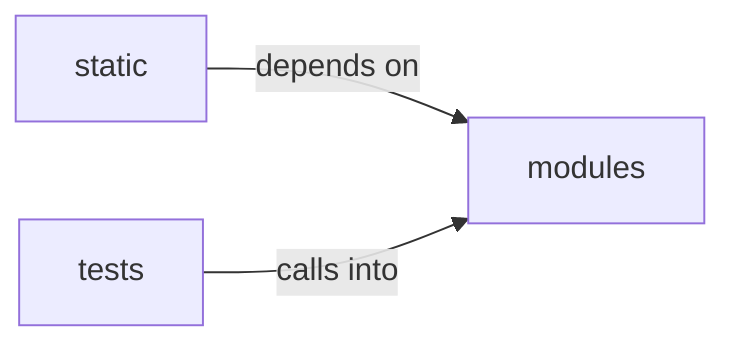

# modules/selection

modules/selection groups 37 files (c, js, py) around SelectionContext, ActionDecision, Selector, propose, ModuleSelector. Campaign command blacklist loaded from ``sessions/campaign_lessons.jsonl``.

## modules (13.1)

modules groups 22 files (c, py) around SelectionContext, ActionDecision, Selector, propose, ModuleSelector. Campaign command blacklist loaded from ``sessions/campaign_lessons.jsonl``.

## static (13.2)

static groups 1 files (js) around d, e, t. !

## tests (13.3)

tests groups 14 files (py) around _rows, test_tie_break_is_name_ascending_regardless_of_order, test_higher_score_still_wins_over_name_order, test_excluded_chain_is_skipped_deterministically, test_no_service_match_returns_none. Determinism tests for chain selection tie-breaking and selector resilience.

**Files**:

- modules/campaign_blacklist.py
- modules/chain_match.py
- modules/reverse-shell.c
- modules/rootkit/rootkit.c
- modules/selection/__init__.py
- modules/selection/_phase_categories.py
- modules/selection/adversary.py
- modules/selection/atomic.py
- modules/selection/base.py
- modules/selection/bridge.py
- modules/selection/chain.py
- modules/selection/cred_spray.py
- modules/selection/edb.py
- modules/selection/intel.py
- modules/selection/lazyscript.py
- modules/selection/module.py
- modules/selection/parquet.py
- modules/selection/playbook.py
- modules/selection/poc.py
- modules/selection/registry.py
- modules/selection/technique.py
- modules/selection/technique_chain.py
- static/js/select2-4.1.0.min.js
- tests/test_chain_match_determinism.py
- tests/test_chain_selector.py
- tests/test_intel_selector.py
- tests/test_loop_fire_pending.py
- tests/test_poc_registry.py
- tests/test_selection_bridge.py
- tests/test_selection_lazyscript.py
- tests/test_selection_module.py
- tests/test_selection_parquet.py
- tests/test_selection_technique.py
- tests/test_selection_technique_chain.py
- tests/test_selection_wiring.py
- tests/test_selectors_base.py
- tests/test_selectors_capabilities.py
