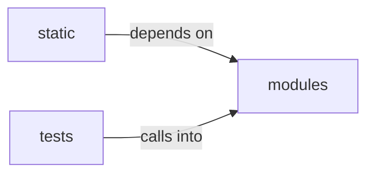

# modules/selection

modules/selection groups 26 files (c, js, py) around SelectionContext, ActionDecision, Selector, propose, _classify. Shared selector for the best vetted chain given phase, platform and services.

## modules (11.1)

modules groups 16 files (c, py) around SelectionContext, ActionDecision, Selector, propose, _classify. Shared selector for the best vetted chain given phase, platform and services.

## static (11.2)

static groups 1 files (js) around d, e, t. !

## tests (11.3)

tests groups 9 files (py) around intel, _report, _ctx, TestCascadeOrder, test_intel_selector_abstains_when_named_intent_wins. BDD tests for the intelligence selector in the shared cascade.

**Files**:

- modules/chain_match.py
- modules/module_registry.py
- modules/reverse-shell.c
- modules/selection/__init__.py
- modules/selection/adversary.py
- modules/selection/atomic.py
- modules/selection/base.py
- modules/selection/chain.py
- modules/selection/cred_spray.py
- modules/selection/edb.py
- modules/selection/intel.py
- modules/selection/module.py
- modules/selection/playbook.py
- modules/selection/poc.py
- modules/selection/registry.py
- modules/selection/technique.py
- static/js/select2-4.1.0.min.js
- tests/test_intel_selector.py
- tests/test_loop_fire_pending.py
- tests/test_module_registry.py
- tests/test_poc_registry.py
- tests/test_selection_module.py
- tests/test_selection_technique.py
- tests/test_selection_wiring.py
- tests/test_selectors_base.py
- tests/test_selectors_capabilities.py
