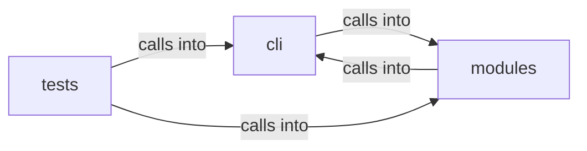

# modules: surface_graph

modules: surface_graph groups 15 files (py) around _cache_path, _cache_load, _cache_save, _cached, _store. Database commands — workspace isolation, host/service/vuln management, nmap import...

## cli (12.1)

cli groups 4 files (py) around _slug_host, _slug_port, SurfaceNode, to_dict, SurfaceEdge. Database commands — workspace isolation, host/service/vuln management, nmap import...

## modules (12.2)

modules groups 6 files (py) around _cache_path, _cache_load, _cache_save, _cached, _store. Attack-surface 3D intel module: C2-centred campaign graph.

## tests (12.3)

tests groups 5 files (py) around _fixture_sessions, test_attack_fuses_surface_and_intel, test_attack_payload_readmenator_shape, test_attack_bundle_payload, test_attack_summary_feeds_loop. Attack-surface 3D module: surface+intel fusion + embedded pages.

**Files**:

- cli/commands/database.py
- cli/commands/surface.py
- cli/surface_graph.py
- cli/surface_tui.py
- modules/attack_surface3d.py
- modules/estorides_fusion.py
- modules/finding_lifecycle.py
- modules/intel_fusion.py
- modules/osint_enrich.py
- modules/surface_ops.py
- tests/test_attack_surface3d.py
- tests/test_estorides_fusion.py
- tests/test_finding_lifecycle.py
- tests/test_intel_fusion.py
- tests/test_surface_graph.py
