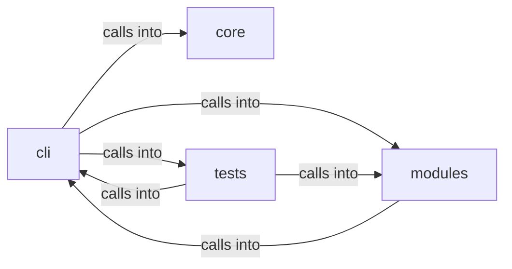

# modules: world_model

modules: world_model groups 91 files (py) around _derive_crypto_key, _machine_password, _master_password, _load_or_create_salt, _encrypt_payload. Command chain registry: explicit prerequisites and dynamic next steps.

## cli (5.1)

cli groups 14 files (py) around ExplorationConfig, DiscoveredService, label, AddonEntry, ToolEntry. Command chain registry: explicit prerequisites and dynamic next steps.

## core (5.2)

core groups 1 files (py) around is_autonomous, autonomous_mode, _guarded_input. Autonomous-run mode for the loop engine.

## modules (5.3)

modules groups 40 files (py) around _derive_crypto_key, _machine_password, _master_password, _load_or_create_salt, _encrypt_payload. Active Directory Certificate Services (AD CS) attack module.

## tests (5.4)

tests groups 36 files (py) around _fixture_sessions, test_attack_fuses_surface_and_intel, test_attack_payload_readmenator_shape, test_attack_bundle_payload, test_attack_summary_feeds_loop. Attack-surface 3D module: surface+intel fusion + embedded pages.

**Files**:

- cli/command_chain.py
- cli/commands/exploit_migrated.py
- cli/commands/surface.py
- cli/dashboard_layout.py
- cli/dashboard_tui.py
- cli/exploration.py
- cli/killchain.py
- cli/lazynmap_post.py
- cli/ops_commands.py
- cli/recommendation.py
- cli/recommendation_signals.py
- cli/recon_plan.py
- cli/surface_graph.py
- cli/surface_tui.py
- core/autonomous.py
- modules/adcs_attacks.py
- modules/attack_surface3d.py
- modules/beacon_recon.py
- modules/c2_surfaces.py
- modules/compliance.py
- modules/estorides_fusion.py
- modules/exploit_chain.py
- modules/factsio.py
- modules/finding_lifecycle.py
- modules/intel_fusion.py
- modules/killchain.py
- modules/lazy_autofire.py
- modules/lazy_checks.py
- modules/lazy_cve_feed.py
- modules/lazy_exposure.py
- modules/lazy_feedmatch.py
- modules/lazy_heat.py
- modules/lazy_hostscore.py
- modules/lazy_inventory.py
- modules/lazy_ledger.py
- modules/lazy_match_policy.py
- modules/lazy_probes.py
- modules/lazy_sentinel.py
- modules/lazy_surface_diff.py
- modules/lazy_world_diff.py
- modules/osint_enrich.py
- modules/outcome_bus.py
- modules/sinks/__init__.py
- modules/sinks/attack_graph.py
- modules/sinks/c2_surfaces.py
- modules/sinks/event_bus.py
- modules/sinks/intel_graph.py
- modules/sinks/killchain.py
- modules/sinks/lazy_intel.py
- modules/sinks/objectives.py
- modules/sinks/routing.py
- modules/sinks/world_diff.py
- modules/sinks/world_model.py
- modules/surface_ops.py
- modules/world_model.py
- tests/test_attack_surface3d.py
- tests/test_beacon_recon_sink.py
- tests/test_chain_list_command.py
- tests/test_command_chain.py
- tests/test_cve_pipeline.py
- tests/test_dashboard_tui.py
- tests/test_estorides_fusion.py
- tests/test_finding_lifecycle.py
- tests/test_gym_registry.py
- tests/test_intel_fusion.py
- tests/test_killchain.py
- tests/test_killchain_gap_signal.py
- tests/test_killchain_snapshot.py
- tests/test_killchain_unified.py
- tests/test_killchain_unified_v2.py
- tests/test_lazy_checks.py
- tests/test_lazy_exposure.py
- tests/test_lazy_feedmatch.py
- tests/test_lazy_hostscore.py
- tests/test_lazy_ledger.py
- tests/test_lazy_match_policy.py
- tests/test_lazy_probes.py
- tests/test_lazy_sentinel.py
- tests/test_lazy_world_diff.py
- tests/test_lazynmap_post.py
- tests/test_loop_evidence_wiring.py
- tests/test_ops_loot_phase.py
- tests/test_outcome_bus.py
- tests/test_phase1_data_gaps.py
- tests/test_recommendation.py
- tests/test_recon_plan.py
- tests/test_single_source_of_truth.py
- tests/test_sink_lazy_intel.py
- tests/test_surface_graph.py
- tests/test_world_diff_retest.py
- tests/test_world_model_extended.py
