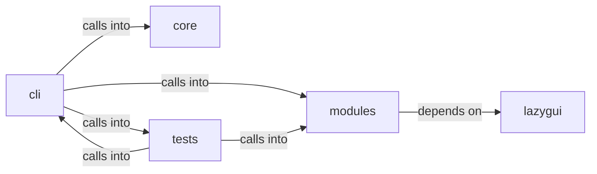

# modules: world_model

modules: world_model groups 60 files (py) around _derive_crypto_key, _machine_password, _master_password, _load_or_create_salt, _encrypt_payload. Command chain registry: explicit prerequisites and dynamic next steps.

## cli (8.1)

cli groups 17 files (py) around ExplorationConfig, DiscoveredService, label, AddonEntry, ToolEntry. Command chain registry: explicit prerequisites and dynamic next steps.

## core (8.2)

core groups 1 files (py) around is_autonomous, autonomous_mode, _guarded_input. Autonomous-run mode for the loop engine.

## lazygui (8.3)

lazygui groups 2 files (py). LazyOwn Operator Console.

## modules (8.4)

modules groups 18 files (py) around _derive_crypto_key, _machine_password, _master_password, _load_or_create_salt, _encrypt_payload. Active Directory Certificate Services (AD CS) attack module.

## tests (8.5)

tests groups 22 files (py) around _fixture_sessions, test_attack_fuses_surface_and_intel, test_attack_payload_readmenator_shape, test_attack_bundle_payload, test_attack_summary_feeds_loop. Attack-surface 3D module: surface+intel fusion + embedded pages.

**Files**:

- cli/command_chain.py
- cli/commands/database.py
- cli/commands/estorides.py
- cli/commands/exploit_migrated.py
- cli/commands/recon.py
- cli/commands/surface.py
- cli/dashboard_layout.py
- cli/dashboard_tui.py
- cli/exploit_advisor.py
- cli/exploration.py
- cli/exploration_view.py
- cli/killchain.py
- cli/lazynmap_post.py
- cli/ops_commands.py
- cli/recommendation.py
- cli/recommendation_signals.py
- cli/recon_plan.py
- core/autonomous.py
- lazygui/__init__.py
- lazygui/version.py
- modules/adcs_attacks.py
- modules/attack_surface3d.py
- modules/compliance.py
- modules/estorides_fusion.py
- modules/estorides_importer.py
- modules/exploit_chain.py
- modules/exploit_recommender.py
- modules/factsio.py
- modules/finding_lifecycle.py
- modules/integrations/nuclei_bridge.py
- modules/integrations/nuclei_parser.py
- modules/intel_fusion.py
- modules/intelligence_engine.py
- modules/killchain.py
- modules/lazy_surface_diff.py
- modules/osint_enrich.py
- modules/surface_ops.py
- modules/world_model.py
- tests/test_attack_surface3d.py
- tests/test_chain_list_command.py
- tests/test_command_chain.py
- tests/test_cve_pipeline.py
- tests/test_dashboard_tui.py
- tests/test_estorides_fusion.py
- tests/test_exploration_and_addons.py
- tests/test_finding_lifecycle.py
- tests/test_intelligence_engine.py
- tests/test_killchain.py
- tests/test_killchain_gap_signal.py
- tests/test_killchain_snapshot.py
- tests/test_killchain_unified.py
- tests/test_killchain_unified_v2.py
- tests/test_lazynmap_post.py
- tests/test_nuclei_parser.py
- tests/test_ops_loot_phase.py
- tests/test_phase1_data_gaps.py
- tests/test_recommendation.py
- tests/test_recon_plan.py
- tests/test_single_source_of_truth.py
- tests/test_world_model_extended.py
