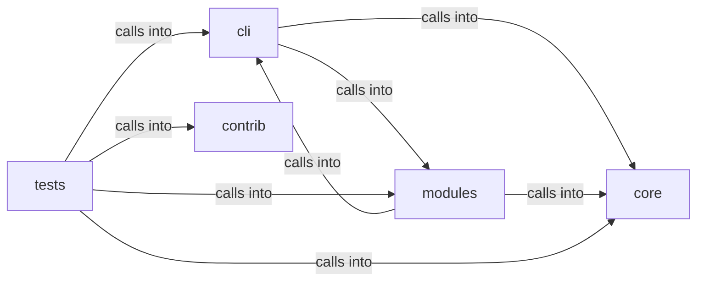

# modules: world_model

modules: world_model groups 63 files (py) around _derive_crypto_key, _machine_password, _master_password, _load_or_create_salt, _encrypt_payload. C2 session CommandSet — headless server, agent deploy, exec, loot.

## cli (6.1)

cli groups 8 files (py) around _slug_host, _slug_port, SurfaceNode, to_dict, SurfaceEdge. C2 session CommandSet — headless server, agent deploy, exec, loot.

## contrib (6.2)

contrib groups 1 files (py) around truncate_message, configure_logging, _load_payload_kv, _load_report_context, _prompt_redteam. Unified Ollama/DeepSeek client for LazyOwn — merges lazydeepseekcli_local +...

## core (6.3)

core groups 2 files (py) around rotate_session_secrets, ensure_session_secrets, _valid_session_token, _mirror, is_autonomous. Autonomous-run mode for the loop engine.

## modules (6.4)

modules groups 31 files (py) around _derive_crypto_key, _machine_password, _master_password, _load_or_create_salt, _encrypt_payload. Active Directory Certificate Services (AD CS) attack module.

## tests (6.5)

tests groups 21 files (py) around _fixture_sessions, test_attack_fuses_surface_and_intel, test_attack_payload_readmenator_shape, test_attack_bundle_payload, test_attack_summary_feeds_loop. Attack-surface 3D module: surface+intel fusion + embedded pages.

**Files**:

- cli/commands/c2_session.py
- cli/commands/database.py
- cli/commands/exploit_migrated.py
- cli/commands/lab.py
- cli/commands/redteam_gym.py
- cli/commands/surface.py
- cli/surface_graph.py
- cli/surface_tui.py
- contrib/legacy/lazydeepseekcli.py
- core/autonomous.py
- core/session_secrets.py
- modules/adcs_attacks.py
- modules/atomic_exploit_bridge.py
- modules/attack_surface3d.py
- modules/beacon_recon.py
- modules/c2_agent.py
- modules/c2_builder.py
- modules/c2_surfaces.py
- modules/ctf_capture.py
- modules/estorides_fusion.py
- modules/exploit_chain.py
- modules/finding_lifecycle.py
- modules/gym_registry.py
- modules/intel_fusion.py
- modules/lazy_bridge.py
- modules/lazy_cve_feed.py
- modules/lazy_heat.py
- modules/lazy_surface_diff.py
- modules/metasploitable_gym.py
- modules/osint_enrich.py
- modules/outcome_bus.py
- modules/professional_report.py
- modules/redteam_gym.py
- modules/sinks/attack_graph.py
- modules/sinks/c2_surfaces.py
- modules/sinks/intel_graph.py
- modules/sinks/killchain.py
- modules/sinks/objectives.py
- modules/sinks/routing.py
- modules/sinks/world_model.py
- modules/surface_ops.py
- modules/world_model.py
- tests/test_attack_surface3d.py
- tests/test_bdd_infra_range_report.py
- tests/test_beacon_recon_sink.py
- tests/test_c2_surfaces.py
- tests/test_chain_list_command.py
- tests/test_cve_pipeline.py
- tests/test_estorides_fusion.py
- tests/test_finding_lifecycle.py
- tests/test_gym_cli.py
- tests/test_gym_matrix_ctf.py
- tests/test_gym_ms2_cli.py
- tests/test_gym_registry.py
- tests/test_implant_session_secrets.py
- tests/test_infra_disposable.py
- tests/test_intel_fusion.py
- tests/test_lab_target_visibility.py
- tests/test_metasploitable_gym.py
- tests/test_outcome_bus.py
- tests/test_session_secrets.py
- tests/test_surface_graph.py
- tests/test_world_model_extended.py
