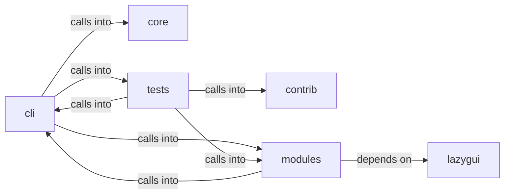

# modules: world_model

modules: world_model groups 91 files (py) around _derive_crypto_key, _machine_password, _master_password, _load_or_create_salt, _encrypt_payload. C2 session CommandSet — headless server, agent deploy, exec, loot.

## cli (5.1)

cli groups 19 files (py) around ExplorationConfig, DiscoveredService, label, AddonEntry, ToolEntry. C2 session CommandSet — headless server, agent deploy, exec, loot.

## contrib (5.2)

contrib groups 1 files (py) around truncate_message, configure_logging, _load_payload_kv, _load_report_context, _prompt_redteam. Unified Ollama/DeepSeek client for LazyOwn — merges lazydeepseekcli_local +...

## core (5.3)

core groups 1 files (py) around is_autonomous, autonomous_mode, _guarded_input. Autonomous-run mode for the loop engine.

## lazygui (5.4)

lazygui groups 2 files (py). LazyOwn Operator Console.

## modules (5.5)

modules groups 37 files (py) around _derive_crypto_key, _machine_password, _master_password, _load_or_create_salt, _encrypt_payload. AD lab gym catalogue (Docker Samba DC): index, exploits, chains.

## tests (5.6)

tests groups 31 files (py) around _fixture_sessions, test_attack_fuses_surface_and_intel, test_attack_payload_readmenator_shape, test_attack_bundle_payload, test_attack_summary_feeds_loop. Attack-surface 3D module: surface+intel fusion + embedded pages.

**Files**:

- cli/commands/c2_session.py
- cli/commands/estorides.py
- cli/commands/exploit_migrated.py
- cli/commands/recon.py
- cli/commands/surface.py
- cli/dashboard_layout.py
- cli/dashboard_tui.py
- cli/exploit_advisor.py
- cli/exploration.py
- cli/exploration_view.py
- cli/graph_advisor.py
- cli/killchain.py
- cli/lazynmap_post.py
- cli/ops_commands.py
- cli/recommendation.py
- cli/recommendation_signals.py
- cli/recon_plan.py
- cli/surface_graph.py
- cli/surface_tui.py
- contrib/legacy/lazydeepseekcli.py
- core/autonomous.py
- lazygui/__init__.py
- lazygui/version.py
- modules/ad_gym.py
- modules/adcs_attacks.py
- modules/atomic_exploit_bridge.py
- modules/attack_surface3d.py
- modules/beacon_recon.py
- modules/c2_agent.py
- modules/c2_surfaces.py
- modules/compliance.py
- modules/ctf_capture.py
- modules/estorides_fusion.py
- modules/estorides_importer.py
- modules/exploit_chain.py
- modules/exploit_recommender.py
- modules/factsio.py
- modules/integrations/nuclei_bridge.py
- modules/integrations/nuclei_parser.py
- modules/intel_fusion.py
- modules/intelligence_engine.py
- modules/killchain.py
- modules/lazy_cve_feed.py
- modules/lazy_heat.py
- modules/lazy_surface_diff.py
- modules/lazy_world_diff.py
- modules/live_surface.py
- modules/metasploitable_gym.py
- modules/outcome_bus.py
- modules/sinks/attack_graph.py
- modules/sinks/beacon_dispatch.py
- modules/sinks/c2_surfaces.py
- modules/sinks/intel_graph.py
- modules/sinks/killchain.py
- modules/sinks/objectives.py
- modules/sinks/world_diff.py
- modules/sinks/world_model.py
- modules/surface_ops.py
- modules/unified_dashboard.py
- modules/world_model.py
- tests/test_attack_surface3d.py
- tests/test_beacon_recon_sink.py
- tests/test_c2_surfaces.py
- tests/test_chain_list_command.py
- tests/test_cve_pipeline.py
- tests/test_dashboard_tui.py
- tests/test_estorides_fusion.py
- tests/test_exploration_and_addons.py
- tests/test_graph_advisor.py
- tests/test_gym_registry.py
- tests/test_intel_fusion.py
- tests/test_intelligence_engine.py
- tests/test_killchain.py
- tests/test_killchain_gap_signal.py
- tests/test_killchain_snapshot.py
- tests/test_killchain_unified.py
- tests/test_killchain_unified_v2.py
- tests/test_lazy_world_diff.py
- tests/test_lazynmap_post.py
- tests/test_live_surface.py
- tests/test_loop_trigger_hints.py
- tests/test_metasploitable_gym.py
- tests/test_nuclei_parser.py
- tests/test_ops_loot_phase.py
- tests/test_outcome_bus.py
- tests/test_recommendation.py
- tests/test_recon_plan.py
- tests/test_single_source_of_truth.py
- tests/test_surface_graph.py
- tests/test_unified_dashboard.py
- tests/test_world_model_extended.py
