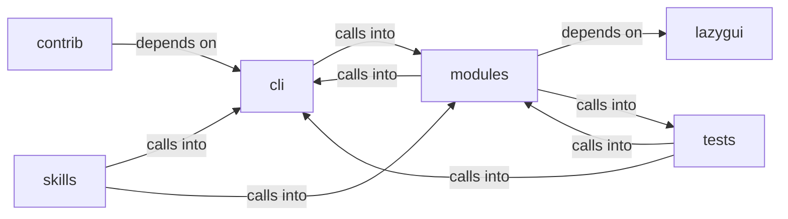

# modules: world_model

modules: world_model groups 99 files (py) around _derive_crypto_key, _machine_password, _master_password, _load_or_create_salt, _encrypt_payload. Command chain registry: explicit prerequisites and dynamic next steps.

## cli (7.1)

cli groups 9 files (py) around ExplorationConfig, DiscoveredService, label, AddonEntry, ToolEntry. Command chain registry: explicit prerequisites and dynamic next steps.

## contrib (7.2)

contrib groups 3 files (py) around BinaryFinder, __init__, find_suid_binaries, find_capabilities_binaries, find_executable_binaries.

## lazygui (7.3)

lazygui groups 2 files (py). LazyOwn Operator Console.

## modules (7.4)

modules groups 45 files (py) around _derive_crypto_key, _machine_password, _master_password, _load_or_create_salt, _encrypt_payload. Attack-surface 3D intel module: C2-centred campaign graph.

## skills (7.5)

skills groups 11 files (py) around handle, handle, handle, _has_data, handle. MCP tool ``lazyown_command_next`` (migrated from the call_tool dispatch chain).

## tests (7.6)

tests groups 29 files (py) around gate_env, test_gate_exact_and_fuzzy_match, test_gate_cidr_match, test_gate_task_allow_is_closed_whitelist, test_gate_blocks_asset_insert. Asset gate + un-nerfed outputs + IntelGraph CSP regression tests.

**Files**:

- cli/command_chain.py
- cli/commands/caldera.py
- cli/commands/pwn.py
- cli/commands/surface.py
- cli/exploration.py
- cli/lazynmap_post.py
- cli/ops_commands.py
- cli/recon_plan.py
- cli/surface_graph.py
- contrib/legacy/lazypwn.py
- contrib/legacy/lazyvsftp.py
- contrib/legacy/sql.py
- lazygui/__init__.py
- lazygui/version.py
- modules/attack_surface3d.py
- modules/beacon_recon.py
- modules/compliance.py
- modules/dashboard_engine.py
- modules/estorides_fusion.py
- modules/estorides_importer.py
- modules/exploit_recommender.py
- modules/factsio.py
- modules/finding_lifecycle.py
- modules/integrations/__init__.py
- modules/integrations/misp_export.py
- modules/integrations/nuclei_bridge.py
- modules/integrations/nuclei_parser.py
- modules/integrations/searchsploit.py
- modules/intel_fusion.py
- modules/intelligence_engine.py
- modules/kill_chain_viz.py
- modules/killchain.py
- modules/lazy_autofire.py
- modules/lazy_bridge.py
- modules/lazy_checks.py
- modules/lazy_cve_feed.py
- modules/lazy_exposure.py
- modules/lazy_feedmatch.py
- modules/lazy_heat.py
- modules/lazy_inventory.py
- modules/lazy_match_policy.py
- modules/lazy_probes.py
- modules/lazy_sentinel.py
- modules/lazy_surface_diff.py
- modules/lazy_timeline.py
- modules/live_surface.py
- modules/obs_parser.py
- modules/operation.py
- modules/osint_enrich.py
- modules/planner.py
- modules/playbook_engine.py
- modules/rich_tui.py
- modules/sinks/lazy_intel.py
- modules/sinks/world_model.py
- modules/surface_ops.py
- modules/ttp_coverage.py
- modules/unified_dashboard.py
- modules/world_model.py
- modules/yara_scanner.py
- skills/mcp_tools/command_next.py
- skills/mcp_tools/command_prev.py
- skills/mcp_tools/dashboard_snapshot.py
- skills/mcp_tools/exploit_recommend.py
- skills/mcp_tools/lazy_intel.py
- skills/mcp_tools/lazy_status.py
- skills/mcp_tools/lazy_sync.py
- skills/mcp_tools/playbook_generate.py
- skills/mcp_tools/playbook_run.py
- skills/mcp_tools/rich_tui_snapshot.py
- skills/mcp_tools/unified_dashboard.py
- tests/test_asset_gate.py
- tests/test_attack_surface3d.py
- tests/test_beacon_recon_sink.py
- tests/test_command_chain.py
- tests/test_cve_pipeline.py
- tests/test_daemon_loop.py
- tests/test_estorides_fusion.py
- tests/test_finding_lifecycle.py
- tests/test_intel_fusion.py
- tests/test_intelligence_engine.py
- tests/test_killchain_snapshot.py
- tests/test_killchain_unified.py
- tests/test_killchain_unified_v2.py
- tests/test_lazy_checks.py
- tests/test_lazy_exposure.py
- tests/test_lazy_feedmatch.py
- tests/test_lazy_intel_wiring.py
- tests/test_lazy_match_policy.py
- tests/test_lazy_probes.py
- tests/test_lazy_sentinel.py
- tests/test_lazynmap_post.py
- tests/test_live_surface.py
- tests/test_nuclei_parser.py
- tests/test_ops_loot_phase.py
- tests/test_recon_plan.py
- tests/test_single_source_of_truth.py
- tests/test_surface_graph.py
- tests/test_unified_dashboard.py
- tests/test_world_model_extended.py
