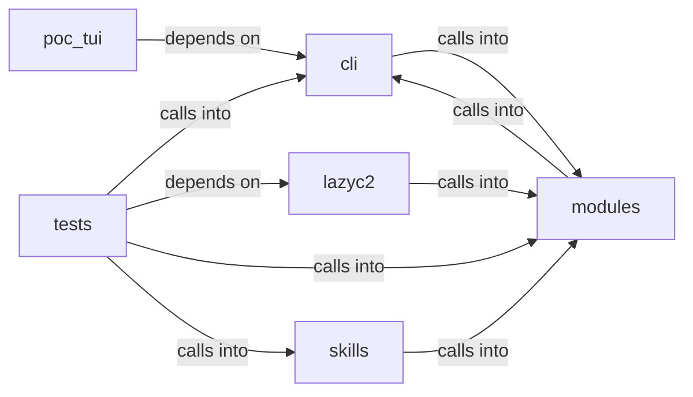

# modules: world_model

modules: world_model groups 112 files (py) around _derive_crypto_key, _machine_password, _master_password, _load_or_create_salt, _encrypt_payload. Container and Kubernetes attack command set.

## cli (4.1)

cli groups 19 files (py) around ContainerCommandSet, do_docker_enum, do_k8s_enum, do_container_escape, do_k8s_pods. Container and Kubernetes attack command set.

## lazyc2 (4.2)

lazyc2 groups 1 files (py) around _error, _namespaced_path, _world_snapshot, _status_payload, status. Orchestrator REST + web panel for the LazyOwn C2 dashboard.

## modules (4.3)

modules groups 38 files (py) around _derive_crypto_key, _machine_password, _master_password, _load_or_create_salt, _encrypt_payload. Attack-surface 3D intel module: C2-centred campaign graph.

## poc_tui (4.4)

poc_tui groups 4 files (py) around ShellBackend, __init__, import_shell_class, start, run. Entry point: python3 -m poc_tui

## skills (4.5)

skills groups 1 files (py) around _sync_harness, _harness_result, _call_harness_tool, list_tools, call_tool. LazyOwn MCP OpenCode bridge.

## tests (4.6)

tests groups 49 files (py) around AdLabCatalogueSpec, test_matrix_validates, test_summary_shape, test_all_vectors_resolve, test_get_unknown_is_none. Contract tests for the AD lab gym (Docker Samba DC) matrix and capture.

**Files**:

- cli/commands/containers.py
- cli/commands/database.py
- cli/commands/golden_paths.py
- cli/commands/gym_matrix.py
- cli/commands/lab.py
- cli/commands/lazy_creds.py
- cli/commands/lazy_dorks.py
- cli/commands/lazy_oob.py
- cli/commands/lazy_passgen.py
- cli/commands/netattack.py
- cli/commands/redteam_gym.py
- cli/commands/surface.py
- cli/commands/winbox_gym.py
- cli/lazy_orchestrator.py
- cli/orchestrator_assets_tabs.py
- cli/session_brief.py
- cli/surface_graph.py
- cli/surface_tui.py
- cli/tui_forms.py
- lazyc2/blueprints/orchestrator.py
- modules/__init__.py
- modules/attack_surface3d.py
- modules/beacon_recon.py
- modules/estorides_fusion.py
- modules/finding_lifecycle.py
- modules/gym_cleanup.py
- modules/gym_registry.py
- modules/gym_winbox_runner.py
- modules/harness.py
- modules/intel_fusion.py
- modules/lab_runtime.py
- modules/lazy_checks.py
- modules/lazy_cve_feed.py
- modules/lazy_heat.py
- modules/lazy_hostscore.py
- modules/lazy_match_policy.py
- modules/lazy_surface_diff.py
- modules/lazy_world_diff.py
- modules/lazyk8s.py
- modules/lazypassgen.py
- modules/loop_triggers.py
- modules/orchestrator_config.py
- modules/osint_enrich.py
- modules/outcome_bus.py
- modules/playbook_admin.py
- modules/professional_report.py
- modules/redteam_gym.py
- modules/sinks/attack_graph.py
- modules/sinks/beacon_dispatch.py
- modules/sinks/c2_surfaces.py
- modules/sinks/intel_graph.py
- modules/sinks/killchain.py
- modules/sinks/objectives.py
- modules/sinks/world_diff.py
- modules/surface_ops.py
- modules/trigger_policy.py
- modules/verb_catalog.py
- modules/world_model.py
- poc_tui/__main__.py
- poc_tui/app.py
- poc_tui/run.py
- poc_tui/test_app.py
- skills/lazyown_mcp_opencode.py
- tests/test_ad_lab_gym.py
- tests/test_attack_surface3d.py
- tests/test_bdd_infra_range_report.py
- tests/test_beacon_recon_sink.py
- tests/test_c2_agent_dual.py
- tests/test_chain_distill_scope.py
- tests/test_cve_pipeline.py
- tests/test_estorides_fusion.py
- tests/test_finding_lifecycle.py
- tests/test_gym_cli.py
- tests/test_gym_lifecycle.py
- tests/test_gym_matrix_ctf.py
- tests/test_gym_ms2_cli.py
- tests/test_gym_registry.py
- tests/test_infra_disposable.py
- tests/test_intel_fusion.py
- tests/test_lab_target_visibility.py
- tests/test_lazy_bridge_traffic.py
- tests/test_lazy_checks.py
- tests/test_lazy_creds.py
- tests/test_lazy_hostscore.py
- tests/test_lazy_match_policy.py
- tests/test_lazy_oob.py
- tests/test_lazy_orchestrator.py
- tests/test_lazy_runner_fallback.py
- tests/test_lazy_scope.py
- tests/test_lazy_world_diff.py
- tests/test_lazydorks.py
- tests/test_lazypassgen.py
- tests/test_lazypoophish.py
- tests/test_lazyshortener.py
- tests/test_loop_cli_catalog.py
- tests/test_loop_mentions.py
- tests/test_loop_trigger_hints.py
- tests/test_opencode_mcp_harness.py
- tests/test_orchestrator_api.py
- tests/test_orchestrator_triggers.py
- tests/test_orchestrator_yaml.py
- tests/test_outcome_bus.py
- tests/test_pi_leg.py
- tests/test_playbook_admin.py
- tests/test_session_brief.py
- tests/test_surface_graph.py
- tests/test_trigger_policy.py
- tests/test_ttpscope_bridge.py
- tests/test_unified_bridge_delegate.py
- tests/test_verb_catalog.py
- tests/test_world_diff_retest.py
- tests/test_world_model_extended.py
