```mermaid
graph LR
    cli_commands["cli/commands"]
    modules_autonomous_daemon["modules: autonomous_daemon"]
    modules_lazyown["modules: lazyown"]
    modules_lazy_sentinel4["modules: lazy_sentinel4"]
    cli_status_bar["cli: status_bar"]
    static_js["static/js"]
    lazygui_panels["lazygui/panels"]
    lazyc2_security["lazyc2/security"]
    modules_dashboard_tui["modules: dashboard_tui"]
    modules_lazy_loop["modules: lazy_loop"]
    cli_banner_config["cli: banner_config"]
    skills_claude_md_orchestrator["skills/claude_md_orchestrator"]
    cli_exploration["cli: exploration"]
    modules_kerberos_core["modules: kerberos_core"]
    modules_saas_attacks["modules: saas_attacks"]
    modules_network_opsec["modules: network_opsec"]
    modules_polymorphic_engine["modules: polymorphic_engine"]
    contrib_legacy["contrib/legacy"]
    scripts_journal["scripts: journal"]
    modules_backdoor["modules/backdoor"]
    poc_tui["poc_tui"]
    scripts_check_contract_manifest["scripts: check_contract_manifest"]
    scripts_migrate_lazyown["scripts: migrate_lazyown"]
    test["test"]
    tools["tools"]
    cli_commands -- "depends on" --> modules_lazy_loop
    cli_commands -- "calls into" --> cli_banner_config
    cli_commands -- "depends on" --> skills_claude_md_orchestrator
    cli_commands -- "calls into" --> cli_exploration
    cli_commands -- "calls into" --> modules_polymorphic_engine
    cli_commands -- "calls into" --> contrib_legacy
    cli_commands -- "calls into" --> scripts_journal
    cli_commands -- "calls into" --> modules_autonomous_daemon
    cli_commands -- "calls into" --> modules_backdoor
    cli_commands -- "calls into" --> poc_tui
    cli_commands -- "calls into" --> modules_lazyown
    cli_commands -- "calls into" --> modules_lazy_sentinel4
    cli_commands -- "calls into" --> cli_status_bar
    cli_commands -- "calls into" --> static_js
    cli_commands -- "calls into" --> lazygui_panels
    cli_commands -- "calls into" --> lazyc2_security
    cli_commands -- "depends on" --> modules_dashboard_tui
    modules_lazy_loop -- "calls into" --> cli_commands
    modules_lazy_loop -- "calls into" --> modules_polymorphic_engine
    modules_lazy_loop -- "calls into" --> modules_autonomous_daemon
    modules_lazy_loop -- "calls into" --> poc_tui
    modules_lazy_loop -- "calls into" --> modules_lazyown
    modules_lazy_loop -- "calls into" --> modules_lazy_sentinel4
    modules_lazy_loop -- "calls into" --> cli_status_bar
    modules_lazy_loop -- "depends on" --> static_js
    modules_lazy_loop -- "calls into" --> lazygui_panels
    modules_lazy_loop -- "calls into" --> lazyc2_security
    modules_lazy_loop -- "calls into" --> modules_dashboard_tui
    cli_banner_config -- "calls into" --> cli_commands
    cli_banner_config -- "calls into" --> modules_polymorphic_engine
    cli_banner_config -- "calls into" --> modules_autonomous_daemon
    cli_banner_config -- "calls into" --> poc_tui
    cli_banner_config -- "calls into" --> modules_lazyown
    cli_banner_config -- "calls into" --> modules_lazy_sentinel4
    cli_banner_config -- "calls into" --> cli_status_bar
    cli_banner_config -- "depends on" --> static_js
    cli_banner_config -- "calls into" --> lazygui_panels
    cli_banner_config -- "calls into" --> lazyc2_security
    skills_claude_md_orchestrator -- "calls into" --> modules_lazy_loop
    skills_claude_md_orchestrator -- "calls into" --> cli_banner_config
    skills_claude_md_orchestrator -- "calls into" --> modules_polymorphic_engine
    skills_claude_md_orchestrator -- "calls into" --> scripts_journal
    skills_claude_md_orchestrator -- "calls into" --> modules_autonomous_daemon
    skills_claude_md_orchestrator -- "calls into" --> poc_tui
    skills_claude_md_orchestrator -- "calls into" --> modules_lazyown
    skills_claude_md_orchestrator -- "calls into" --> modules_lazy_sentinel4
    skills_claude_md_orchestrator -- "calls into" --> cli_status_bar
    skills_claude_md_orchestrator -- "calls into" --> static_js
    skills_claude_md_orchestrator -- "calls into" --> lazygui_panels
    skills_claude_md_orchestrator -- "calls into" --> lazyc2_security
    cli_exploration -- "calls into" --> poc_tui
    cli_exploration -- "depends on" --> modules_lazy_sentinel4
    cli_exploration -- "depends on" --> cli_status_bar
    cli_exploration -- "calls into" --> lazygui_panels
    cli_exploration -- "calls into" --> lazyc2_security
    cli_exploration -- "calls into" --> modules_dashboard_tui
    modules_kerberos_core -- "calls into" --> cli_commands
    modules_kerberos_core -- "calls into" --> poc_tui
    modules_kerberos_core -- "calls into" --> lazygui_panels
    modules_saas_attacks -- "calls into" --> cli_commands
    modules_saas_attacks -- "calls into" --> scripts_journal
    modules_saas_attacks -- "calls into" --> poc_tui
    modules_saas_attacks -- "calls into" --> lazygui_panels
    modules_network_opsec -- "calls into" --> cli_commands
    modules_network_opsec -- "calls into" --> poc_tui
    modules_network_opsec -- "calls into" --> modules_lazyown
    modules_network_opsec -- "calls into" --> static_js
    modules_network_opsec -- "calls into" --> lazygui_panels
    modules_polymorphic_engine -- "calls into" --> cli_commands
    modules_polymorphic_engine -- "calls into" --> poc_tui
    modules_polymorphic_engine -- "calls into" --> lazygui_panels
    modules_polymorphic_engine -- "calls into" --> lazyc2_security
    contrib_legacy -- "calls into" --> poc_tui
    scripts_journal -- "calls into" --> poc_tui
    scripts_journal -- "calls into" --> lazygui_panels
    modules_autonomous_daemon -- "calls into" --> cli_commands
    modules_autonomous_daemon -- "calls into" --> modules_lazy_loop
    modules_autonomous_daemon -- "calls into" --> cli_banner_config
    modules_autonomous_daemon -- "calls into" --> cli_exploration
    modules_autonomous_daemon -- "calls into" --> modules_kerberos_core
    modules_autonomous_daemon -- "calls into" --> modules_polymorphic_engine
    modules_autonomous_daemon -- "calls into" --> scripts_journal
    modules_autonomous_daemon -- "calls into" --> poc_tui
    modules_autonomous_daemon -- "calls into" --> modules_lazyown
    modules_autonomous_daemon -- "calls into" --> modules_lazy_sentinel4
    modules_autonomous_daemon -- "calls into" --> cli_status_bar
    modules_autonomous_daemon -- "calls into" --> static_js
    modules_autonomous_daemon -- "calls into" --> lazygui_panels
    modules_autonomous_daemon -- "calls into" --> lazyc2_security
    modules_autonomous_daemon -- "calls into" --> modules_dashboard_tui
    poc_tui -- "calls into" --> modules_polymorphic_engine
    scripts_check_contract_manifest -- "calls into" --> modules_polymorphic_engine
    scripts_check_contract_manifest -- "calls into" --> lazygui_panels
    scripts_migrate_lazyown -- "calls into" --> poc_tui
    scripts_migrate_lazyown -- "calls into" --> lazyc2_security
    test -- "calls into" --> scripts_journal
    modules_lazyown -- "calls into" --> cli_commands
    modules_lazyown -- "calls into" --> modules_lazy_loop
    modules_lazyown -- "calls into" --> cli_banner_config
    modules_lazyown -- "calls into" --> cli_exploration
    modules_lazyown -- "calls into" --> modules_polymorphic_engine
    modules_lazyown -- "calls into" --> scripts_journal
    modules_lazyown -- "calls into" --> modules_autonomous_daemon
    modules_lazyown -- "calls into" --> poc_tui
    modules_lazyown -- "calls into" --> modules_lazy_sentinel4
    modules_lazyown -- "calls into" --> cli_status_bar
    modules_lazyown -- "calls into" --> static_js
    modules_lazyown -- "calls into" --> lazygui_panels
    modules_lazyown -- "calls into" --> lazyc2_security
    modules_lazyown -- "calls into" --> modules_dashboard_tui
    modules_lazy_sentinel4 -- "calls into" --> cli_commands
    modules_lazy_sentinel4 -- "calls into" --> modules_lazy_loop
    modules_lazy_sentinel4 -- "calls into" --> cli_banner_config
    modules_lazy_sentinel4 -- "calls into" --> skills_claude_md_orchestrator
    modules_lazy_sentinel4 -- "depends on" --> cli_exploration
    modules_lazy_sentinel4 -- "calls into" --> modules_polymorphic_engine
    modules_lazy_sentinel4 -- "calls into" --> scripts_journal
    modules_lazy_sentinel4 -- "calls into" --> modules_autonomous_daemon
    modules_lazy_sentinel4 -- "calls into" --> poc_tui
    modules_lazy_sentinel4 -- "calls into" --> modules_lazyown
    modules_lazy_sentinel4 -- "calls into" --> cli_status_bar
    modules_lazy_sentinel4 -- "calls into" --> static_js
    modules_lazy_sentinel4 -- "calls into" --> lazygui_panels
    modules_lazy_sentinel4 -- "depends on" --> modules_dashboard_tui
    cli_status_bar -- "depends on" --> cli_commands
    cli_status_bar -- "calls into" --> cli_banner_config
    cli_status_bar -- "calls into" --> cli_exploration
    cli_status_bar -- "calls into" --> modules_polymorphic_engine
    cli_status_bar -- "calls into" --> modules_autonomous_daemon
    cli_status_bar -- "calls into" --> poc_tui
    cli_status_bar -- "depends on" --> modules_lazyown
    cli_status_bar -- "calls into" --> modules_lazy_sentinel4
    cli_status_bar -- "calls into" --> static_js
    cli_status_bar -- "calls into" --> lazygui_panels
    cli_status_bar -- "calls into" --> lazyc2_security
    cli_status_bar -- "calls into" --> modules_dashboard_tui
    static_js -- "calls into" --> cli_commands
    static_js -- "calls into" --> modules_lazy_loop
    static_js -- "calls into" --> cli_banner_config
    static_js -- "calls into" --> cli_exploration
    static_js -- "calls into" --> modules_polymorphic_engine
    static_js -- "calls into" --> scripts_journal
    static_js -- "calls into" --> modules_autonomous_daemon
    static_js -- "calls into" --> poc_tui
    static_js -- "calls into" --> modules_lazyown
    static_js -- "calls into" --> modules_lazy_sentinel4
    static_js -- "calls into" --> cli_status_bar
    static_js -- "calls into" --> lazygui_panels
    static_js -- "calls into" --> lazyc2_security
    static_js -- "depends on" --> modules_dashboard_tui
    lazygui_panels -- "calls into" --> modules_polymorphic_engine
    lazygui_panels -- "calls into" --> scripts_journal
    lazygui_panels -- "calls into" --> modules_autonomous_daemon
    lazygui_panels -- "calls into" --> poc_tui
    lazygui_panels -- "depends on" --> modules_lazyown
    lazygui_panels -- "calls into" --> cli_status_bar
    lazygui_panels -- "calls into" --> static_js
    lazygui_panels -- "calls into" --> lazyc2_security
    lazygui_panels -- "calls into" --> modules_dashboard_tui
    lazyc2_security -- "calls into" --> cli_commands
    lazyc2_security -- "depends on" --> modules_lazy_loop
    lazyc2_security -- "calls into" --> cli_banner_config
    lazyc2_security -- "depends on" --> skills_claude_md_orchestrator
    lazyc2_security -- "calls into" --> modules_polymorphic_engine
    lazyc2_security -- "calls into" --> scripts_journal
    lazyc2_security -- "calls into" --> modules_autonomous_daemon
    lazyc2_security -- "calls into" --> poc_tui
    lazyc2_security -- "calls into" --> modules_lazyown
    lazyc2_security -- "calls into" --> modules_lazy_sentinel4
    lazyc2_security -- "calls into" --> cli_status_bar
    lazyc2_security -- "calls into" --> static_js
    lazyc2_security -- "calls into" --> lazygui_panels
    lazyc2_security -- "depends on" --> modules_dashboard_tui
    modules_dashboard_tui -- "calls into" --> cli_commands
    modules_dashboard_tui -- "calls into" --> modules_lazy_loop
    modules_dashboard_tui -- "calls into" --> cli_exploration
    modules_dashboard_tui -- "calls into" --> modules_polymorphic_engine
    modules_dashboard_tui -- "calls into" --> scripts_journal
    modules_dashboard_tui -- "calls into" --> modules_autonomous_daemon
    modules_dashboard_tui -- "calls into" --> poc_tui
    modules_dashboard_tui -- "calls into" --> modules_lazyown
    modules_dashboard_tui -- "calls into" --> modules_lazy_sentinel4
    modules_dashboard_tui -- "calls into" --> cli_status_bar
    modules_dashboard_tui -- "calls into" --> lazygui_panels
    modules_dashboard_tui -- "calls into" --> lazyc2_security
    click cli_commands href "./cli_commands.md" "Details"
    click modules_autonomous_daemon href "./modules_autonomous_daemon.md" "Details"
    click modules_lazyown href "./modules_lazyown.md" "Details"
    click modules_lazy_sentinel4 href "./modules_lazy_sentinel4.md" "Details"
    click cli_status_bar href "./cli_status_bar.md" "Details"
    click static_js href "./static_js.md" "Details"
    click lazygui_panels href "./lazygui_panels.md" "Details"
    click lazyc2_security href "./lazyc2_security.md" "Details"
    click modules_dashboard_tui href "./modules_dashboard_tui.md" "Details"
    click modules_lazy_loop href "./modules_lazy_loop.md" "Details"
    click cli_banner_config href "./cli_banner_config.md" "Details"
    click skills_claude_md_orchestrator href "./skills_claude_md_orchestrator.md" "Details"
    click cli_exploration href "./cli_exploration.md" "Details"
    click modules_kerberos_core href "./modules_kerberos_core.md" "Details"
    click modules_saas_attacks href "./modules_saas_attacks.md" "Details"
    click modules_network_opsec href "./modules_network_opsec.md" "Details"
    click modules_polymorphic_engine href "./modules_polymorphic_engine.md" "Details"
```

## Details

Static architecture map of 961 files (asm, c, cpp, cs, h, js, lua, php, py, sh) in 25 components: cli/commands, modules: autonomous_daemon, modules: lazyown, modules: lazy_sentinel4, cli: status_bar, static/js, lazygui/panels, lazyc2/security. Structure is extracted statically without LLM calls; component prose may be enriched locally.

### cli/commands (1)

cli/commands groups 118 files (c, py) around parse_ip_mac, create_arp_packet, send_packet, load_version, parse_bool. Autor: Gris Iscomeback Correo electrónico: grisiscomeback[at]gmail[dot]com Fecha de...

**Related Classes/Methods**:

- <a href="../utils.py#L312-L333">utils.py::parse_ip_mac</a>
- <a href="../utils.py#L334-L368">utils.py::create_arp_packet</a>
- <a href="../utils.py#L369-L386">utils.py::send_packet</a>
- <a href="../utils.py#L387-L412">utils.py::load_version</a>
- <a href="../utils.py#L413-L430">utils.py::parse_bool</a>
- <a href="../utils.py#L431-L455">utils.py::signal_handler</a>
- <a href="../utils.py#L456-L480">utils.py::activate_virtualenv</a>
- <a href="../utils.py#L481-L524">utils.py::parse_proc_net_file</a>

### modules: autonomous_daemon (2)

modules: autonomous_daemon groups 115 files (py) around EnumCommandSet, do_smbclient, do_smbclient_impacket, do_smbclient_py, do_smbmap. Phase-scoped CommandSet modules.

**Related Classes/Methods**:

- <a href="../cli/commands/enum.py#L31-L37">cli/commands/enum.py::EnumCommandSet</a>
- <a href="../cli/commands/enum.py#L38-L107">cli/commands/enum.py::do_smbclient</a>
- <a href="../cli/commands/enum.py#L108-L177">cli/commands/enum.py::do_smbclient_impacket</a>
- <a href="../cli/commands/enum.py#L178-L224">cli/commands/enum.py::do_smbclient_py</a>
- <a href="../cli/commands/enum.py#L225-L344">cli/commands/enum.py::do_smbmap</a>
- <a href="../cli/commands/enum.py#L345-L389">cli/commands/enum.py::do_getnpusers</a>
- <a href="../cli/commands/enum.py#L390-L445">cli/commands/enum.py::do_psexec</a>
- <a href="../cli/commands/enum.py#L446-L501">cli/commands/enum.py::do_psexec_py</a>

### modules: lazyown (3)

modules: lazyown groups 70 files (c, py) around StructuredLogConfig, _JsonLineFormatter, __init__, format, _ConsoleFormatter. Automatic encryption of sensitive session data on app open/close.

**Related Classes/Methods**:

- <a href="../core/logging.py#L42-L70">core/logging.py::StructuredLogConfig</a>
- <a href="../core/logging.py#L71-L73">core/logging.py::_JsonLineFormatter</a>
- <a href="../core/logging.py#L74-L77">core/logging.py::__init__</a>
- <a href="../core/logging.py#L78-L120">core/logging.py::format</a>
- <a href="../core/logging.py#L121-L131">core/logging.py::_ConsoleFormatter</a>
- <a href="../core/logging.py#L132-L138">core/logging.py::format</a>
- <a href="../core/logging.py#L139-L147">core/logging.py::StructuredLogger</a>
- <a href="../core/logging.py#L148-L179">core/logging.py::makeRecord</a>

### modules: lazy_sentinel4 (4)

modules: lazy_sentinel4 groups 64 files (py) around _sanitize, colors_enabled, _paint, format_line, print_error. Interactive command explorer by phase and goal for the LazyOwn shell.

**Related Classes/Methods**:

- <a href="../core/console.py#L93-L97">core/console.py::_sanitize</a>
- <a href="../core/console.py#L98-L113">core/console.py::colors_enabled</a>
- <a href="../core/console.py#L114-L120">core/console.py::_paint</a>
- <a href="../core/console.py#L121-L136">core/console.py::format_line</a>
- <a href="../core/console.py#L137-L142">core/console.py::print_error</a>
- <a href="../core/console.py#L143-L148">core/console.py::print_msg</a>
- <a href="../core/console.py#L149-L154">core/console.py::print_warn</a>
- <a href="../core/console.py#L155-L160">core/console.py::print_succ</a>

### cli: status_bar (5)

cli: status_bar groups 61 files (py) around Theme, get_theme, theme_from_payload, truncate_text, ContainerCommandSet. LazyOwn CLI infrastructure.

**Related Classes/Methods**:

- <a href="../cli/themes.py#L31-L221">cli/themes.py::Theme</a>
- <a href="../cli/themes.py#L222-L237">cli/themes.py::get_theme</a>
- <a href="../cli/themes.py#L238-L263">cli/themes.py::theme_from_payload</a>
- <a href="../core/text_utils.py#L10-L31">core/text_utils.py::truncate_text</a>
- <a href="../cli/commands/containers.py#L30-L36">cli/commands/containers.py::ContainerCommandSet</a>
- <a href="../cli/commands/containers.py#L37-L100">cli/commands/containers.py::do_docker_enum</a>
- <a href="../cli/commands/containers.py#L101-L168">cli/commands/containers.py::do_k8s_enum</a>
- <a href="../cli/commands/containers.py#L169-L238">cli/commands/containers.py::do_container_escape</a>

### static/js (6)

static/js groups 55 files (c, js, py, sh) around _apply_env_overrides, _coerce_env_value, _mask_if_sensitive, _log_config_change, _collect_validation_warnings. ``assign`` business logic.

**Related Classes/Methods**:

- <a href="../core/config.py#L70-L102">core/config.py::_apply_env_overrides</a>
- <a href="../core/config.py#L103-L127">core/config.py::_coerce_env_value</a>
- <a href="../core/config.py#L128-L145">core/config.py::_mask_if_sensitive</a>
- <a href="../core/config.py#L146-L170">core/config.py::_log_config_change</a>
- <a href="../core/config.py#L171-L194">core/config.py::_collect_validation_warnings</a>
- <a href="../core/config.py#L195-L207">core/config.py::Config</a>
- <a href="../core/config.py#L208-L216">core/config.py::__init__</a>
- <a href="../core/config.py#L217-L219">core/config.py::__getattr__</a>

### lazygui/panels (7)

lazygui/panels groups 54 files (py) around WindowConstants, TimingConstants, NetworkConstants, PtyConstants, FontConstants. Entry point for ``python -m lazygui``.

**Related Classes/Methods**:

- <a href="../lazygui/config/constants.py#L18-L33">lazygui/config/constants.py::WindowConstants</a>
- <a href="../lazygui/config/constants.py#L34-L47">lazygui/config/constants.py::TimingConstants</a>
- <a href="../lazygui/config/constants.py#L48-L85">lazygui/config/constants.py::NetworkConstants</a>
- <a href="../lazygui/config/constants.py#L86-L98">lazygui/config/constants.py::PtyConstants</a>
- <a href="../lazygui/config/constants.py#L99-L123">lazygui/config/constants.py::FontConstants</a>
- <a href="../lazygui/config/constants.py#L124-L141">lazygui/config/constants.py::KeybindingConstants</a>
- <a href="../lazygui/config/constants.py#L142-L160">lazygui/config/constants.py::IdentifierConstants</a>
- <a href="../lazygui/config/constants.py#L161-L175">lazygui/config/constants.py::ThemeConstants</a>

### lazyc2/security (8)

lazyc2/security groups 53 files (js, py) around Role, valid_roles, Permission, _UsersFileUnreadable, RBACUser. Tenant-bound API authorization for the LazyOwn C2 dashboard.

**Related Classes/Methods**:

- <a href="../modules/lazy_rbac.py#L55-L61">modules/lazy_rbac.py::Role</a>
- <a href="../modules/lazy_rbac.py#L62-L65">modules/lazy_rbac.py::valid_roles</a>
- <a href="../modules/lazy_rbac.py#L66-L114">modules/lazy_rbac.py::Permission</a>
- <a href="../modules/lazy_rbac.py#L115-L123">modules/lazy_rbac.py::_UsersFileUnreadable</a>
- <a href="../modules/lazy_rbac.py#L124-L135">modules/lazy_rbac.py::RBACUser</a>
- <a href="../modules/lazy_rbac.py#L136-L139">modules/lazy_rbac.py::to_dict</a>
- <a href="../modules/lazy_rbac.py#L140-L163">modules/lazy_rbac.py::from_dict</a>
- <a href="../modules/lazy_rbac.py#L164-L169">modules/lazy_rbac.py::get_role</a>

### modules: dashboard_tui (9)

modules: dashboard_tui groups 38 files (py) around _derive_crypto_key, _master_password, read_state_dict, write_state_dict, HostState. exploit commands migrated from lazyown.py.

**Related Classes/Methods**:

- <a href="../modules/world_model.py#L58-L66">modules/world_model.py::_derive_crypto_key</a>
- <a href="../modules/world_model.py#L67-L71">modules/world_model.py::_master_password</a>
- <a href="../modules/world_model.py#L72-L117">modules/world_model.py::read_state_dict</a>
- <a href="../modules/world_model.py#L118-L150">modules/world_model.py::write_state_dict</a>
- <a href="../modules/world_model.py#L151-L159">modules/world_model.py::HostState</a>
- <a href="../modules/world_model.py#L160-L162">modules/world_model.py::rank</a>
- <a href="../modules/world_model.py#L163-L166">modules/world_model.py::can_advance_to</a>
- <a href="../modules/world_model.py#L167-L178">modules/world_model.py::EngagementPhase</a>

### modules: lazy_loop (10)

modules: lazy_loop groups 25 files (py) around _now, _store_path, _load_json, _save_json, _slug. Database commands — workspace isolation, host/service/vuln management, nmap import...

**Related Classes/Methods**:

- <a href="../modules/lazy_loop.py#L94-L98">modules/lazy_loop.py::_now</a>
- <a href="../modules/lazy_loop.py#L99-L104">modules/lazy_loop.py::_store_path</a>
- <a href="../modules/lazy_loop.py#L105-L114">modules/lazy_loop.py::_load_json</a>
- <a href="../modules/lazy_loop.py#L115-L121">modules/lazy_loop.py::_save_json</a>
- <a href="../modules/lazy_loop.py#L122-L126">modules/lazy_loop.py::_slug</a>
- <a href="../modules/lazy_loop.py#L127-L137">modules/lazy_loop.py::_traffic_template</a>
- <a href="../modules/lazy_loop.py#L138-L151">modules/lazy_loop.py::ExplorationNode</a>
- <a href="../modules/lazy_loop.py#L152-L160">modules/lazy_loop.py::ExplorationEdge</a>

### cli: banner_config (11)

cli: banner_config groups 19 files (py) around _load_users, _save_users, _load_payload, _save_payload, user_exists. Configurable Neon Box banner for the LazyOwn interactive shell.

**Related Classes/Methods**:

- <a href="../modules/cli_auth.py#L34-L51">modules/cli_auth.py::_load_users</a>
- <a href="../modules/cli_auth.py#L52-L84">modules/cli_auth.py::_save_users</a>
- <a href="../modules/cli_auth.py#L85-L99">modules/cli_auth.py::_load_payload</a>
- <a href="../modules/cli_auth.py#L100-L121">modules/cli_auth.py::_save_payload</a>
- <a href="../modules/cli_auth.py#L122-L144">modules/cli_auth.py::user_exists</a>
- <a href="../modules/cli_auth.py#L145-L213">modules/cli_auth.py::register</a>
- <a href="../modules/cli_auth.py#L214-L239">modules/cli_auth.py::verify_password</a>
- <a href="../modules/cli_auth.py#L240-L292">modules/cli_auth.py::login</a>

### skills/claude_md_orchestrator (12)

skills/claude_md_orchestrator groups 19 files (js, py) around _now_iso, Stage, Severity, Contract, to_dict. Autor: Gris Iscomeback Correo electrónico: grisiscomeback[at]gmail[dot]com Fecha de...

**Related Classes/Methods**:

- <a href="../skills/claude_md_orchestrator/models.py#L19-L27">skills/claude_md_orchestrator/models.py::_now_iso</a>
- <a href="../skills/claude_md_orchestrator/models.py#L28-L49">skills/claude_md_orchestrator/models.py::Stage</a>
- <a href="../skills/claude_md_orchestrator/models.py#L50-L67">skills/claude_md_orchestrator/models.py::Severity</a>
- <a href="../skills/claude_md_orchestrator/models.py#L68-L90">skills/claude_md_orchestrator/models.py::Contract</a>
- <a href="../skills/claude_md_orchestrator/models.py#L91-L95">skills/claude_md_orchestrator/models.py::to_dict</a>
- <a href="../skills/claude_md_orchestrator/models.py#L96-L108">skills/claude_md_orchestrator/models.py::from_dict</a>
- <a href="../skills/claude_md_orchestrator/models.py#L109-L119">skills/claude_md_orchestrator/models.py::SadPath</a>
- <a href="../skills/claude_md_orchestrator/models.py#L120-L124">skills/claude_md_orchestrator/models.py::to_dict</a>

### cli: exploration (13)

cli: exploration groups 9 files (py) around ExplorationConfig, DiscoveredService, label, AddonEntry, ToolEntry. Command chain registry: explicit prerequisites and dynamic next steps.

**Related Classes/Methods**:

- <a href="../cli/exploration.py#L68-L86">cli/exploration.py::ExplorationConfig</a>
- <a href="../cli/exploration.py#L87-L97">cli/exploration.py::DiscoveredService</a>
- <a href="../cli/exploration.py#L98-L104">cli/exploration.py::label</a>
- <a href="../cli/exploration.py#L105-L118">cli/exploration.py::AddonEntry</a>
- <a href="../cli/exploration.py#L119-L131">cli/exploration.py::ToolEntry</a>
- <a href="../cli/exploration.py#L132-L144">cli/exploration.py::CoverageReport</a>
- <a href="../cli/exploration.py#L145-L152">cli/exploration.py::service_coverage</a>
- <a href="../cli/exploration.py#L153-L160">cli/exploration.py::addon_coverage</a>

### modules: kerberos_core (14)

modules: kerberos_core groups 7 files (py) around KerberosPrincipal, to_string, EncryptedData, KerberosTicket, has_flag. Active Directory attack commands — Kerberos, tickets, delegation, DACL, GPO...

**Related Classes/Methods**:

- <a href="../modules/kerberos_core.py#L139-L151">modules/kerberos_core.py::KerberosPrincipal</a>
- <a href="../modules/kerberos_core.py#L152-L156">modules/kerberos_core.py::to_string</a>
- <a href="../modules/kerberos_core.py#L157-L171">modules/kerberos_core.py::EncryptedData</a>
- <a href="../modules/kerberos_core.py#L172-L206">modules/kerberos_core.py::KerberosTicket</a>
- <a href="../modules/kerberos_core.py#L207-L212">modules/kerberos_core.py::has_flag</a>
- <a href="../modules/kerberos_core.py#L213-L227">modules/kerberos_core.py::PACSignature</a>
- <a href="../modules/kerberos_core.py#L228-L248">modules/kerberos_core.py::PACInfo</a>
- <a href="../modules/kerberos_core.py#L249-L270">modules/kerberos_core.py::TGSRequest</a>

### modules: saas_attacks (15)

modules: saas_attacks groups 7 files (py) around AWSConfig, AWSAttackEngine, __init__, enumerate_iam_permissions, lambda_backdoor. Cloud attack commands — Azure AD/Entra ID, AWS, GCP, Kubernetes, cross-cloud, SaaS.

**Related Classes/Methods**:

- <a href="../modules/aws_attacks.py#L58-L79">modules/aws_attacks.py::AWSConfig</a>
- <a href="../modules/aws_attacks.py#L80-L90">modules/aws_attacks.py::AWSAttackEngine</a>
- <a href="../modules/aws_attacks.py#L91-L94">modules/aws_attacks.py::__init__</a>
- <a href="../modules/aws_attacks.py#L95-L126">modules/aws_attacks.py::enumerate_iam_permissions</a>
- <a href="../modules/aws_attacks.py#L127-L154">modules/aws_attacks.py::lambda_backdoor</a>
- <a href="../modules/aws_attacks.py#L155-L180">modules/aws_attacks.py::sts_role_chain</a>
- <a href="../modules/aws_attacks.py#L181-L205">modules/aws_attacks.py::ec2_user_data_exfil</a>
- <a href="../modules/aws_attacks.py#L206-L241">modules/aws_attacks.py::s3_enumeration</a>

### modules: network_opsec (16)

modules: network_opsec groups 6 files (py) around LogTamperConfig, LogTamper, __init__, windows_clear_commands, linux_clear_commands. OPSEC and cleanup commands — scoring, log tamper, forensic cleaner, timestomp, memory...

**Related Classes/Methods**:

- <a href="../modules/log_tamper.py#L71-L94">modules/log_tamper.py::LogTamperConfig</a>
- <a href="../modules/log_tamper.py#L95-L104">modules/log_tamper.py::LogTamper</a>
- <a href="../modules/log_tamper.py#L105-L107">modules/log_tamper.py::__init__</a>
- <a href="../modules/log_tamper.py#L108-L175">modules/log_tamper.py::windows_clear_commands</a>
- <a href="../modules/log_tamper.py#L176-L242">modules/log_tamper.py::linux_clear_commands</a>
- <a href="../modules/log_tamper.py#L243-L294">modules/log_tamper.py::macos_clear_commands</a>
- <a href="../modules/log_tamper.py#L295-L306">modules/log_tamper.py::generate_all</a>
- <a href="../modules/log_tamper.py#L307-L340">modules/log_tamper.py::auditd_disable_commands</a>

### modules: polymorphic_engine (17)

modules: polymorphic_engine groups 6 files (py) around DotNetPayloadConfig, DotNetPayloadFactory, __init__, _detect_compiler, list_templates. Payload arsenal commands — dotnet, reflective DLL, staged delivery, polymorphic...

**Related Classes/Methods**:

- <a href="../modules/dotnet_payload.py#L293-L314">modules/dotnet_payload.py::DotNetPayloadConfig</a>
- <a href="../modules/dotnet_payload.py#L315-L326">modules/dotnet_payload.py::DotNetPayloadFactory</a>
- <a href="../modules/dotnet_payload.py#L327-L332">modules/dotnet_payload.py::__init__</a>
- <a href="../modules/dotnet_payload.py#L333-L363">modules/dotnet_payload.py::_detect_compiler</a>
- <a href="../modules/dotnet_payload.py#L364-L367">modules/dotnet_payload.py::list_templates</a>
- <a href="../modules/dotnet_payload.py#L368-L388">modules/dotnet_payload.py::_resolve_template</a>
- <a href="../modules/dotnet_payload.py#L389-L402">modules/dotnet_payload.py::generate_source</a>
- <a href="../modules/dotnet_payload.py#L403-L453">modules/dotnet_payload.py::compile</a>

### contrib/legacy (18)

contrib/legacy groups 5 files (py) around base64_encode, base64_decode, caesar_cipher, caesar_decipher, key_substitution.

**Related Classes/Methods**:

- <a href="../modules/lazyencoder_decoder.py#L4-L7">modules/lazyencoder_decoder.py::base64_encode</a>
- <a href="../modules/lazyencoder_decoder.py#L8-L12">modules/lazyencoder_decoder.py::base64_decode</a>
- <a href="../modules/lazyencoder_decoder.py#L13-L26">modules/lazyencoder_decoder.py::caesar_cipher</a>
- <a href="../modules/lazyencoder_decoder.py#L27-L30">modules/lazyencoder_decoder.py::caesar_decipher</a>
- <a href="../modules/lazyencoder_decoder.py#L31-L46">modules/lazyencoder_decoder.py::key_substitution</a>
- <a href="../modules/lazyencoder_decoder.py#L47-L62">modules/lazyencoder_decoder.py::key_substitution_reverse</a>
- <a href="../modules/lazyencoder_decoder.py#L63-L74">modules/lazyencoder_decoder.py::encode</a>
- <a href="../modules/lazyencoder_decoder.py#L75-L81">modules/lazyencoder_decoder.py::encode_string</a>

### scripts: journal (19)

scripts: journal groups 3 files (py) around JournalError, JournalConfig, from_git_remote, _run_git, _git_remote_slug. Read-before-you-write journal over GitHub Discussions.

**Related Classes/Methods**:

- <a href="../scripts/journal.py#L48-L52">scripts/journal.py::JournalError</a>
- <a href="../scripts/journal.py#L53-L70">scripts/journal.py::JournalConfig</a>
- <a href="../scripts/journal.py#L71-L89">scripts/journal.py::from_git_remote</a>
- <a href="../scripts/journal.py#L90-L113">scripts/journal.py::_run_git</a>
- <a href="../scripts/journal.py#L114-L123">scripts/journal.py::_git_remote_slug</a>
- <a href="../scripts/journal.py#L124-L148">scripts/journal.py::_default_runner</a>
- <a href="../scripts/journal.py#L149-L162">scripts/journal.py::Journal</a>
- <a href="../scripts/journal.py#L163-L183">scripts/journal.py::_graphql</a>

### modules/backdoor (20)

modules/backdoor groups 2 files (c, h) around logg, bzero, bootRun, str_cut, Shell.

**Related Classes/Methods**:

- <a href="../modules/backdoor/keylogger.h#L1-L106">modules/backdoor/keylogger.h::logg</a>
- <a href="../modules/backdoor/backdoor.c#L14-L17">modules/backdoor/backdoor.c::bzero</a>
- <a href="../modules/backdoor/backdoor.c#L18-L48">modules/backdoor/backdoor.c::bootRun</a>
- <a href="../modules/backdoor/backdoor.c#L49-L83">modules/backdoor/backdoor.c::str_cut</a>
- <a href="../modules/backdoor/backdoor.c#L84-L124">modules/backdoor/backdoor.c::Shell</a>
- <a href="../modules/backdoor/backdoor.c#L125-L160">modules/backdoor/backdoor.c::WinMain</a>

### poc_tui (21)

poc_tui groups 2 files (py) around PayloadConfig, __post_init__, reload, save, get. Payload.json configuration manager for the TUI shell.

**Related Classes/Methods**:

- <a href="../poc_tui/config.py#L12-L17">poc_tui/config.py::PayloadConfig</a>
- <a href="../poc_tui/config.py#L18-L20">poc_tui/config.py::__post_init__</a>
- <a href="../poc_tui/config.py#L21-L27">poc_tui/config.py::reload</a>
- <a href="../poc_tui/config.py#L28-L34">poc_tui/config.py::save</a>
- <a href="../poc_tui/config.py#L35-L37">poc_tui/config.py::get</a>
- <a href="../poc_tui/config.py#L38-L40">poc_tui/config.py::set</a>
- <a href="../poc_tui/config.py#L41-L43">poc_tui/config.py::keys</a>
- <a href="../poc_tui/config.py#L44-L46">poc_tui/config.py::items</a>

### scripts: check_contract_manifest (22)

scripts: check_contract_manifest groups 2 files (py) around ManifestConfig, __post_init__, _resolve, _top_level_names, _module_path. Verify that documented contracts still exist on disk.

**Related Classes/Methods**:

- <a href="../scripts/check_contract_manifest.py#L34-L52">scripts/check_contract_manifest.py::ManifestConfig</a>
- <a href="../scripts/check_contract_manifest.py#L53-L57">scripts/check_contract_manifest.py::__post_init__</a>
- <a href="../scripts/check_contract_manifest.py#L58-L71">scripts/check_contract_manifest.py::_resolve</a>
- <a href="../scripts/check_contract_manifest.py#L72-L99">scripts/check_contract_manifest.py::_top_level_names</a>
- <a href="../scripts/check_contract_manifest.py#L100-L111">scripts/check_contract_manifest.py::_module_path</a>
- <a href="../scripts/check_contract_manifest.py#L112-L126">scripts/check_contract_manifest.py::_dotted_symbol_exists</a>
- <a href="../scripts/check_contract_manifest.py#L127-L137">scripts/check_contract_manifest.py::_iter_table_cells</a>
- <a href="../scripts/check_contract_manifest.py#L138-L153">scripts/check_contract_manifest.py::_extract_path_tokens</a>

### scripts: migrate_lazyown (23)

scripts: migrate_lazyown groups 2 files (py) around _category_from_decorator, _indent_level, extract_method, rewrite_globals, build_migrated_module. Staged migration script: extract do_* methods from lazyown.py into cli/commands/.

**Related Classes/Methods**:

- <a href="../scripts/migrate_lazyown.py#L70-L83">scripts/migrate_lazyown.py::_category_from_decorator</a>
- <a href="../scripts/migrate_lazyown.py#L84-L87">scripts/migrate_lazyown.py::_indent_level</a>
- <a href="../scripts/migrate_lazyown.py#L88-L95">scripts/migrate_lazyown.py::extract_method</a>
- <a href="../scripts/migrate_lazyown.py#L96-L123">scripts/migrate_lazyown.py::rewrite_globals</a>
- <a href="../scripts/migrate_lazyown.py#L124-L172">scripts/migrate_lazyown.py::build_migrated_module</a>
- <a href="../scripts/migrate_lazyown.py#L173-L239">scripts/migrate_lazyown.py::main</a>
- <a href="../tests/test_migrate_lazyown_generator.py#L27-L56">tests/test_migrate_lazyown_generator.py::_module_all</a>
- <a href="../tests/test_migrate_lazyown_generator.py#L57-L61">tests/test_migrate_lazyown_generator.py::test_generated_module_parses</a>

### test (24)

test groups 2 files (py) around encrypt_data, decrypt_data, send_command_via_web, get_encrypted_command, post_result. o config.py

**Related Classes/Methods**:

- <a href="../test/config.py#L24-L32">test/config.py::encrypt_data</a>
- <a href="../test/config.py#L33-L40">test/config.py::decrypt_data</a>
- <a href="../test/test_commands.py#L36-L50">test/test_commands.py::send_command_via_web</a>
- <a href="../test/test_commands.py#L51-L58">test/test_commands.py::get_encrypted_command</a>
- <a href="../test/test_commands.py#L59-L78">test/test_commands.py::post_result</a>
- <a href="../test/test_commands.py#L79-L88">test/test_commands.py::test_migrate</a>
- <a href="../test/test_commands.py#L89-L98">test/test_commands.py::test_uac_bypass</a>
- <a href="../test/test_commands.py#L99-L109">test/test_commands.py::test_portscan</a>

### tools (25)

tools groups 2 files (py) around font, render, main, main. Generate LazyOwn demo GIFs without external services.

**Related Classes/Methods**:

- <a href="../tools/gen_demo_gifs.py#L14-L21">tools/gen_demo_gifs.py::font</a>
- <a href="../tools/gen_demo_gifs.py#L22-L69">tools/gen_demo_gifs.py::render</a>
- <a href="../tools/gen_demo_gifs.py#L70-L79">tools/gen_demo_gifs.py::main</a>
- <a href="../tools/gen_demo_gifs_extra.py#L49-L58">tools/gen_demo_gifs_extra.py::main</a>
