```mermaid
graph LR
    cli_commands_utils["cli/commands: utils"]
    modules_lazyc2["modules: lazyc2"]
    modules_autonomous_daemon["modules: autonomous_daemon"]
    cli_status_bar["cli: status_bar"]
    modules_lazy_loop["modules: lazy_loop"]
    lazygui_panels["lazygui/panels"]
    modules_estorides_importer["modules: estorides_importer"]
    static_js["static/js"]
    cli_banner_config["cli: banner_config"]
    cli_commands_c2_profile_engine["cli/commands: c2_profile_engine"]
    skills_claude_md_orchestrator["skills/claude_md_orchestrator"]
    modules_surface_graph["modules: surface_graph"]
    modules_kerberos_core["modules: kerberos_core"]
    modules_saas_attacks["modules: saas_attacks"]
    skills_hermes_lazyown["skills/hermes-lazyown"]
    modules_polymorphic_engine["modules: polymorphic_engine"]
    contrib_legacy["contrib/legacy"]
    scripts_journal["scripts: journal"]
    modules_backdoor["modules/backdoor"]
    poc_tui["poc_tui"]
    scripts_check_contract_manifest["scripts: check_contract_manifest"]
    scripts_migrate_lazyown["scripts: migrate_lazyown"]
    test["test"]
    tools["tools"]
    cli_commands_utils -- "depends on" --> skills_claude_md_orchestrator
    cli_commands_utils -- "depends on" --> modules_surface_graph
    cli_commands_utils -- "calls into" --> modules_polymorphic_engine
    cli_commands_utils -- "calls into" --> contrib_legacy
    cli_commands_utils -- "calls into" --> scripts_journal
    cli_commands_utils -- "calls into" --> modules_backdoor
    cli_commands_utils -- "calls into" --> modules_lazyc2
    cli_commands_utils -- "calls into" --> poc_tui
    cli_commands_utils -- "calls into" --> modules_autonomous_daemon
    cli_commands_utils -- "calls into" --> cli_status_bar
    cli_commands_utils -- "calls into" --> modules_lazy_loop
    cli_commands_utils -- "calls into" --> lazygui_panels
    cli_commands_utils -- "calls into" --> modules_estorides_importer
    cli_commands_utils -- "calls into" --> static_js
    cli_commands_utils -- "calls into" --> cli_banner_config
    cli_commands_c2_profile_engine -- "calls into" --> cli_commands_utils
    cli_commands_c2_profile_engine -- "calls into" --> modules_polymorphic_engine
    cli_commands_c2_profile_engine -- "depends on" --> modules_lazyc2
    cli_commands_c2_profile_engine -- "calls into" --> poc_tui
    cli_commands_c2_profile_engine -- "calls into" --> cli_status_bar
    cli_commands_c2_profile_engine -- "calls into" --> modules_lazy_loop
    cli_commands_c2_profile_engine -- "calls into" --> lazygui_panels
    cli_commands_c2_profile_engine -- "calls into" --> static_js
    cli_commands_c2_profile_engine -- "calls into" --> cli_banner_config
    skills_claude_md_orchestrator -- "depends on" --> cli_commands_utils
    skills_claude_md_orchestrator -- "depends on" --> cli_commands_c2_profile_engine
    skills_claude_md_orchestrator -- "calls into" --> modules_polymorphic_engine
    skills_claude_md_orchestrator -- "calls into" --> modules_lazyc2
    skills_claude_md_orchestrator -- "calls into" --> poc_tui
    skills_claude_md_orchestrator -- "calls into" --> modules_autonomous_daemon
    skills_claude_md_orchestrator -- "calls into" --> cli_status_bar
    skills_claude_md_orchestrator -- "calls into" --> modules_lazy_loop
    skills_claude_md_orchestrator -- "calls into" --> lazygui_panels
    modules_surface_graph -- "calls into" --> cli_commands_utils
    modules_surface_graph -- "calls into" --> modules_polymorphic_engine
    modules_surface_graph -- "calls into" --> modules_lazyc2
    modules_surface_graph -- "calls into" --> poc_tui
    modules_surface_graph -- "calls into" --> modules_autonomous_daemon
    modules_surface_graph -- "calls into" --> cli_status_bar
    modules_surface_graph -- "calls into" --> modules_lazy_loop
    modules_surface_graph -- "calls into" --> lazygui_panels
    modules_surface_graph -- "calls into" --> modules_estorides_importer
    modules_surface_graph -- "calls into" --> static_js
    modules_kerberos_core -- "calls into" --> cli_commands_utils
    modules_kerberos_core -- "calls into" --> poc_tui
    modules_kerberos_core -- "calls into" --> lazygui_panels
    modules_saas_attacks -- "calls into" --> cli_commands_utils
    modules_saas_attacks -- "calls into" --> scripts_journal
    modules_saas_attacks -- "calls into" --> poc_tui
    modules_saas_attacks -- "calls into" --> lazygui_panels
    skills_hermes_lazyown -- "depends on" --> cli_commands_utils
    skills_hermes_lazyown -- "calls into" --> modules_polymorphic_engine
    skills_hermes_lazyown -- "calls into" --> modules_lazyc2
    skills_hermes_lazyown -- "calls into" --> modules_autonomous_daemon
    skills_hermes_lazyown -- "calls into" --> modules_lazy_loop
    skills_hermes_lazyown -- "calls into" --> lazygui_panels
    modules_polymorphic_engine -- "calls into" --> cli_commands_utils
    modules_polymorphic_engine -- "calls into" --> modules_lazyc2
    modules_polymorphic_engine -- "calls into" --> poc_tui
    modules_polymorphic_engine -- "calls into" --> modules_lazy_loop
    modules_polymorphic_engine -- "calls into" --> lazygui_panels
    contrib_legacy -- "calls into" --> poc_tui
    scripts_journal -- "calls into" --> poc_tui
    scripts_journal -- "calls into" --> lazygui_panels
    modules_lazyc2 -- "calls into" --> cli_commands_utils
    modules_lazyc2 -- "calls into" --> cli_commands_c2_profile_engine
    modules_lazyc2 -- "calls into" --> skills_claude_md_orchestrator
    modules_lazyc2 -- "depends on" --> modules_surface_graph
    modules_lazyc2 -- "calls into" --> skills_hermes_lazyown
    modules_lazyc2 -- "calls into" --> modules_polymorphic_engine
    modules_lazyc2 -- "calls into" --> scripts_journal
    modules_lazyc2 -- "calls into" --> poc_tui
    modules_lazyc2 -- "calls into" --> modules_autonomous_daemon
    modules_lazyc2 -- "calls into" --> cli_status_bar
    modules_lazyc2 -- "calls into" --> modules_lazy_loop
    modules_lazyc2 -- "calls into" --> lazygui_panels
    modules_lazyc2 -- "calls into" --> modules_estorides_importer
    modules_lazyc2 -- "calls into" --> static_js
    modules_lazyc2 -- "calls into" --> cli_banner_config
    poc_tui -- "calls into" --> modules_polymorphic_engine
    poc_tui -- "calls into" --> modules_lazy_loop
    scripts_check_contract_manifest -- "calls into" --> modules_polymorphic_engine
    scripts_check_contract_manifest -- "calls into" --> modules_lazy_loop
    scripts_check_contract_manifest -- "calls into" --> lazygui_panels
    scripts_migrate_lazyown -- "calls into" --> modules_lazyc2
    scripts_migrate_lazyown -- "calls into" --> poc_tui
    scripts_migrate_lazyown -- "calls into" --> modules_lazy_loop
    test -- "calls into" --> scripts_journal
    test -- "calls into" --> modules_lazy_loop
    modules_autonomous_daemon -- "calls into" --> cli_commands_utils
    modules_autonomous_daemon -- "depends on" --> cli_commands_c2_profile_engine
    modules_autonomous_daemon -- "calls into" --> modules_surface_graph
    modules_autonomous_daemon -- "calls into" --> modules_kerberos_core
    modules_autonomous_daemon -- "calls into" --> modules_polymorphic_engine
    modules_autonomous_daemon -- "calls into" --> scripts_journal
    modules_autonomous_daemon -- "calls into" --> modules_lazyc2
    modules_autonomous_daemon -- "calls into" --> poc_tui
    modules_autonomous_daemon -- "calls into" --> cli_status_bar
    modules_autonomous_daemon -- "calls into" --> modules_lazy_loop
    modules_autonomous_daemon -- "calls into" --> lazygui_panels
    modules_autonomous_daemon -- "calls into" --> modules_estorides_importer
    modules_autonomous_daemon -- "calls into" --> static_js
    modules_autonomous_daemon -- "calls into" --> cli_banner_config
    cli_status_bar -- "calls into" --> cli_commands_utils
    cli_status_bar -- "depends on" --> cli_commands_c2_profile_engine
    cli_status_bar -- "calls into" --> modules_polymorphic_engine
    cli_status_bar -- "calls into" --> scripts_journal
    cli_status_bar -- "calls into" --> modules_lazyc2
    cli_status_bar -- "calls into" --> poc_tui
    cli_status_bar -- "calls into" --> modules_autonomous_daemon
    cli_status_bar -- "calls into" --> modules_lazy_loop
    cli_status_bar -- "calls into" --> lazygui_panels
    cli_status_bar -- "calls into" --> modules_estorides_importer
    cli_status_bar -- "calls into" --> static_js
    cli_status_bar -- "calls into" --> cli_banner_config
    modules_lazy_loop -- "calls into" --> cli_commands_utils
    modules_lazy_loop -- "calls into" --> skills_claude_md_orchestrator
    modules_lazy_loop -- "calls into" --> modules_surface_graph
    modules_lazy_loop -- "calls into" --> modules_polymorphic_engine
    modules_lazy_loop -- "calls into" --> scripts_journal
    modules_lazy_loop -- "calls into" --> modules_lazyc2
    modules_lazy_loop -- "calls into" --> poc_tui
    modules_lazy_loop -- "calls into" --> modules_autonomous_daemon
    modules_lazy_loop -- "calls into" --> cli_status_bar
    modules_lazy_loop -- "calls into" --> lazygui_panels
    modules_lazy_loop -- "calls into" --> modules_estorides_importer
    modules_lazy_loop -- "calls into" --> static_js
    lazygui_panels -- "depends on" --> cli_commands_c2_profile_engine
    lazygui_panels -- "calls into" --> modules_polymorphic_engine
    lazygui_panels -- "calls into" --> scripts_journal
    lazygui_panels -- "calls into" --> modules_lazyc2
    lazygui_panels -- "calls into" --> poc_tui
    lazygui_panels -- "calls into" --> modules_autonomous_daemon
    lazygui_panels -- "calls into" --> cli_status_bar
    lazygui_panels -- "calls into" --> modules_lazy_loop
    lazygui_panels -- "calls into" --> modules_estorides_importer
    lazygui_panels -- "calls into" --> static_js
    lazygui_panels -- "depends on" --> cli_banner_config
    modules_estorides_importer -- "calls into" --> cli_commands_utils
    modules_estorides_importer -- "depends on" --> cli_commands_c2_profile_engine
    modules_estorides_importer -- "calls into" --> modules_polymorphic_engine
    modules_estorides_importer -- "calls into" --> scripts_journal
    modules_estorides_importer -- "depends on" --> modules_lazyc2
    modules_estorides_importer -- "calls into" --> poc_tui
    modules_estorides_importer -- "calls into" --> modules_autonomous_daemon
    modules_estorides_importer -- "calls into" --> cli_status_bar
    modules_estorides_importer -- "calls into" --> modules_lazy_loop
    modules_estorides_importer -- "calls into" --> lazygui_panels
    modules_estorides_importer -- "depends on" --> static_js
    modules_estorides_importer -- "depends on" --> cli_banner_config
    static_js -- "calls into" --> cli_commands_utils
    static_js -- "calls into" --> cli_commands_c2_profile_engine
    static_js -- "calls into" --> modules_polymorphic_engine
    static_js -- "calls into" --> modules_lazyc2
    static_js -- "calls into" --> poc_tui
    static_js -- "calls into" --> modules_autonomous_daemon
    static_js -- "calls into" --> cli_status_bar
    static_js -- "calls into" --> modules_lazy_loop
    static_js -- "calls into" --> lazygui_panels
    static_js -- "calls into" --> cli_banner_config
    cli_banner_config -- "calls into" --> cli_commands_utils
    cli_banner_config -- "depends on" --> cli_commands_c2_profile_engine
    cli_banner_config -- "calls into" --> modules_polymorphic_engine
    cli_banner_config -- "calls into" --> modules_lazyc2
    cli_banner_config -- "calls into" --> poc_tui
    cli_banner_config -- "calls into" --> modules_autonomous_daemon
    cli_banner_config -- "calls into" --> cli_status_bar
    cli_banner_config -- "calls into" --> modules_lazy_loop
    cli_banner_config -- "calls into" --> lazygui_panels
    cli_banner_config -- "calls into" --> modules_estorides_importer
    cli_banner_config -- "calls into" --> static_js
    click cli_commands_utils href "./cli_commands_utils.md" "Details"
    click modules_lazyc2 href "./modules_lazyc2.md" "Details"
    click modules_autonomous_daemon href "./modules_autonomous_daemon.md" "Details"
    click cli_status_bar href "./cli_status_bar.md" "Details"
    click modules_lazy_loop href "./modules_lazy_loop.md" "Details"
    click lazygui_panels href "./lazygui_panels.md" "Details"
    click modules_estorides_importer href "./modules_estorides_importer.md" "Details"
    click static_js href "./static_js.md" "Details"
    click cli_banner_config href "./cli_banner_config.md" "Details"
    click cli_commands_c2_profile_engine href "./cli_commands_c2_profile_engine.md" "Details"
    click skills_claude_md_orchestrator href "./skills_claude_md_orchestrator.md" "Details"
    click modules_surface_graph href "./modules_surface_graph.md" "Details"
    click modules_kerberos_core href "./modules_kerberos_core.md" "Details"
    click modules_saas_attacks href "./modules_saas_attacks.md" "Details"
    click modules_polymorphic_engine href "./modules_polymorphic_engine.md" "Details"
```

## Details

Static architecture map of 1015 files (asm, c, cpp, cs, h, js, lua, php, py, sh) in 24 components: cli/commands: utils, modules: lazyc2, modules: autonomous_daemon, cli: status_bar, modules: lazy_loop, lazygui/panels, modules: estorides_importer, static/js. Structure is extracted statically without LLM calls; component prose may be enriched locally.

### cli/commands: utils (1)

cli/commands: utils groups 125 files (c, py) around needs_sudo, sudo_available, redact_secrets, parse_ip_mac, create_arp_packet. Autor: Gris Iscomeback Correo electrónico: grisiscomeback[at]gmail[dot]com Fecha de...

**Related Classes/Methods**:

- <a href="../utils.py#L323-L346">utils.py::needs_sudo</a>
- <a href="../utils.py#L347-L375">utils.py::sudo_available</a>
- <a href="../utils.py#L376-L395">utils.py::redact_secrets</a>
- <a href="../utils.py#L396-L417">utils.py::parse_ip_mac</a>
- <a href="../utils.py#L418-L452">utils.py::create_arp_packet</a>
- <a href="../utils.py#L453-L470">utils.py::send_packet</a>
- <a href="../utils.py#L471-L496">utils.py::load_version</a>
- <a href="../utils.py#L497-L514">utils.py::parse_bool</a>

### modules: lazyc2 (2)

modules: lazyc2 groups 123 files (js, py) around StructuredLogConfig, _JsonLineFormatter, __init__, format, _ConsoleFormatter. Automatic encryption of sensitive session data on app open/close.

**Related Classes/Methods**:

- <a href="../core/logging.py#L42-L70">core/logging.py::StructuredLogConfig</a>
- <a href="../core/logging.py#L71-L73">core/logging.py::_JsonLineFormatter</a>
- <a href="../core/logging.py#L74-L77">core/logging.py::__init__</a>
- <a href="../core/logging.py#L78-L120">core/logging.py::format</a>
- <a href="../core/logging.py#L121-L131">core/logging.py::_ConsoleFormatter</a>
- <a href="../core/logging.py#L132-L138">core/logging.py::format</a>
- <a href="../core/logging.py#L139-L147">core/logging.py::StructuredLogger</a>
- <a href="../core/logging.py#L148-L179">core/logging.py::makeRecord</a>

### modules: autonomous_daemon (3)

modules: autonomous_daemon groups 113 files (py) around _derive_crypto_key, _master_password, read_state_dict, write_state_dict, HostState. Caldera-style command set — operation lifecycle, TTP coverage, and planner.

**Related Classes/Methods**:

- <a href="../modules/world_model.py#L58-L66">modules/world_model.py::_derive_crypto_key</a>
- <a href="../modules/world_model.py#L67-L71">modules/world_model.py::_master_password</a>
- <a href="../modules/world_model.py#L72-L117">modules/world_model.py::read_state_dict</a>
- <a href="../modules/world_model.py#L118-L150">modules/world_model.py::write_state_dict</a>
- <a href="../modules/world_model.py#L151-L159">modules/world_model.py::HostState</a>
- <a href="../modules/world_model.py#L160-L162">modules/world_model.py::rank</a>
- <a href="../modules/world_model.py#L163-L166">modules/world_model.py::can_advance_to</a>
- <a href="../modules/world_model.py#L167-L178">modules/world_model.py::EngagementPhase</a>

### cli: status_bar (4)

cli: status_bar groups 97 files (py) around _sanitize, colors_enabled, _paint, format_line, print_error. LazyOwn CLI infrastructure.

**Related Classes/Methods**:

- <a href="../core/console.py#L93-L97">core/console.py::_sanitize</a>
- <a href="../core/console.py#L98-L113">core/console.py::colors_enabled</a>
- <a href="../core/console.py#L114-L120">core/console.py::_paint</a>
- <a href="../core/console.py#L121-L136">core/console.py::format_line</a>
- <a href="../core/console.py#L137-L142">core/console.py::print_error</a>
- <a href="../core/console.py#L143-L148">core/console.py::print_msg</a>
- <a href="../core/console.py#L149-L154">core/console.py::print_warn</a>
- <a href="../core/console.py#L155-L160">core/console.py::print_succ</a>

### modules: lazy_loop (5)

modules: lazy_loop groups 69 files (py) around _apply_env_overrides, _coerce_env_value, _mask_if_sensitive, _log_config_change, _collect_validation_warnings. exploit commands migrated from lazyown.py.

**Related Classes/Methods**:

- <a href="../core/config.py#L70-L102">core/config.py::_apply_env_overrides</a>
- <a href="../core/config.py#L103-L127">core/config.py::_coerce_env_value</a>
- <a href="../core/config.py#L128-L145">core/config.py::_mask_if_sensitive</a>
- <a href="../core/config.py#L146-L170">core/config.py::_log_config_change</a>
- <a href="../core/config.py#L171-L194">core/config.py::_collect_validation_warnings</a>
- <a href="../core/config.py#L195-L207">core/config.py::Config</a>
- <a href="../core/config.py#L208-L216">core/config.py::__init__</a>
- <a href="../core/config.py#L217-L219">core/config.py::__getattr__</a>

### lazygui/panels (6)

lazygui/panels groups 54 files (py) around WindowConstants, TimingConstants, NetworkConstants, PtyConstants, FontConstants. Entry point for ``python -m lazygui``.

**Related Classes/Methods**:

- <a href="../lazygui/config/constants.py#L18-L33">lazygui/config/constants.py::WindowConstants</a>
- <a href="../lazygui/config/constants.py#L34-L47">lazygui/config/constants.py::TimingConstants</a>
- <a href="../lazygui/config/constants.py#L48-L85">lazygui/config/constants.py::NetworkConstants</a>
- <a href="../lazygui/config/constants.py#L86-L98">lazygui/config/constants.py::PtyConstants</a>
- <a href="../lazygui/config/constants.py#L99-L123">lazygui/config/constants.py::FontConstants</a>
- <a href="../lazygui/config/constants.py#L124-L141">lazygui/config/constants.py::KeybindingConstants</a>
- <a href="../lazygui/config/constants.py#L142-L160">lazygui/config/constants.py::IdentifierConstants</a>
- <a href="../lazygui/config/constants.py#L161-L175">lazygui/config/constants.py::ThemeConstants</a>

### modules: estorides_importer (7)

modules: estorides_importer groups 50 files (c, py) around generate_salt, derive_key, xor_encrypt_decrypt, generate_xor_key, AESencrypt. Estorides integration commands — bidirectional feedback loop with passive OSINT.

**Related Classes/Methods**:

- <a href="../core/crypto.py#L24-L35">core/crypto.py::generate_salt</a>
- <a href="../core/crypto.py#L36-L66">core/crypto.py::derive_key</a>
- <a href="../core/crypto.py#L67-L82">core/crypto.py::xor_encrypt_decrypt</a>
- <a href="../core/crypto.py#L83-L97">core/crypto.py::generate_xor_key</a>
- <a href="../core/crypto.py#L98-L122">core/crypto.py::AESencrypt</a>
- <a href="../core/crypto.py#L123-L153">core/crypto.py::AESdecrypt</a>
- <a href="../core/crypto.py#L154-L174">core/crypto.py::dropFile</a>
- <a href="../modules/db.py#L147-L158">modules/db.py::LazyOwnDB</a>

### static/js (8)

static/js groups 29 files (c, js, py, sh) around FieldKind, Severity, FieldSpec, ValidationIssue, _validate_string. ``assign`` business logic.

**Related Classes/Methods**:

- <a href="../core/payload_schema.py#L73-L90">core/payload_schema.py::FieldKind</a>
- <a href="../core/payload_schema.py#L91-L99">core/payload_schema.py::Severity</a>
- <a href="../core/payload_schema.py#L100-L141">core/payload_schema.py::FieldSpec</a>
- <a href="../core/payload_schema.py#L142-L164">core/payload_schema.py::ValidationIssue</a>
- <a href="../core/payload_schema.py#L165-L170">core/payload_schema.py::_validate_string</a>
- <a href="../core/payload_schema.py#L171-L184">core/payload_schema.py::_validate_int</a>
- <a href="../core/payload_schema.py#L185-L194">core/payload_schema.py::_validate_port</a>
- <a href="../core/payload_schema.py#L195-L211">core/payload_schema.py::_validate_bool</a>

### cli: banner_config (9)

cli: banner_config groups 29 files (js, py) around Role, valid_roles, Permission, _UsersFileUnreadable, RBACUser. Configurable Neon Box banner for the LazyOwn interactive shell.

**Related Classes/Methods**:

- <a href="../modules/lazy_rbac.py#L55-L61">modules/lazy_rbac.py::Role</a>
- <a href="../modules/lazy_rbac.py#L62-L65">modules/lazy_rbac.py::valid_roles</a>
- <a href="../modules/lazy_rbac.py#L66-L114">modules/lazy_rbac.py::Permission</a>
- <a href="../modules/lazy_rbac.py#L115-L123">modules/lazy_rbac.py::_UsersFileUnreadable</a>
- <a href="../modules/lazy_rbac.py#L124-L135">modules/lazy_rbac.py::RBACUser</a>
- <a href="../modules/lazy_rbac.py#L136-L139">modules/lazy_rbac.py::to_dict</a>
- <a href="../modules/lazy_rbac.py#L140-L163">modules/lazy_rbac.py::from_dict</a>
- <a href="../modules/lazy_rbac.py#L164-L169">modules/lazy_rbac.py::get_role</a>

### cli/commands: c2_profile_engine (10)

cli/commands: c2_profile_engine groups 26 files (py) around EnumCommandSet, do_smbclient, do_smbclient_impacket, do_smbclient_py, do_smbmap. BOF marketplace CommandSet — Beacon Object File discovery, install, and execution.

**Related Classes/Methods**:

- <a href="../cli/commands/enum.py#L31-L37">cli/commands/enum.py::EnumCommandSet</a>
- <a href="../cli/commands/enum.py#L38-L107">cli/commands/enum.py::do_smbclient</a>
- <a href="../cli/commands/enum.py#L108-L177">cli/commands/enum.py::do_smbclient_impacket</a>
- <a href="../cli/commands/enum.py#L178-L224">cli/commands/enum.py::do_smbclient_py</a>
- <a href="../cli/commands/enum.py#L225-L344">cli/commands/enum.py::do_smbmap</a>
- <a href="../cli/commands/enum.py#L345-L389">cli/commands/enum.py::do_getnpusers</a>
- <a href="../cli/commands/enum.py#L390-L445">cli/commands/enum.py::do_psexec</a>
- <a href="../cli/commands/enum.py#L446-L501">cli/commands/enum.py::do_psexec_py</a>

### skills/claude_md_orchestrator (11)

skills/claude_md_orchestrator groups 17 files (py) around _now_iso, Stage, Severity, Contract, to_dict. Autor: Gris Iscomeback Correo electrónico: grisiscomeback[at]gmail[dot]com Fecha de...

**Related Classes/Methods**:

- <a href="../skills/claude_md_orchestrator/models.py#L19-L27">skills/claude_md_orchestrator/models.py::_now_iso</a>
- <a href="../skills/claude_md_orchestrator/models.py#L28-L49">skills/claude_md_orchestrator/models.py::Stage</a>
- <a href="../skills/claude_md_orchestrator/models.py#L50-L67">skills/claude_md_orchestrator/models.py::Severity</a>
- <a href="../skills/claude_md_orchestrator/models.py#L68-L90">skills/claude_md_orchestrator/models.py::Contract</a>
- <a href="../skills/claude_md_orchestrator/models.py#L91-L95">skills/claude_md_orchestrator/models.py::to_dict</a>
- <a href="../skills/claude_md_orchestrator/models.py#L96-L108">skills/claude_md_orchestrator/models.py::from_dict</a>
- <a href="../skills/claude_md_orchestrator/models.py#L109-L119">skills/claude_md_orchestrator/models.py::SadPath</a>
- <a href="../skills/claude_md_orchestrator/models.py#L120-L124">skills/claude_md_orchestrator/models.py::to_dict</a>

### modules: surface_graph (12)

modules: surface_graph groups 15 files (py) around _cache_path, _cache_load, _cache_save, _cached, _store. Database commands — workspace isolation, host/service/vuln management, nmap import...

**Related Classes/Methods**:

- <a href="../modules/osint_enrich.py#L47-L51">modules/osint_enrich.py::_cache_path</a>
- <a href="../modules/osint_enrich.py#L52-L60">modules/osint_enrich.py::_cache_load</a>
- <a href="../modules/osint_enrich.py#L61-L68">modules/osint_enrich.py::_cache_save</a>
- <a href="../modules/osint_enrich.py#L69-L76">modules/osint_enrich.py::_cached</a>
- <a href="../modules/osint_enrich.py#L77-L83">modules/osint_enrich.py::_store</a>
- <a href="../modules/osint_enrich.py#L84-L95">modules/osint_enrich.py::_get_json</a>
- <a href="../modules/osint_enrich.py#L96-L109">modules/osint_enrich.py::_post_json</a>
- <a href="../modules/osint_enrich.py#L110-L121">modules/osint_enrich.py::_get_text</a>

### modules: kerberos_core (13)

modules: kerberos_core groups 7 files (py) around KerberosPrincipal, to_string, EncryptedData, KerberosTicket, has_flag. Active Directory attack commands — Kerberos, tickets, delegation, DACL, GPO...

**Related Classes/Methods**:

- <a href="../modules/kerberos_core.py#L139-L151">modules/kerberos_core.py::KerberosPrincipal</a>
- <a href="../modules/kerberos_core.py#L152-L156">modules/kerberos_core.py::to_string</a>
- <a href="../modules/kerberos_core.py#L157-L171">modules/kerberos_core.py::EncryptedData</a>
- <a href="../modules/kerberos_core.py#L172-L206">modules/kerberos_core.py::KerberosTicket</a>
- <a href="../modules/kerberos_core.py#L207-L212">modules/kerberos_core.py::has_flag</a>
- <a href="../modules/kerberos_core.py#L213-L227">modules/kerberos_core.py::PACSignature</a>
- <a href="../modules/kerberos_core.py#L228-L248">modules/kerberos_core.py::PACInfo</a>
- <a href="../modules/kerberos_core.py#L249-L270">modules/kerberos_core.py::TGSRequest</a>

### modules: saas_attacks (14)

modules: saas_attacks groups 7 files (py) around AWSConfig, AWSAttackEngine, __init__, enumerate_iam_permissions, lambda_backdoor. Cloud attack commands — Azure AD/Entra ID, AWS, GCP, Kubernetes, cross-cloud, SaaS.

**Related Classes/Methods**:

- <a href="../modules/aws_attacks.py#L58-L79">modules/aws_attacks.py::AWSConfig</a>
- <a href="../modules/aws_attacks.py#L80-L90">modules/aws_attacks.py::AWSAttackEngine</a>
- <a href="../modules/aws_attacks.py#L91-L94">modules/aws_attacks.py::__init__</a>
- <a href="../modules/aws_attacks.py#L95-L126">modules/aws_attacks.py::enumerate_iam_permissions</a>
- <a href="../modules/aws_attacks.py#L127-L154">modules/aws_attacks.py::lambda_backdoor</a>
- <a href="../modules/aws_attacks.py#L155-L180">modules/aws_attacks.py::sts_role_chain</a>
- <a href="../modules/aws_attacks.py#L181-L205">modules/aws_attacks.py::ec2_user_data_exfil</a>
- <a href="../modules/aws_attacks.py#L206-L241">modules/aws_attacks.py::s3_enumeration</a>

### skills/hermes-lazyown (15)

skills/hermes-lazyown groups 7 files (py) around ConfigKeys, EnvKeys, Defaults, PhaseNames, Paths. Dynamic Claude.md rule generator for the Hermes-LazyOwn integration.

**Related Classes/Methods**:

- <a href="../skills/hermes-lazyown/constants.py#L12-L34">skills/hermes-lazyown/constants.py::ConfigKeys</a>
- <a href="../skills/hermes-lazyown/constants.py#L35-L44">skills/hermes-lazyown/constants.py::EnvKeys</a>
- <a href="../skills/hermes-lazyown/constants.py#L45-L58">skills/hermes-lazyown/constants.py::Defaults</a>
- <a href="../skills/hermes-lazyown/constants.py#L59-L101">skills/hermes-lazyown/constants.py::PhaseNames</a>
- <a href="../skills/hermes-lazyown/constants.py#L102-L105">skills/hermes-lazyown/constants.py::Paths</a>
- <a href="../skills/hermes-lazyown/constants.py#L106-L114">skills/hermes-lazyown/constants.py::lazyown_dir</a>
- <a href="../skills/hermes-lazyown/constants.py#L115-L119">skills/hermes-lazyown/constants.py::payload_file</a>
- <a href="../skills/hermes-lazyown/constants.py#L120-L124">skills/hermes-lazyown/constants.py::sessions_dir</a>

### modules: polymorphic_engine (16)

modules: polymorphic_engine groups 6 files (py) around DotNetPayloadConfig, DotNetPayloadFactory, __init__, _detect_compiler, list_templates. Payload arsenal commands — dotnet, reflective DLL, staged delivery, polymorphic...

**Related Classes/Methods**:

- <a href="../modules/dotnet_payload.py#L293-L314">modules/dotnet_payload.py::DotNetPayloadConfig</a>
- <a href="../modules/dotnet_payload.py#L315-L326">modules/dotnet_payload.py::DotNetPayloadFactory</a>
- <a href="../modules/dotnet_payload.py#L327-L332">modules/dotnet_payload.py::__init__</a>
- <a href="../modules/dotnet_payload.py#L333-L363">modules/dotnet_payload.py::_detect_compiler</a>
- <a href="../modules/dotnet_payload.py#L364-L367">modules/dotnet_payload.py::list_templates</a>
- <a href="../modules/dotnet_payload.py#L368-L388">modules/dotnet_payload.py::_resolve_template</a>
- <a href="../modules/dotnet_payload.py#L389-L402">modules/dotnet_payload.py::generate_source</a>
- <a href="../modules/dotnet_payload.py#L403-L453">modules/dotnet_payload.py::compile</a>

### contrib/legacy (17)

contrib/legacy groups 5 files (py) around base64_encode, base64_decode, caesar_cipher, caesar_decipher, key_substitution.

**Related Classes/Methods**:

- <a href="../modules/lazyencoder_decoder.py#L4-L7">modules/lazyencoder_decoder.py::base64_encode</a>
- <a href="../modules/lazyencoder_decoder.py#L8-L12">modules/lazyencoder_decoder.py::base64_decode</a>
- <a href="../modules/lazyencoder_decoder.py#L13-L26">modules/lazyencoder_decoder.py::caesar_cipher</a>
- <a href="../modules/lazyencoder_decoder.py#L27-L30">modules/lazyencoder_decoder.py::caesar_decipher</a>
- <a href="../modules/lazyencoder_decoder.py#L31-L46">modules/lazyencoder_decoder.py::key_substitution</a>
- <a href="../modules/lazyencoder_decoder.py#L47-L62">modules/lazyencoder_decoder.py::key_substitution_reverse</a>
- <a href="../modules/lazyencoder_decoder.py#L63-L74">modules/lazyencoder_decoder.py::encode</a>
- <a href="../modules/lazyencoder_decoder.py#L75-L81">modules/lazyencoder_decoder.py::encode_string</a>

### scripts: journal (18)

scripts: journal groups 3 files (py) around JournalError, JournalConfig, from_git_remote, _run_git, _git_remote_slug. Read-before-you-write journal over GitHub Discussions.

**Related Classes/Methods**:

- <a href="../scripts/journal.py#L48-L52">scripts/journal.py::JournalError</a>
- <a href="../scripts/journal.py#L53-L70">scripts/journal.py::JournalConfig</a>
- <a href="../scripts/journal.py#L71-L89">scripts/journal.py::from_git_remote</a>
- <a href="../scripts/journal.py#L90-L113">scripts/journal.py::_run_git</a>
- <a href="../scripts/journal.py#L114-L123">scripts/journal.py::_git_remote_slug</a>
- <a href="../scripts/journal.py#L124-L148">scripts/journal.py::_default_runner</a>
- <a href="../scripts/journal.py#L149-L162">scripts/journal.py::Journal</a>
- <a href="../scripts/journal.py#L163-L183">scripts/journal.py::_graphql</a>

### modules/backdoor (19)

modules/backdoor groups 2 files (c, h) around logg, bzero, bootRun, str_cut, Shell.

**Related Classes/Methods**:

- <a href="../modules/backdoor/keylogger.h#L1-L106">modules/backdoor/keylogger.h::logg</a>
- <a href="../modules/backdoor/backdoor.c#L14-L17">modules/backdoor/backdoor.c::bzero</a>
- <a href="../modules/backdoor/backdoor.c#L18-L48">modules/backdoor/backdoor.c::bootRun</a>
- <a href="../modules/backdoor/backdoor.c#L49-L83">modules/backdoor/backdoor.c::str_cut</a>
- <a href="../modules/backdoor/backdoor.c#L84-L124">modules/backdoor/backdoor.c::Shell</a>
- <a href="../modules/backdoor/backdoor.c#L125-L160">modules/backdoor/backdoor.c::WinMain</a>

### poc_tui (20)

poc_tui groups 2 files (py) around PayloadConfig, __post_init__, reload, save, get. Payload.json configuration manager for the TUI shell.

**Related Classes/Methods**:

- <a href="../poc_tui/config.py#L12-L17">poc_tui/config.py::PayloadConfig</a>
- <a href="../poc_tui/config.py#L18-L20">poc_tui/config.py::__post_init__</a>
- <a href="../poc_tui/config.py#L21-L27">poc_tui/config.py::reload</a>
- <a href="../poc_tui/config.py#L28-L34">poc_tui/config.py::save</a>
- <a href="../poc_tui/config.py#L35-L37">poc_tui/config.py::get</a>
- <a href="../poc_tui/config.py#L38-L40">poc_tui/config.py::set</a>
- <a href="../poc_tui/config.py#L41-L43">poc_tui/config.py::keys</a>
- <a href="../poc_tui/config.py#L44-L46">poc_tui/config.py::items</a>

### scripts: check_contract_manifest (21)

scripts: check_contract_manifest groups 2 files (py) around ManifestConfig, __post_init__, _resolve, _top_level_names, _module_path. Verify that documented contracts still exist on disk.

**Related Classes/Methods**:

- <a href="../scripts/check_contract_manifest.py#L34-L52">scripts/check_contract_manifest.py::ManifestConfig</a>
- <a href="../scripts/check_contract_manifest.py#L53-L57">scripts/check_contract_manifest.py::__post_init__</a>
- <a href="../scripts/check_contract_manifest.py#L58-L71">scripts/check_contract_manifest.py::_resolve</a>
- <a href="../scripts/check_contract_manifest.py#L72-L99">scripts/check_contract_manifest.py::_top_level_names</a>
- <a href="../scripts/check_contract_manifest.py#L100-L111">scripts/check_contract_manifest.py::_module_path</a>
- <a href="../scripts/check_contract_manifest.py#L112-L126">scripts/check_contract_manifest.py::_dotted_symbol_exists</a>
- <a href="../scripts/check_contract_manifest.py#L127-L137">scripts/check_contract_manifest.py::_iter_table_cells</a>
- <a href="../scripts/check_contract_manifest.py#L138-L153">scripts/check_contract_manifest.py::_extract_path_tokens</a>

### scripts: migrate_lazyown (22)

scripts: migrate_lazyown groups 2 files (py) around _category_from_decorator, _indent_level, extract_method, rewrite_globals, build_migrated_module. Staged migration script: extract do_* methods from lazyown.py into cli/commands/.

**Related Classes/Methods**:

- <a href="../scripts/migrate_lazyown.py#L70-L83">scripts/migrate_lazyown.py::_category_from_decorator</a>
- <a href="../scripts/migrate_lazyown.py#L84-L87">scripts/migrate_lazyown.py::_indent_level</a>
- <a href="../scripts/migrate_lazyown.py#L88-L95">scripts/migrate_lazyown.py::extract_method</a>
- <a href="../scripts/migrate_lazyown.py#L96-L123">scripts/migrate_lazyown.py::rewrite_globals</a>
- <a href="../scripts/migrate_lazyown.py#L124-L172">scripts/migrate_lazyown.py::build_migrated_module</a>
- <a href="../scripts/migrate_lazyown.py#L173-L239">scripts/migrate_lazyown.py::main</a>
- <a href="../tests/test_migrate_lazyown_generator.py#L27-L56">tests/test_migrate_lazyown_generator.py::_module_all</a>
- <a href="../tests/test_migrate_lazyown_generator.py#L57-L61">tests/test_migrate_lazyown_generator.py::test_generated_module_parses</a>

### test (23)

test groups 2 files (py) around encrypt_data, decrypt_data, send_command_via_web, get_encrypted_command, post_result. o config.py

**Related Classes/Methods**:

- <a href="../test/config.py#L24-L32">test/config.py::encrypt_data</a>
- <a href="../test/config.py#L33-L40">test/config.py::decrypt_data</a>
- <a href="../test/test_commands.py#L36-L50">test/test_commands.py::send_command_via_web</a>
- <a href="../test/test_commands.py#L51-L58">test/test_commands.py::get_encrypted_command</a>
- <a href="../test/test_commands.py#L59-L78">test/test_commands.py::post_result</a>
- <a href="../test/test_commands.py#L79-L88">test/test_commands.py::test_migrate</a>
- <a href="../test/test_commands.py#L89-L98">test/test_commands.py::test_uac_bypass</a>
- <a href="../test/test_commands.py#L99-L109">test/test_commands.py::test_portscan</a>

### tools (24)

tools groups 2 files (py) around font, render, main, main. Generate LazyOwn demo GIFs without external services.

**Related Classes/Methods**:

- <a href="../tools/gen_demo_gifs.py#L14-L21">tools/gen_demo_gifs.py::font</a>
- <a href="../tools/gen_demo_gifs.py#L22-L69">tools/gen_demo_gifs.py::render</a>
- <a href="../tools/gen_demo_gifs.py#L70-L79">tools/gen_demo_gifs.py::main</a>
- <a href="../tools/gen_demo_gifs_extra.py#L49-L58">tools/gen_demo_gifs_extra.py::main</a>
