```mermaid
graph LR
    modules_autonomous_daemon["modules: autonomous_daemon"]
    cli_commands["cli/commands"]
    cli["cli"]
    modules_lazy_loop["modules: lazy_loop"]
    modules_world_model["modules: world_model"]
    lazygui_panels["lazygui/panels"]
    lazyc2_security["lazyc2/security"]
    modules_chain_runner["modules: chain_runner"]
    modules_llm_budget["modules: llm_budget"]
    static_js["static/js"]
    skills_claude_md_orchestrator["skills/claude_md_orchestrator"]
    modules_opsec_scorer["modules: opsec_scorer"]
    modules_kerberos_core["modules: kerberos_core"]
    modules_saas_attacks["modules: saas_attacks"]
    modules_polymorphic_engine["modules: polymorphic_engine"]
    contrib_legacy["contrib/legacy"]
    tests["tests"]
    scripts_journal["scripts: journal"]
    modules_backdoor["modules/backdoor"]
    poc_tui["poc_tui"]
    scripts_check_contract_manifest["scripts: check_contract_manifest"]
    scripts_migrate_lazyown["scripts: migrate_lazyown"]
    tools["tools"]
    modules_autonomous_daemon -- "calls into" --> static_js
    modules_autonomous_daemon -- "calls into" --> skills_claude_md_orchestrator
    modules_autonomous_daemon -- "calls into" --> modules_opsec_scorer
    modules_autonomous_daemon -- "calls into" --> modules_kerberos_core
    modules_autonomous_daemon -- "calls into" --> modules_polymorphic_engine
    modules_autonomous_daemon -- "calls into" --> scripts_journal
    modules_autonomous_daemon -- "calls into" --> cli_commands
    modules_autonomous_daemon -- "calls into" --> poc_tui
    modules_autonomous_daemon -- "calls into" --> cli
    modules_autonomous_daemon -- "calls into" --> modules_lazy_loop
    modules_autonomous_daemon -- "calls into" --> modules_world_model
    modules_autonomous_daemon -- "calls into" --> lazygui_panels
    modules_autonomous_daemon -- "calls into" --> lazyc2_security
    modules_autonomous_daemon -- "calls into" --> modules_chain_runner
    modules_autonomous_daemon -- "calls into" --> modules_llm_budget
    static_js -- "calls into" --> modules_autonomous_daemon
    static_js -- "calls into" --> skills_claude_md_orchestrator
    static_js -- "calls into" --> modules_polymorphic_engine
    static_js -- "calls into" --> cli_commands
    static_js -- "calls into" --> poc_tui
    static_js -- "calls into" --> cli
    static_js -- "calls into" --> modules_lazy_loop
    static_js -- "depends on" --> modules_world_model
    static_js -- "calls into" --> lazygui_panels
    static_js -- "calls into" --> lazyc2_security
    static_js -- "calls into" --> modules_llm_budget
    skills_claude_md_orchestrator -- "calls into" --> modules_autonomous_daemon
    skills_claude_md_orchestrator -- "calls into" --> static_js
    skills_claude_md_orchestrator -- "calls into" --> modules_polymorphic_engine
    skills_claude_md_orchestrator -- "calls into" --> scripts_journal
    skills_claude_md_orchestrator -- "depends on" --> cli_commands
    skills_claude_md_orchestrator -- "calls into" --> poc_tui
    skills_claude_md_orchestrator -- "calls into" --> cli
    skills_claude_md_orchestrator -- "calls into" --> modules_lazy_loop
    skills_claude_md_orchestrator -- "calls into" --> lazygui_panels
    skills_claude_md_orchestrator -- "calls into" --> lazyc2_security
    skills_claude_md_orchestrator -- "calls into" --> modules_llm_budget
    modules_opsec_scorer -- "calls into" --> modules_autonomous_daemon
    modules_opsec_scorer -- "calls into" --> static_js
    modules_opsec_scorer -- "calls into" --> modules_polymorphic_engine
    modules_opsec_scorer -- "calls into" --> cli_commands
    modules_opsec_scorer -- "calls into" --> poc_tui
    modules_opsec_scorer -- "depends on" --> cli
    modules_opsec_scorer -- "calls into" --> modules_lazy_loop
    modules_opsec_scorer -- "calls into" --> lazygui_panels
    modules_opsec_scorer -- "calls into" --> lazyc2_security
    modules_kerberos_core -- "calls into" --> skills_claude_md_orchestrator
    modules_kerberos_core -- "calls into" --> cli_commands
    modules_kerberos_core -- "calls into" --> poc_tui
    modules_kerberos_core -- "calls into" --> lazygui_panels
    modules_saas_attacks -- "calls into" --> scripts_journal
    modules_saas_attacks -- "calls into" --> cli_commands
    modules_saas_attacks -- "calls into" --> poc_tui
    modules_saas_attacks -- "calls into" --> lazygui_panels
    modules_polymorphic_engine -- "calls into" --> cli_commands
    modules_polymorphic_engine -- "calls into" --> poc_tui
    modules_polymorphic_engine -- "calls into" --> modules_lazy_loop
    modules_polymorphic_engine -- "calls into" --> lazygui_panels
    modules_polymorphic_engine -- "calls into" --> lazyc2_security
    contrib_legacy -- "calls into" --> poc_tui
    contrib_legacy -- "calls into" --> modules_lazy_loop
    tests -- "calls into" --> poc_tui
    tests -- "calls into" --> modules_lazy_loop
    scripts_journal -- "calls into" --> poc_tui
    scripts_journal -- "calls into" --> lazygui_panels
    cli_commands -- "calls into" --> modules_autonomous_daemon
    cli_commands -- "calls into" --> static_js
    cli_commands -- "calls into" --> skills_claude_md_orchestrator
    cli_commands -- "depends on" --> modules_opsec_scorer
    cli_commands -- "calls into" --> modules_polymorphic_engine
    cli_commands -- "calls into" --> contrib_legacy
    cli_commands -- "calls into" --> tests
    cli_commands -- "calls into" --> scripts_journal
    cli_commands -- "calls into" --> modules_backdoor
    cli_commands -- "calls into" --> poc_tui
    cli_commands -- "calls into" --> cli
    cli_commands -- "calls into" --> modules_lazy_loop
    cli_commands -- "calls into" --> modules_world_model
    cli_commands -- "calls into" --> lazygui_panels
    cli_commands -- "calls into" --> lazyc2_security
    cli_commands -- "calls into" --> modules_llm_budget
    poc_tui -- "calls into" --> skills_claude_md_orchestrator
    poc_tui -- "calls into" --> modules_polymorphic_engine
    poc_tui -- "calls into" --> modules_lazy_loop
    scripts_check_contract_manifest -- "calls into" --> skills_claude_md_orchestrator
    scripts_check_contract_manifest -- "calls into" --> modules_polymorphic_engine
    scripts_check_contract_manifest -- "calls into" --> modules_lazy_loop
    scripts_check_contract_manifest -- "calls into" --> lazygui_panels
    scripts_migrate_lazyown -- "calls into" --> tests
    scripts_migrate_lazyown -- "calls into" --> poc_tui
    scripts_migrate_lazyown -- "calls into" --> modules_lazy_loop
    scripts_migrate_lazyown -- "calls into" --> lazyc2_security
    cli -- "calls into" --> modules_autonomous_daemon
    cli -- "calls into" --> static_js
    cli -- "calls into" --> skills_claude_md_orchestrator
    cli -- "calls into" --> modules_opsec_scorer
    cli -- "calls into" --> modules_polymorphic_engine
    cli -- "calls into" --> tests
    cli -- "calls into" --> scripts_journal
    cli -- "calls into" --> cli_commands
    cli -- "calls into" --> poc_tui
    cli -- "calls into" --> modules_lazy_loop
    cli -- "calls into" --> modules_world_model
    cli -- "calls into" --> lazygui_panels
    cli -- "calls into" --> lazyc2_security
    cli -- "calls into" --> modules_chain_runner
    cli -- "calls into" --> modules_llm_budget
    modules_lazy_loop -- "calls into" --> modules_autonomous_daemon
    modules_lazy_loop -- "calls into" --> static_js
    modules_lazy_loop -- "calls into" --> skills_claude_md_orchestrator
    modules_lazy_loop -- "calls into" --> modules_polymorphic_engine
    modules_lazy_loop -- "calls into" --> scripts_journal
    modules_lazy_loop -- "calls into" --> cli_commands
    modules_lazy_loop -- "calls into" --> poc_tui
    modules_lazy_loop -- "calls into" --> cli
    modules_lazy_loop -- "calls into" --> modules_world_model
    modules_lazy_loop -- "calls into" --> lazygui_panels
    modules_lazy_loop -- "calls into" --> lazyc2_security
    modules_lazy_loop -- "calls into" --> modules_chain_runner
    modules_lazy_loop -- "calls into" --> modules_llm_budget
    modules_world_model -- "calls into" --> modules_autonomous_daemon
    modules_world_model -- "calls into" --> static_js
    modules_world_model -- "calls into" --> skills_claude_md_orchestrator
    modules_world_model -- "calls into" --> modules_polymorphic_engine
    modules_world_model -- "calls into" --> scripts_journal
    modules_world_model -- "calls into" --> cli_commands
    modules_world_model -- "calls into" --> poc_tui
    modules_world_model -- "calls into" --> cli
    modules_world_model -- "calls into" --> modules_lazy_loop
    modules_world_model -- "calls into" --> lazygui_panels
    modules_world_model -- "calls into" --> lazyc2_security
    modules_world_model -- "calls into" --> modules_chain_runner
    modules_world_model -- "calls into" --> modules_llm_budget
    lazygui_panels -- "calls into" --> modules_autonomous_daemon
    lazygui_panels -- "calls into" --> static_js
    lazygui_panels -- "calls into" --> skills_claude_md_orchestrator
    lazygui_panels -- "calls into" --> modules_polymorphic_engine
    lazygui_panels -- "calls into" --> tests
    lazygui_panels -- "calls into" --> scripts_journal
    lazygui_panels -- "calls into" --> poc_tui
    lazygui_panels -- "calls into" --> cli
    lazygui_panels -- "calls into" --> modules_lazy_loop
    lazygui_panels -- "calls into" --> modules_world_model
    lazygui_panels -- "calls into" --> lazyc2_security
    lazyc2_security -- "calls into" --> modules_autonomous_daemon
    lazyc2_security -- "calls into" --> static_js
    lazyc2_security -- "calls into" --> skills_claude_md_orchestrator
    lazyc2_security -- "calls into" --> modules_polymorphic_engine
    lazyc2_security -- "calls into" --> scripts_journal
    lazyc2_security -- "depends on" --> cli_commands
    lazyc2_security -- "calls into" --> poc_tui
    lazyc2_security -- "calls into" --> cli
    lazyc2_security -- "calls into" --> modules_lazy_loop
    lazyc2_security -- "depends on" --> modules_world_model
    lazyc2_security -- "calls into" --> lazygui_panels
    lazyc2_security -- "calls into" --> modules_chain_runner
    lazyc2_security -- "calls into" --> modules_llm_budget
    modules_chain_runner -- "calls into" --> modules_autonomous_daemon
    modules_chain_runner -- "calls into" --> static_js
    modules_chain_runner -- "calls into" --> skills_claude_md_orchestrator
    modules_chain_runner -- "calls into" --> modules_polymorphic_engine
    modules_chain_runner -- "calls into" --> tests
    modules_chain_runner -- "calls into" --> scripts_journal
    modules_chain_runner -- "calls into" --> cli_commands
    modules_chain_runner -- "calls into" --> poc_tui
    modules_chain_runner -- "calls into" --> cli
    modules_chain_runner -- "calls into" --> modules_lazy_loop
    modules_chain_runner -- "calls into" --> modules_world_model
    modules_chain_runner -- "calls into" --> lazygui_panels
    modules_chain_runner -- "calls into" --> lazyc2_security
    modules_chain_runner -- "calls into" --> modules_llm_budget
    modules_llm_budget -- "calls into" --> modules_autonomous_daemon
    modules_llm_budget -- "calls into" --> static_js
    modules_llm_budget -- "calls into" --> skills_claude_md_orchestrator
    modules_llm_budget -- "calls into" --> modules_polymorphic_engine
    modules_llm_budget -- "calls into" --> scripts_journal
    modules_llm_budget -- "calls into" --> cli_commands
    modules_llm_budget -- "calls into" --> poc_tui
    modules_llm_budget -- "calls into" --> cli
    modules_llm_budget -- "calls into" --> modules_lazy_loop
    modules_llm_budget -- "calls into" --> modules_world_model
    modules_llm_budget -- "depends on" --> lazyc2_security
    click modules_autonomous_daemon href "./modules_autonomous_daemon.md" "Details"
    click cli_commands href "./cli_commands.md" "Details"
    click cli href "./cli.md" "Details"
    click modules_lazy_loop href "./modules_lazy_loop.md" "Details"
    click modules_world_model href "./modules_world_model.md" "Details"
    click lazygui_panels href "./lazygui_panels.md" "Details"
    click lazyc2_security href "./lazyc2_security.md" "Details"
    click modules_chain_runner href "./modules_chain_runner.md" "Details"
    click modules_llm_budget href "./modules_llm_budget.md" "Details"
    click static_js href "./static_js.md" "Details"
    click skills_claude_md_orchestrator href "./skills_claude_md_orchestrator.md" "Details"
    click modules_opsec_scorer href "./modules_opsec_scorer.md" "Details"
    click modules_kerberos_core href "./modules_kerberos_core.md" "Details"
    click modules_saas_attacks href "./modules_saas_attacks.md" "Details"
    click modules_polymorphic_engine href "./modules_polymorphic_engine.md" "Details"
```

## Details

Static architecture map of 1171 files (asm, c, cpp, cs, h, js, lua, php, py, sh) in 23 components: modules: autonomous_daemon, cli/commands, cli, modules: lazy_loop, modules: world_model, lazygui/panels, lazyc2/security, modules: chain_runner. Structure is extracted statically without LLM calls; component prose may be enriched locally.

### modules: autonomous_daemon (1)

modules: autonomous_daemon groups 173 files (py) around StructuredLogConfig, _JsonLineFormatter, __init__, format, _ConsoleFormatter. Caldera-style command set — operation lifecycle, TTP coverage, and planner.

**Related Classes/Methods**:

- <a href="../core/logging.py#L42-L70">core/logging.py::StructuredLogConfig</a>
- <a href="../core/logging.py#L71-L73">core/logging.py::_JsonLineFormatter</a>
- <a href="../core/logging.py#L74-L77">core/logging.py::__init__</a>
- <a href="../core/logging.py#L78-L120">core/logging.py::format</a>
- <a href="../core/logging.py#L121-L131">core/logging.py::_ConsoleFormatter</a>
- <a href="../core/logging.py#L132-L138">core/logging.py::format</a>
- <a href="../core/logging.py#L139-L147">core/logging.py::StructuredLogger</a>
- <a href="../core/logging.py#L148-L179">core/logging.py::makeRecord</a>

### cli/commands (2)

cli/commands groups 159 files (c, py) around needs_sudo, sudo_available, _retry_sudo_gate, redact_secrets, parse_ip_mac. Autor: Gris Iscomeback Correo electrónico: grisiscomeback[at]gmail[dot]com Fecha de...

**Related Classes/Methods**:

- <a href="../utils.py#L323-L346">utils.py::needs_sudo</a>
- <a href="../utils.py#L347-L382">utils.py::sudo_available</a>
- <a href="../utils.py#L383-L398">utils.py::_retry_sudo_gate</a>
- <a href="../utils.py#L399-L418">utils.py::redact_secrets</a>
- <a href="../utils.py#L419-L440">utils.py::parse_ip_mac</a>
- <a href="../utils.py#L441-L475">utils.py::create_arp_packet</a>
- <a href="../utils.py#L476-L493">utils.py::send_packet</a>
- <a href="../utils.py#L494-L519">utils.py::load_version</a>

### cli (3)

cli groups 126 files (py) around _sanitize, colors_enabled, _paint, format_line, print_error. LazyOwn CLI infrastructure.

**Related Classes/Methods**:

- <a href="../core/console.py#L93-L97">core/console.py::_sanitize</a>
- <a href="../core/console.py#L98-L113">core/console.py::colors_enabled</a>
- <a href="../core/console.py#L114-L120">core/console.py::_paint</a>
- <a href="../core/console.py#L121-L136">core/console.py::format_line</a>
- <a href="../core/console.py#L137-L142">core/console.py::print_error</a>
- <a href="../core/console.py#L143-L148">core/console.py::print_msg</a>
- <a href="../core/console.py#L149-L154">core/console.py::print_warn</a>
- <a href="../core/console.py#L155-L160">core/console.py::print_succ</a>

### modules: lazy_loop (4)

modules: lazy_loop groups 120 files (py) around _apply_env_overrides, _coerce_env_value, _mask_if_sensitive, _log_config_change, _calling_frame. Container and Kubernetes attack command set.

**Related Classes/Methods**:

- <a href="../core/config.py#L70-L102">core/config.py::_apply_env_overrides</a>
- <a href="../core/config.py#L103-L127">core/config.py::_coerce_env_value</a>
- <a href="../core/config.py#L128-L145">core/config.py::_mask_if_sensitive</a>
- <a href="../core/config.py#L146-L167">core/config.py::_log_config_change</a>
- <a href="../core/config.py#L168-L181">core/config.py::_calling_frame</a>
- <a href="../core/config.py#L182-L205">core/config.py::_collect_validation_warnings</a>
- <a href="../core/config.py#L206-L218">core/config.py::Config</a>
- <a href="../core/config.py#L219-L227">core/config.py::__init__</a>

### modules: world_model (5)

modules: world_model groups 62 files (py) around _derive_crypto_key, _machine_password, _master_password, _load_or_create_salt, _encrypt_payload. C2 session CommandSet — headless server, agent deploy, exec, loot.

**Related Classes/Methods**:

- <a href="../modules/world_model.py#L76-L84">modules/world_model.py::_derive_crypto_key</a>
- <a href="../modules/world_model.py#L85-L125">modules/world_model.py::_machine_password</a>
- <a href="../modules/world_model.py#L126-L154">modules/world_model.py::_master_password</a>
- <a href="../modules/world_model.py#L155-L197">modules/world_model.py::_load_or_create_salt</a>
- <a href="../modules/world_model.py#L198-L217">modules/world_model.py::_encrypt_payload</a>
- <a href="../modules/world_model.py#L218-L256">modules/world_model.py::_decrypt_payload_text</a>
- <a href="../modules/world_model.py#L257-L289">modules/world_model.py::_read_encrypted_dict</a>
- <a href="../modules/world_model.py#L290-L324">modules/world_model.py::read_state_dict</a>

### lazygui/panels (6)

lazygui/panels groups 54 files (py) around WindowConstants, TimingConstants, NetworkConstants, PtyConstants, FontConstants. Entry point for ``python -m lazygui``.

**Related Classes/Methods**:

- <a href="../lazygui/config/constants.py#L18-L33">lazygui/config/constants.py::WindowConstants</a>
- <a href="../lazygui/config/constants.py#L34-L47">lazygui/config/constants.py::TimingConstants</a>
- <a href="../lazygui/config/constants.py#L48-L85">lazygui/config/constants.py::NetworkConstants</a>
- <a href="../lazygui/config/constants.py#L86-L98">lazygui/config/constants.py::PtyConstants</a>
- <a href="../lazygui/config/constants.py#L99-L123">lazygui/config/constants.py::FontConstants</a>
- <a href="../lazygui/config/constants.py#L124-L141">lazygui/config/constants.py::KeybindingConstants</a>
- <a href="../lazygui/config/constants.py#L142-L160">lazygui/config/constants.py::IdentifierConstants</a>
- <a href="../lazygui/config/constants.py#L161-L175">lazygui/config/constants.py::ThemeConstants</a>

### lazyc2/security (7)

lazyc2/security groups 52 files (js, py) around Role, valid_roles, Permission, _UsersFileUnreadable, RBACUser. Automation command set — credential reuse, conditional hooks, operator profiles.

**Related Classes/Methods**:

- <a href="../modules/lazy_rbac.py#L55-L61">modules/lazy_rbac.py::Role</a>
- <a href="../modules/lazy_rbac.py#L62-L65">modules/lazy_rbac.py::valid_roles</a>
- <a href="../modules/lazy_rbac.py#L66-L114">modules/lazy_rbac.py::Permission</a>
- <a href="../modules/lazy_rbac.py#L115-L123">modules/lazy_rbac.py::_UsersFileUnreadable</a>
- <a href="../modules/lazy_rbac.py#L124-L135">modules/lazy_rbac.py::RBACUser</a>
- <a href="../modules/lazy_rbac.py#L136-L139">modules/lazy_rbac.py::to_dict</a>
- <a href="../modules/lazy_rbac.py#L140-L163">modules/lazy_rbac.py::from_dict</a>
- <a href="../modules/lazy_rbac.py#L164-L169">modules/lazy_rbac.py::get_role</a>

### modules: chain_runner (8)

modules: chain_runner groups 40 files (py) around ChainStep, identifier, Chain, resolve, _render. Parsing, printing and replanning support for the ``apt_chain`` CLI.

**Related Classes/Methods**:

- <a href="../modules/chain_registry.py#L55-L83">modules/chain_registry.py::ChainStep</a>
- <a href="../modules/chain_registry.py#L84-L89">modules/chain_registry.py::identifier</a>
- <a href="../modules/chain_registry.py#L90-L106">modules/chain_registry.py::Chain</a>
- <a href="../modules/chain_registry.py#L107-L163">modules/chain_registry.py::resolve</a>
- <a href="../modules/chain_registry.py#L164-L192">modules/chain_registry.py::_render</a>
- <a href="../modules/chain_registry.py#L193-L219">modules/chain_registry.py::_when_tree</a>
- <a href="../modules/chain_registry.py#L220-L241">modules/chain_registry.py::evaluate_when</a>
- <a href="../modules/chain_registry.py#L242-L284">modules/chain_registry.py::_eval</a>

### modules: llm_budget (9)

modules: llm_budget groups 36 files (py) around is_model_missing_error, groq_model_chain, LLMBackendUnavailableError, LLMBackendNotSupportedError, default_model_for. Artificial Intelligence command set.

**Related Classes/Methods**:

- <a href="../modules/llm_factory.py#L121-L140">modules/llm_factory.py::is_model_missing_error</a>
- <a href="../modules/llm_factory.py#L141-L189">modules/llm_factory.py::groq_model_chain</a>
- <a href="../modules/llm_factory.py#L190-L193">modules/llm_factory.py::LLMBackendUnavailableError</a>
- <a href="../modules/llm_factory.py#L194-L223">modules/llm_factory.py::LLMBackendNotSupportedError</a>
- <a href="../modules/llm_factory.py#L224-L244">modules/llm_factory.py::default_model_for</a>
- <a href="../modules/llm_factory.py#L245-L265">modules/llm_factory.py::model_config_key</a>
- <a href="../modules/llm_factory.py#L266-L290">modules/llm_factory.py::api_key_config_key</a>
- <a href="../modules/llm_factory.py#L291-L308">modules/llm_factory.py::backend_requires_api_key</a>

### static/js (10)

static/js groups 29 files (c, js, py, sh) around check_go_tool_installed, is_binary_present, handle_multiple_rhosts, wrapper, check_sudo. ``assign`` business logic.

**Related Classes/Methods**:

- <a href="../core/process.py#L34-L53">core/process.py::check_go_tool_installed</a>
- <a href="../core/process.py#L54-L67">core/process.py::is_binary_present</a>
- <a href="../core/process.py#L68-L81">core/process.py::handle_multiple_rhosts</a>
- <a href="../core/process.py#L82-L96">core/process.py::wrapper</a>
- <a href="../core/process.py#L97-L107">core/process.py::check_sudo</a>
- <a href="../core/process.py#L108-L142">core/process.py::run</a>
- <a href="../core/process.py#L143-L158">core/process.py::is_package_installed</a>
- <a href="../core/process.py#L159-L182">core/process.py::_print_run_command_status</a>

### skills/claude_md_orchestrator (11)

skills/claude_md_orchestrator groups 23 files (js, py) around _now_iso, Stage, Severity, Contract, to_dict. Autor: Gris Iscomeback Correo electrónico: grisiscomeback[at]gmail[dot]com Fecha de...

**Related Classes/Methods**:

- <a href="../skills/claude_md_orchestrator/models.py#L19-L27">skills/claude_md_orchestrator/models.py::_now_iso</a>
- <a href="../skills/claude_md_orchestrator/models.py#L28-L49">skills/claude_md_orchestrator/models.py::Stage</a>
- <a href="../skills/claude_md_orchestrator/models.py#L50-L67">skills/claude_md_orchestrator/models.py::Severity</a>
- <a href="../skills/claude_md_orchestrator/models.py#L68-L90">skills/claude_md_orchestrator/models.py::Contract</a>
- <a href="../skills/claude_md_orchestrator/models.py#L91-L95">skills/claude_md_orchestrator/models.py::to_dict</a>
- <a href="../skills/claude_md_orchestrator/models.py#L96-L108">skills/claude_md_orchestrator/models.py::from_dict</a>
- <a href="../skills/claude_md_orchestrator/models.py#L109-L119">skills/claude_md_orchestrator/models.py::SadPath</a>
- <a href="../skills/claude_md_orchestrator/models.py#L120-L124">skills/claude_md_orchestrator/models.py::to_dict</a>

### modules: opsec_scorer (12)

modules: opsec_scorer groups 14 files (py) around check_dangerous_defaults, _get_aes_key, seal_value, unseal_value, seal_payload. OPSEC and cleanup commands — scoring, log tamper, forensic cleaner, timestomp, memory...

**Related Classes/Methods**:

- <a href="../core/credential_vault.py#L63-L78">core/credential_vault.py::check_dangerous_defaults</a>
- <a href="../core/credential_vault.py#L79-L92">core/credential_vault.py::_get_aes_key</a>
- <a href="../core/credential_vault.py#L93-L111">core/credential_vault.py::seal_value</a>
- <a href="../core/credential_vault.py#L112-L140">core/credential_vault.py::unseal_value</a>
- <a href="../core/credential_vault.py#L141-L163">core/credential_vault.py::seal_payload</a>
- <a href="../core/credential_vault.py#L164-L185">core/credential_vault.py::unseal_payload</a>
- <a href="../core/credential_vault.py#L186-L214">core/credential_vault.py::rotate_aes_key</a>
- <a href="../core/credential_vault.py#L215-L241">core/credential_vault.py::generate_secure_defaults</a>

### modules: kerberos_core (13)

modules: kerberos_core groups 7 files (py) around KerberosPrincipal, to_string, EncryptedData, KerberosTicket, has_flag. Active Directory attack commands — Kerberos, tickets, delegation, DACL, GPO...

**Related Classes/Methods**:

- <a href="../modules/kerberos_core.py#L139-L151">modules/kerberos_core.py::KerberosPrincipal</a>
- <a href="../modules/kerberos_core.py#L152-L156">modules/kerberos_core.py::to_string</a>
- <a href="../modules/kerberos_core.py#L157-L171">modules/kerberos_core.py::EncryptedData</a>
- <a href="../modules/kerberos_core.py#L172-L206">modules/kerberos_core.py::KerberosTicket</a>
- <a href="../modules/kerberos_core.py#L207-L212">modules/kerberos_core.py::has_flag</a>
- <a href="../modules/kerberos_core.py#L213-L227">modules/kerberos_core.py::PACSignature</a>
- <a href="../modules/kerberos_core.py#L228-L248">modules/kerberos_core.py::PACInfo</a>
- <a href="../modules/kerberos_core.py#L249-L270">modules/kerberos_core.py::TGSRequest</a>

### modules: saas_attacks (14)

modules: saas_attacks groups 7 files (py) around AWSConfig, AWSAttackEngine, __init__, enumerate_iam_permissions, lambda_backdoor. Cloud attack commands — Azure AD/Entra ID, AWS, GCP, Kubernetes, cross-cloud, SaaS.

**Related Classes/Methods**:

- <a href="../modules/aws_attacks.py#L58-L79">modules/aws_attacks.py::AWSConfig</a>
- <a href="../modules/aws_attacks.py#L80-L90">modules/aws_attacks.py::AWSAttackEngine</a>
- <a href="../modules/aws_attacks.py#L91-L94">modules/aws_attacks.py::__init__</a>
- <a href="../modules/aws_attacks.py#L95-L126">modules/aws_attacks.py::enumerate_iam_permissions</a>
- <a href="../modules/aws_attacks.py#L127-L154">modules/aws_attacks.py::lambda_backdoor</a>
- <a href="../modules/aws_attacks.py#L155-L180">modules/aws_attacks.py::sts_role_chain</a>
- <a href="../modules/aws_attacks.py#L181-L205">modules/aws_attacks.py::ec2_user_data_exfil</a>
- <a href="../modules/aws_attacks.py#L206-L241">modules/aws_attacks.py::s3_enumeration</a>

### modules: polymorphic_engine (15)

modules: polymorphic_engine groups 6 files (py) around DotNetPayloadConfig, DotNetPayloadFactory, __init__, _detect_compiler, list_templates. Payload arsenal commands — dotnet, reflective DLL, staged delivery, polymorphic...

**Related Classes/Methods**:

- <a href="../modules/dotnet_payload.py#L293-L314">modules/dotnet_payload.py::DotNetPayloadConfig</a>
- <a href="../modules/dotnet_payload.py#L315-L326">modules/dotnet_payload.py::DotNetPayloadFactory</a>
- <a href="../modules/dotnet_payload.py#L327-L332">modules/dotnet_payload.py::__init__</a>
- <a href="../modules/dotnet_payload.py#L333-L363">modules/dotnet_payload.py::_detect_compiler</a>
- <a href="../modules/dotnet_payload.py#L364-L367">modules/dotnet_payload.py::list_templates</a>
- <a href="../modules/dotnet_payload.py#L368-L388">modules/dotnet_payload.py::_resolve_template</a>
- <a href="../modules/dotnet_payload.py#L389-L402">modules/dotnet_payload.py::generate_source</a>
- <a href="../modules/dotnet_payload.py#L403-L453">modules/dotnet_payload.py::compile</a>

### contrib/legacy (16)

contrib/legacy groups 5 files (py) around base64_encode, base64_decode, caesar_cipher, caesar_decipher, key_substitution.

**Related Classes/Methods**:

- <a href="../modules/lazyencoder_decoder.py#L4-L7">modules/lazyencoder_decoder.py::base64_encode</a>
- <a href="../modules/lazyencoder_decoder.py#L8-L12">modules/lazyencoder_decoder.py::base64_decode</a>
- <a href="../modules/lazyencoder_decoder.py#L13-L26">modules/lazyencoder_decoder.py::caesar_cipher</a>
- <a href="../modules/lazyencoder_decoder.py#L27-L30">modules/lazyencoder_decoder.py::caesar_decipher</a>
- <a href="../modules/lazyencoder_decoder.py#L31-L46">modules/lazyencoder_decoder.py::key_substitution</a>
- <a href="../modules/lazyencoder_decoder.py#L47-L62">modules/lazyencoder_decoder.py::key_substitution_reverse</a>
- <a href="../modules/lazyencoder_decoder.py#L63-L74">modules/lazyencoder_decoder.py::encode</a>
- <a href="../modules/lazyencoder_decoder.py#L75-L81">modules/lazyencoder_decoder.py::encode_string</a>

### tests (17)

tests groups 4 files (py) around backup_files, restore_files, run_tests, title, run_all. Shared driver for curated mutation runners.

**Related Classes/Methods**:

- <a href="../tests/mutation_common.py#L20-L29">tests/mutation_common.py::backup_files</a>
- <a href="../tests/mutation_common.py#L30-L36">tests/mutation_common.py::restore_files</a>
- <a href="../tests/mutation_common.py#L37-L48">tests/mutation_common.py::run_tests</a>
- <a href="../tests/mutation_common.py#L49-L55">tests/mutation_common.py::title</a>
- <a href="../tests/mutation_common.py#L56-L96">tests/mutation_common.py::run_all</a>
- <a href="../tests/run_mutation_loop_cli_catalog.py#L50-L56">tests/run_mutation_loop_cli_catalog.py::main</a>
- <a href="../tests/run_mutation_trigger_policy.py#L52-L58">tests/run_mutation_trigger_policy.py::main</a>
- <a href="../tests/run_mutation_verb_catalog.py#L52-L58">tests/run_mutation_verb_catalog.py::main</a>

### scripts: journal (18)

scripts: journal groups 3 files (py) around JournalError, JournalConfig, from_git_remote, _run_git, _git_remote_slug. Read-before-you-write journal over GitHub Discussions.

**Related Classes/Methods**:

- <a href="../scripts/journal.py#L48-L52">scripts/journal.py::JournalError</a>
- <a href="../scripts/journal.py#L53-L70">scripts/journal.py::JournalConfig</a>
- <a href="../scripts/journal.py#L71-L89">scripts/journal.py::from_git_remote</a>
- <a href="../scripts/journal.py#L90-L113">scripts/journal.py::_run_git</a>
- <a href="../scripts/journal.py#L114-L123">scripts/journal.py::_git_remote_slug</a>
- <a href="../scripts/journal.py#L124-L148">scripts/journal.py::_default_runner</a>
- <a href="../scripts/journal.py#L149-L162">scripts/journal.py::Journal</a>
- <a href="../scripts/journal.py#L163-L183">scripts/journal.py::_graphql</a>

### modules/backdoor (19)

modules/backdoor groups 2 files (c, h) around logg, bzero, bootRun, str_cut, Shell.

**Related Classes/Methods**:

- <a href="../modules/backdoor/keylogger.h#L1-L106">modules/backdoor/keylogger.h::logg</a>
- <a href="../modules/backdoor/backdoor.c#L14-L17">modules/backdoor/backdoor.c::bzero</a>
- <a href="../modules/backdoor/backdoor.c#L18-L48">modules/backdoor/backdoor.c::bootRun</a>
- <a href="../modules/backdoor/backdoor.c#L49-L83">modules/backdoor/backdoor.c::str_cut</a>
- <a href="../modules/backdoor/backdoor.c#L84-L124">modules/backdoor/backdoor.c::Shell</a>
- <a href="../modules/backdoor/backdoor.c#L125-L160">modules/backdoor/backdoor.c::WinMain</a>

### poc_tui (20)

poc_tui groups 2 files (py) around PayloadConfig, __post_init__, reload, save, get. Payload.json configuration manager for the TUI shell.

**Related Classes/Methods**:

- <a href="../poc_tui/config.py#L12-L17">poc_tui/config.py::PayloadConfig</a>
- <a href="../poc_tui/config.py#L18-L20">poc_tui/config.py::__post_init__</a>
- <a href="../poc_tui/config.py#L21-L27">poc_tui/config.py::reload</a>
- <a href="../poc_tui/config.py#L28-L34">poc_tui/config.py::save</a>
- <a href="../poc_tui/config.py#L35-L37">poc_tui/config.py::get</a>
- <a href="../poc_tui/config.py#L38-L40">poc_tui/config.py::set</a>
- <a href="../poc_tui/config.py#L41-L43">poc_tui/config.py::keys</a>
- <a href="../poc_tui/config.py#L44-L46">poc_tui/config.py::items</a>

### scripts: check_contract_manifest (21)

scripts: check_contract_manifest groups 2 files (py) around ManifestConfig, __post_init__, _resolve, _top_level_names, _module_path. Verify that documented contracts still exist on disk.

**Related Classes/Methods**:

- <a href="../scripts/check_contract_manifest.py#L34-L52">scripts/check_contract_manifest.py::ManifestConfig</a>
- <a href="../scripts/check_contract_manifest.py#L53-L57">scripts/check_contract_manifest.py::__post_init__</a>
- <a href="../scripts/check_contract_manifest.py#L58-L71">scripts/check_contract_manifest.py::_resolve</a>
- <a href="../scripts/check_contract_manifest.py#L72-L99">scripts/check_contract_manifest.py::_top_level_names</a>
- <a href="../scripts/check_contract_manifest.py#L100-L111">scripts/check_contract_manifest.py::_module_path</a>
- <a href="../scripts/check_contract_manifest.py#L112-L126">scripts/check_contract_manifest.py::_dotted_symbol_exists</a>
- <a href="../scripts/check_contract_manifest.py#L127-L137">scripts/check_contract_manifest.py::_iter_table_cells</a>
- <a href="../scripts/check_contract_manifest.py#L138-L153">scripts/check_contract_manifest.py::_extract_path_tokens</a>

### scripts: migrate_lazyown (22)

scripts: migrate_lazyown groups 2 files (py) around _category_from_decorator, _indent_level, extract_method, rewrite_globals, build_migrated_module. Staged migration script: extract do_* methods from lazyown.py into cli/commands/.

**Related Classes/Methods**:

- <a href="../scripts/migrate_lazyown.py#L70-L83">scripts/migrate_lazyown.py::_category_from_decorator</a>
- <a href="../scripts/migrate_lazyown.py#L84-L87">scripts/migrate_lazyown.py::_indent_level</a>
- <a href="../scripts/migrate_lazyown.py#L88-L95">scripts/migrate_lazyown.py::extract_method</a>
- <a href="../scripts/migrate_lazyown.py#L96-L123">scripts/migrate_lazyown.py::rewrite_globals</a>
- <a href="../scripts/migrate_lazyown.py#L124-L172">scripts/migrate_lazyown.py::build_migrated_module</a>
- <a href="../scripts/migrate_lazyown.py#L173-L239">scripts/migrate_lazyown.py::main</a>
- <a href="../tests/test_migrate_lazyown_generator.py#L27-L56">tests/test_migrate_lazyown_generator.py::_module_all</a>
- <a href="../tests/test_migrate_lazyown_generator.py#L57-L61">tests/test_migrate_lazyown_generator.py::test_generated_module_parses</a>

### tools (23)

tools groups 2 files (py) around font, render, main, main. Generate LazyOwn demo GIFs without external services.

**Related Classes/Methods**:

- <a href="../tools/gen_demo_gifs.py#L14-L21">tools/gen_demo_gifs.py::font</a>
- <a href="../tools/gen_demo_gifs.py#L22-L69">tools/gen_demo_gifs.py::render</a>
- <a href="../tools/gen_demo_gifs.py#L70-L79">tools/gen_demo_gifs.py::main</a>
- <a href="../tools/gen_demo_gifs_extra.py#L49-L58">tools/gen_demo_gifs_extra.py::main</a>
