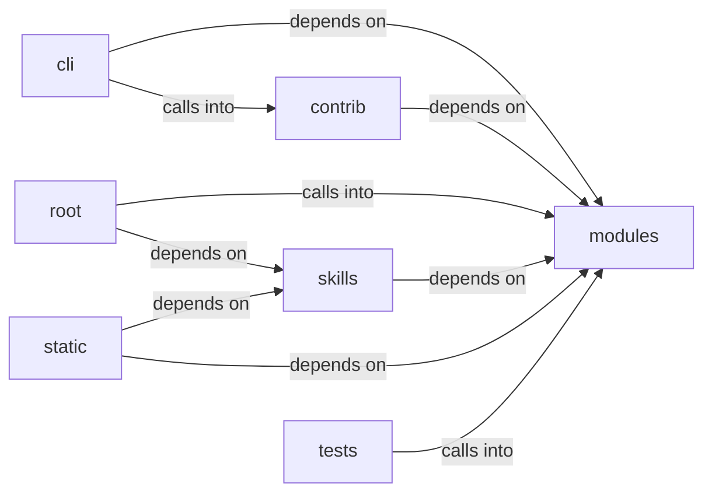

# skills/claude_md_orchestrator

skills/claude_md_orchestrator groups 37 files (c, js, py) around main, _now_iso, Stage, Severity, Contract. DNS exfiltration and covert channel command set.

## cli (7.1)

cli groups 2 files (py) around _sanitize_filename, DNSExfilCommandSet, do_dns_beacon, do_dns_exfil_listen, do_dns_beacon_status. DNS exfiltration and covert channel command set.

## contrib (7.2)

contrib groups 6 files (py) around _ret_model, truncate_message, _configure_logging, _load_knowledge_base, _save_knowledge_base. Autor: Gris Iscomeback Correo electrónico: grisiscomeback[at]gmail[dot]com Fecha de...

## modules (7.3)

modules groups 5 files (c, py) around main, retModel, delete_lines, no_html, SecurityConfig. retModel: gemma2-9b-it        Google  8,192   -       - llama-3.3-70b-versatile...

## root (7.4)

root groups 1 files (py) around _build_substitutions, _fix_sessions_owner, _run_tool. This software must not be used by military or secret service organisations.

## skills (7.5)

skills groups 21 files (py) around _now_iso, Stage, Severity, Contract, to_dict. Public API for the claude_md_orchestrator skill.

## static (7.6)

static groups 1 files (js) around P, S, a, a, a.

## tests (7.7)

tests groups 1 files (py) around cfg, TestSecurityConfig, test_defaults_are_conservative, test_from_payload_accepts_known_keys, test_from_payload_drops_wrong_types. Unit tests for :mod:`modules.security_sanitizers`.

**Files**:

- cli/commands/dns_exfil.py
- cli/commands/phishing_wizard.py
- contrib/legacy/lazygalazy.py
- contrib/legacy/lazygptcli.py
- contrib/legacy/lazygptcli_unified.py
- contrib/legacy/lazyhttpreverseshell.py
- contrib/legacy/lazyproxy.py
- contrib/legacy/lazyseo.py
- modules/backdoor/server.c
- modules/colors.py
- modules/dns_beacon.py
- modules/lazyown_bprfuzzer.py
- modules/security_sanitizers.py
- pwntomate.py
- skills/claude_md_orchestrator/__init__.py
- skills/claude_md_orchestrator/bdd_agent.py
- skills/claude_md_orchestrator/boy_scout.py
- skills/claude_md_orchestrator/cicd_agent.py
- skills/claude_md_orchestrator/config.py
- skills/claude_md_orchestrator/documentation_agent.py
- skills/claude_md_orchestrator/models.py
- skills/claude_md_orchestrator/orchestrator.py
- skills/claude_md_orchestrator/parser.py
- skills/claude_md_orchestrator/reviewer_agent.py
- skills/claude_md_orchestrator/sdd_agent.py
- skills/claude_md_orchestrator/tdd_agent.py
- skills/claude_md_orchestrator/validators.py
- skills/hermes-lazyown/claudemd_rules.py
- skills/hermes-lazyown/config_bridge.py
- skills/hermes-lazyown/constants.py
- skills/hermes-lazyown/executor.py
- skills/hermes-lazyown/hermes_sync.py
- skills/hermes-lazyown/mcp_server.py
- skills/hermes-lazyown/output_compactor.py
- skills/lazyown_mcp_opencode.py
- static/js/xterm.js
- tests/test_security_sanitizers.py
