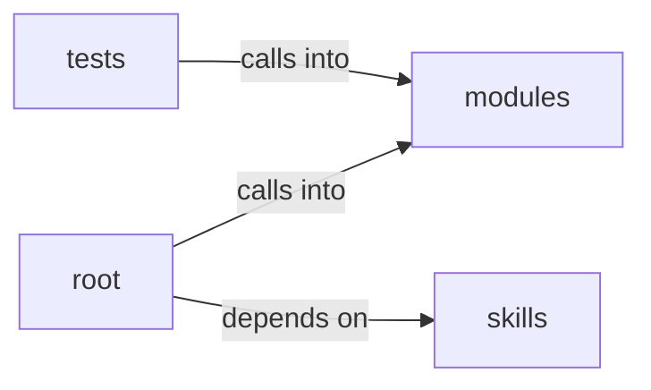

# skills/claude_md_orchestrator

skills/claude_md_orchestrator groups 17 files (py) around _now_iso, Stage, Severity, Contract, to_dict. Autor: Gris Iscomeback Correo electrónico: grisiscomeback[at]gmail[dot]com Fecha de...

## modules (11.1)

modules groups 2 files (py) around SecurityConfig, from_payload, HeaderValueSanitizer, __init__, is_valid_name. Autor: Gris Iscomeback Correo electrónico: grisiscomeback[at]gmail[dot]com Fecha de...

## root (11.2)

root groups 1 files (py) around _build_substitutions, _fix_sessions_owner, _run_tool. This software must not be used by military or secret service organisations.

## skills (11.3)

skills groups 13 files (py) around _now_iso, Stage, Severity, Contract, to_dict. Public API for the claude_md_orchestrator skill.

## tests (11.4)

tests groups 1 files (py) around cfg, TestSecurityConfig, test_defaults_are_conservative, test_from_payload_accepts_known_keys, test_from_payload_drops_wrong_types. Unit tests for :mod:`modules.security_sanitizers`.

**Files**:

- modules/lazyown_bprfuzzer.py
- modules/security_sanitizers.py
- pwntomate.py
- skills/claude_md_orchestrator/__init__.py
- skills/claude_md_orchestrator/bdd_agent.py
- skills/claude_md_orchestrator/boy_scout.py
- skills/claude_md_orchestrator/cicd_agent.py
- skills/claude_md_orchestrator/config.py
- skills/claude_md_orchestrator/documentation_agent.py
- skills/claude_md_orchestrator/models.py
- skills/claude_md_orchestrator/orchestrator.py
- skills/claude_md_orchestrator/parser.py
- skills/claude_md_orchestrator/reviewer_agent.py
- skills/claude_md_orchestrator/sdd_agent.py
- skills/claude_md_orchestrator/tdd_agent.py
- skills/claude_md_orchestrator/validators.py
- tests/test_security_sanitizers.py
