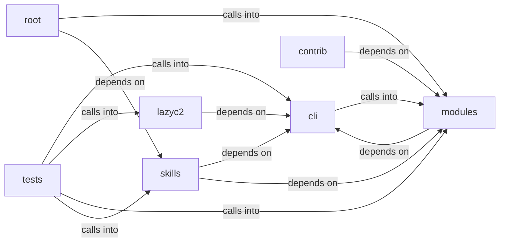

# skills/claude_md_orchestrator

skills/claude_md_orchestrator groups 61 files (c, py) around EnumCommandSet, do_smbclient, do_smbclient_impacket, do_smbclient_py, do_smbmap. BOF marketplace CommandSet — Beacon Object File discovery, staging and delivery.

## cli (9.1)

cli groups 3 files (py) around EnumCommandSet, do_smbclient, do_smbclient_impacket, do_smbclient_py, do_smbmap. BOF marketplace CommandSet — Beacon Object File discovery, staging and delivery.

## contrib (9.2)

contrib groups 2 files (py) around SamsungKnoxExploitServer, do_GET, apk_bytes, launch_html, exploit_js.

## lazyc2 (9.3)

lazyc2 groups 1 files (py) around CommandRejectionReason, CommandDecision, to_dict, CommandAllowlist, __init__. Command allowlist policy for the LazyOwn C2 ``/api/run`` endpoint.

## modules (9.4)

modules groups 17 files (c, py) around main, TaskClass, is_known, RunTicket, GuardrailContract. Beacon configuration builder — wires profile engines into beacon compile-time config.

## root (9.5)

root groups 1 files (py) around _build_substitutions, _fix_sessions_owner, _run_tool. This software must not be used by military or secret service organisations.

## skills (9.6)

skills groups 24 files (py) around _now_iso, Stage, Severity, Contract, to_dict. Public API for the claude_md_orchestrator skill.

## tests (9.7)

tests groups 13 files (py) around TestBeaconConfig, test_default_construction, test_to_gen_beacon_args, test_to_go_implant_vars, test_to_config_json. Tests for modules/beacon_config_builder.py — BeaconConfig, BeaconConfigBuilder, and...

**Files**:

- cli/commands/bof_registry.py
- cli/commands/enum.py
- cli/scope_guard.py
- contrib/legacy/lazygalazy.py
- contrib/legacy/lazyhttpreverseshell.py
- lazyc2/security/command_allowlist.py
- modules/backdoor/server.c
- modules/beacon_config_builder.py
- modules/bof_admin.py
- modules/bof_delivery.py
- modules/bof_registry.py
- modules/c2_profile_engine.py
- modules/guardrails/__init__.py
- modules/guardrails/advisories.py
- modules/guardrails/budget.py
- modules/guardrails/checkpoints.py
- modules/guardrails/contracts.py
- modules/guardrails/harness.py
- modules/lazy_oob.py
- modules/lazyown_bprfuzzer.py
- modules/security_sanitizers.py
- modules/sleep_obfuscation.py
- modules/socks_proxy.py
- pwntomate.py
- skills/claude_md_orchestrator/__init__.py
- skills/claude_md_orchestrator/bdd_agent.py
- skills/claude_md_orchestrator/boy_scout.py
- skills/claude_md_orchestrator/cicd_agent.py
- skills/claude_md_orchestrator/config.py
- skills/claude_md_orchestrator/documentation_agent.py
- skills/claude_md_orchestrator/models.py
- skills/claude_md_orchestrator/orchestrator.py
- skills/claude_md_orchestrator/parser.py
- skills/claude_md_orchestrator/reviewer_agent.py
- skills/claude_md_orchestrator/sdd_agent.py
- skills/claude_md_orchestrator/tdd_agent.py
- skills/claude_md_orchestrator/validators.py
- skills/hermes-lazyown/claudemd_rules.py
- skills/hermes-lazyown/config_bridge.py
- skills/hermes-lazyown/constants.py
- skills/hermes-lazyown/executor.py
- skills/hermes-lazyown/hermes_sync.py
- skills/hermes-lazyown/mcp_server.py
- skills/hermes-lazyown/output_compactor.py
- skills/lazyown_claudemd.py
- skills/lazyown_hooks.py
- skills/lazyown_permissions.py
- skills/tests/test_harness_e2e.py
- tests/test_beacon_config_builder.py
- tests/test_bof_admin.py
- tests/test_bof_delivery.py
- tests/test_bof_registry.py
- tests/test_bof_repo_contract.py
- tests/test_c2_profile_engine.py
- tests/test_command_allowlist.py
- tests/test_command_allowlist_behavior.py
- tests/test_scope_guard.py
- tests/test_security_codeql_batch.py
- tests/test_security_sanitizers.py
- tests/test_sleep_obfuscation.py
- tests/test_socks_proxy.py
