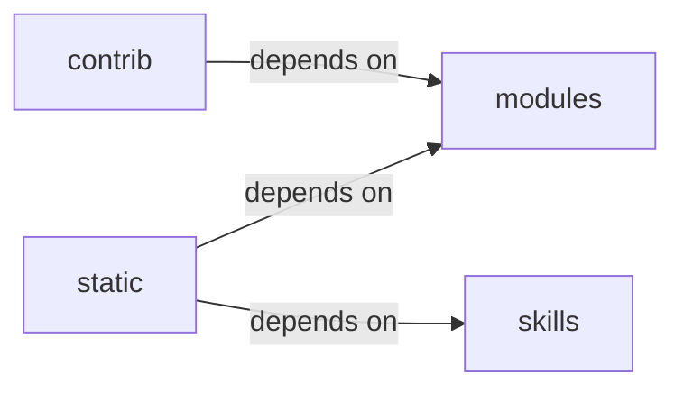

# skills/claude_md_orchestrator

skills/claude_md_orchestrator groups 19 files (js, py) around _now_iso, Stage, Severity, Contract, to_dict. Autor: Gris Iscomeback Correo electrónico: grisiscomeback[at]gmail[dot]com Fecha de...

## contrib (11.1)

contrib groups 4 files (py) around _ret_model, truncate_message, _configure_logging, _load_knowledge_base, _save_knowledge_base. Autor: Gris Iscomeback Correo electrónico: grisiscomeback[at]gmail[dot]com Fecha de...

## modules (11.2)

modules groups 1 files (py) around retModel, delete_lines, no_html. retModel: gemma2-9b-it        Google  8,192   -       - llama-3.3-70b-versatile...

## skills (11.3)

skills groups 13 files (py) around _now_iso, Stage, Severity, Contract, to_dict. Public API for the claude_md_orchestrator skill.

## static (11.4)

static groups 1 files (js) around P, S, a, a, a.

**Files**:

- contrib/legacy/lazygptcli.py
- contrib/legacy/lazygptcli_unified.py
- contrib/legacy/lazyproxy.py
- contrib/legacy/lazyseo.py
- modules/colors.py
- skills/claude_md_orchestrator/__init__.py
- skills/claude_md_orchestrator/bdd_agent.py
- skills/claude_md_orchestrator/boy_scout.py
- skills/claude_md_orchestrator/cicd_agent.py
- skills/claude_md_orchestrator/config.py
- skills/claude_md_orchestrator/documentation_agent.py
- skills/claude_md_orchestrator/models.py
- skills/claude_md_orchestrator/orchestrator.py
- skills/claude_md_orchestrator/parser.py
- skills/claude_md_orchestrator/reviewer_agent.py
- skills/claude_md_orchestrator/sdd_agent.py
- skills/claude_md_orchestrator/tdd_agent.py
- skills/claude_md_orchestrator/validators.py
- static/js/xterm.js
