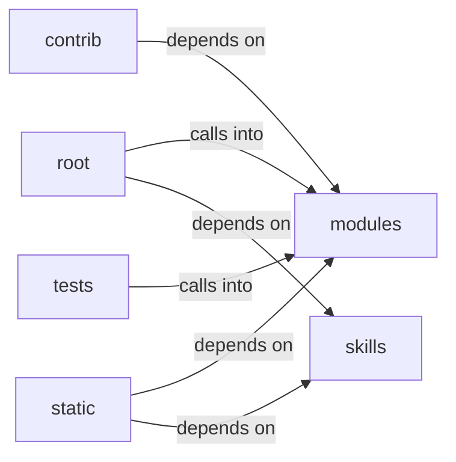

# skills/claude_md_orchestrator

skills/claude_md_orchestrator groups 23 files (js, py) around _now_iso, Stage, Severity, Contract, to_dict. Autor: Gris Iscomeback Correo electrónico: grisiscomeback[at]gmail[dot]com Fecha de...

## contrib (10.1)

contrib groups 4 files (py) around _ret_model, truncate_message, _configure_logging, _load_knowledge_base, _save_knowledge_base. Autor: Gris Iscomeback Correo electrónico: grisiscomeback[at]gmail[dot]com Fecha de...

## modules (10.2)

modules groups 3 files (py) around retModel, delete_lines, no_html, SecurityConfig, from_payload. retModel: gemma2-9b-it        Google  8,192   -       - llama-3.3-70b-versatile...

## root (10.3)

root groups 1 files (py) around _build_substitutions, _fix_sessions_owner, _run_tool. This software must not be used by military or secret service organisations.

## skills (10.4)

skills groups 13 files (py) around _now_iso, Stage, Severity, Contract, to_dict. Public API for the claude_md_orchestrator skill.

## static (10.5)

static groups 1 files (js) around P, S, a, a, a.

## tests (10.6)

tests groups 1 files (py) around cfg, TestSecurityConfig, test_defaults_are_conservative, test_from_payload_accepts_known_keys, test_from_payload_drops_wrong_types. Unit tests for :mod:`modules.security_sanitizers`.

**Files**:

- contrib/legacy/lazygptcli.py
- contrib/legacy/lazygptcli_unified.py
- contrib/legacy/lazyproxy.py
- contrib/legacy/lazyseo.py
- modules/colors.py
- modules/lazyown_bprfuzzer.py
- modules/security_sanitizers.py
- pwntomate.py
- skills/claude_md_orchestrator/__init__.py
- skills/claude_md_orchestrator/bdd_agent.py
- skills/claude_md_orchestrator/boy_scout.py
- skills/claude_md_orchestrator/cicd_agent.py
- skills/claude_md_orchestrator/config.py
- skills/claude_md_orchestrator/documentation_agent.py
- skills/claude_md_orchestrator/models.py
- skills/claude_md_orchestrator/orchestrator.py
- skills/claude_md_orchestrator/parser.py
- skills/claude_md_orchestrator/reviewer_agent.py
- skills/claude_md_orchestrator/sdd_agent.py
- skills/claude_md_orchestrator/tdd_agent.py
- skills/claude_md_orchestrator/validators.py
- static/js/xterm.js
- tests/test_security_sanitizers.py
