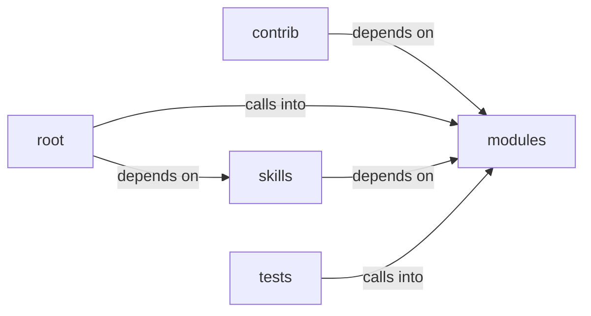

# skills/claude_md_orchestrator

skills/claude_md_orchestrator groups 30 files (c, py) around main, _now_iso, Stage, Severity, Contract.

## contrib (14.1)

contrib groups 2 files (py) around SamsungKnoxExploitServer, do_GET, apk_bytes, launch_html, exploit_js.

## modules (14.2)

modules groups 5 files (c, py) around main, SecurityConfig, from_payload, HeaderValueSanitizer, __init__. Browser identity sync between the operator browser and the recorder proxy.

## root (14.3)

root groups 1 files (py) around _build_substitutions, _fix_sessions_owner, _run_tool. This software must not be used by military or secret service organisations.

## skills (14.4)

skills groups 20 files (py) around _now_iso, Stage, Severity, Contract, to_dict. Public API for the claude_md_orchestrator skill.

## tests (14.5)

tests groups 2 files (py) around EchoHandler, do_GET, do_POST, _reply, log_message. Contract tests: browser identity inheritance in the lazy burp fuzzer.

**Files**:

- contrib/legacy/lazygalazy.py
- contrib/legacy/lazyhttpreverseshell.py
- modules/backdoor/server.c
- modules/browser_sync.py
- modules/lazy_oob.py
- modules/lazyown_bprfuzzer.py
- modules/security_sanitizers.py
- pwntomate.py
- skills/claude_md_orchestrator/__init__.py
- skills/claude_md_orchestrator/bdd_agent.py
- skills/claude_md_orchestrator/boy_scout.py
- skills/claude_md_orchestrator/cicd_agent.py
- skills/claude_md_orchestrator/config.py
- skills/claude_md_orchestrator/documentation_agent.py
- skills/claude_md_orchestrator/models.py
- skills/claude_md_orchestrator/orchestrator.py
- skills/claude_md_orchestrator/parser.py
- skills/claude_md_orchestrator/reviewer_agent.py
- skills/claude_md_orchestrator/sdd_agent.py
- skills/claude_md_orchestrator/tdd_agent.py
- skills/claude_md_orchestrator/validators.py
- skills/hermes-lazyown/claudemd_rules.py
- skills/hermes-lazyown/config_bridge.py
- skills/hermes-lazyown/constants.py
- skills/hermes-lazyown/executor.py
- skills/hermes-lazyown/hermes_sync.py
- skills/hermes-lazyown/mcp_server.py
- skills/hermes-lazyown/output_compactor.py
- tests/test_bprfuzzer_identity.py
- tests/test_security_sanitizers.py
