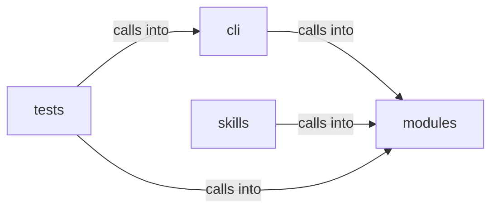

# skills/hermes-lazyown

skills/hermes-lazyown groups 13 files (py) around KillChainConfig, world_model_path, phase_index, is_valid_phase, PhaseStatus. Self-populating kill-chain progress derived from the daemon event stream.

## cli (13.1)

cli groups 1 files (py) around PhaseProgress, _phase_from_event, _detect_current_phase, compute_killchain. Self-populating kill-chain progress derived from the daemon event stream.

## modules (13.2)

modules groups 2 files (py) around KillChainConfig, world_model_path, phase_index, is_valid_phase, PhaseStatus. SVG / HTML kill-chain visualizer — generates standalone HTML with embedded SVG.

## skills (13.3)

skills groups 7 files (py) around ConfigKeys, EnvKeys, Defaults, PhaseNames, Paths. Dynamic Claude.md rule generator for the Hermes-LazyOwn integration.

## tests (13.4)

tests groups 3 files (py) around _states, test_empty_events_all_pending_without_world, test_current_phase_from_step_events, test_phase_advance_event_sets_current, test_activity_and_reward_accumulate. Tests for cli/killchain.py.

**Files**:

- cli/killchain.py
- modules/kill_chain_viz.py
- modules/killchain.py
- skills/hermes-lazyown/claudemd_rules.py
- skills/hermes-lazyown/config_bridge.py
- skills/hermes-lazyown/constants.py
- skills/hermes-lazyown/executor.py
- skills/hermes-lazyown/hermes_sync.py
- skills/hermes-lazyown/mcp_server.py
- skills/hermes-lazyown/output_compactor.py
- tests/test_killchain.py
- tests/test_killchain_snapshot.py
- tests/test_killchain_unified_v2.py
