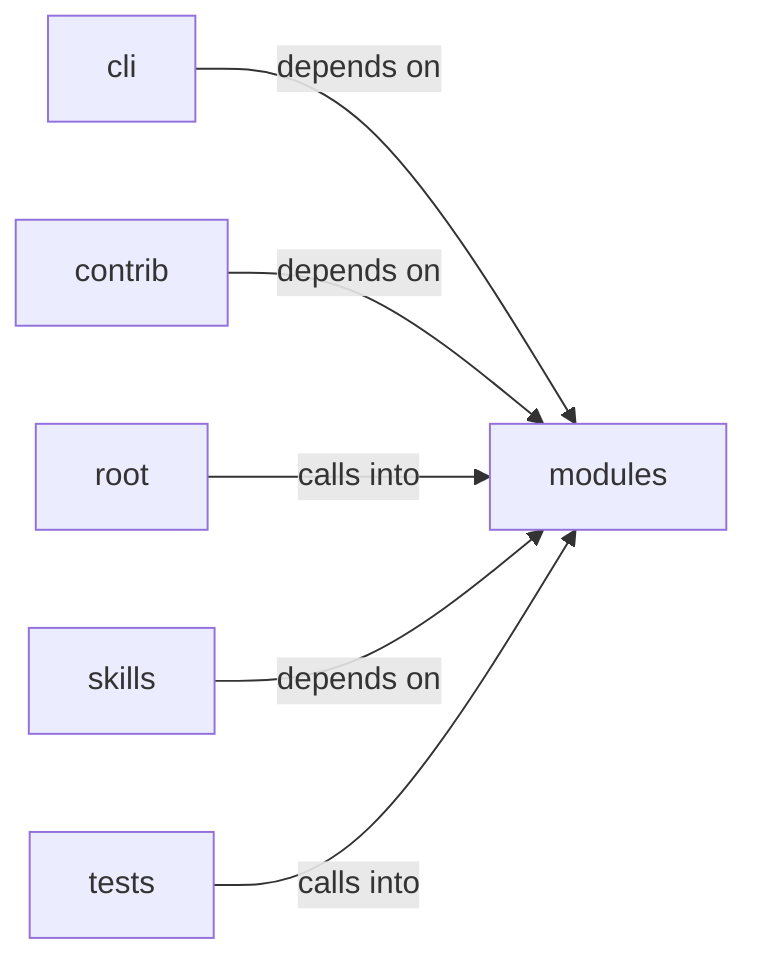

# skills/hermes-lazyown

skills/hermes-lazyown groups 16 files (c, py) around main, ConfigKeys, EnvKeys, Defaults, PhaseNames. Phishing Wizard command set.

## cli (10.1)

cli groups 1 files (py) around PhishingWizardCommandSet, do_phish_wizard, do_phish_serve, PhishingHandler, log_message. Phishing Wizard command set.

## contrib (10.2)

contrib groups 2 files (py) around SamsungKnoxExploitServer, do_GET, apk_bytes, launch_html, exploit_js.

## modules (10.3)

modules groups 3 files (c, py) around main, SecurityConfig, from_payload, HeaderValueSanitizer, __init__. Autor: Gris Iscomeback Correo electrónico: grisiscomeback[at]gmail[dot]com Fecha de...

## root (10.4)

root groups 1 files (py) around _build_substitutions, _fix_sessions_owner, _run_tool. This software must not be used by military or secret service organisations.

## skills (10.5)

skills groups 8 files (py) around ConfigKeys, EnvKeys, Defaults, PhaseNames, Paths. Dynamic Claude.md rule generator for the Hermes-LazyOwn integration.

## tests (10.6)

tests groups 1 files (py) around cfg, TestSecurityConfig, test_defaults_are_conservative, test_from_payload_accepts_known_keys, test_from_payload_drops_wrong_types. Unit tests for :mod:`modules.security_sanitizers`.

**Files**:

- cli/commands/phishing_wizard.py
- contrib/legacy/lazygalazy.py
- contrib/legacy/lazyhttpreverseshell.py
- modules/backdoor/server.c
- modules/lazyown_bprfuzzer.py
- modules/security_sanitizers.py
- pwntomate.py
- skills/hermes-lazyown/claudemd_rules.py
- skills/hermes-lazyown/config_bridge.py
- skills/hermes-lazyown/constants.py
- skills/hermes-lazyown/executor.py
- skills/hermes-lazyown/hermes_sync.py
- skills/hermes-lazyown/mcp_server.py
- skills/hermes-lazyown/output_compactor.py
- skills/lazyown_mcp_opencode.py
- tests/test_security_sanitizers.py
