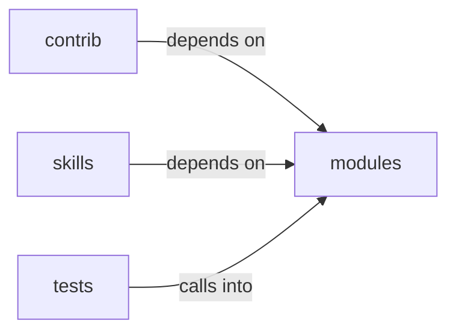

# skills/hermes-lazyown

skills/hermes-lazyown groups 14 files (c, py) around main, ConfigKeys, EnvKeys, Defaults, PhaseNames.

## contrib (12.1)

contrib groups 2 files (py) around SamsungKnoxExploitServer, do_GET, apk_bytes, launch_html, exploit_js.

## modules (12.2)

modules groups 4 files (c, py) around main, _sessions_dir, _profile_path, _jar_path, _rules_path. Browser identity sync between the operator browser and the recorder proxy.

## skills (12.3)

skills groups 7 files (py) around ConfigKeys, EnvKeys, Defaults, PhaseNames, Paths. Dynamic Claude.md rule generator for the Hermes-LazyOwn integration.

## tests (12.4)

tests groups 1 files (py) around EchoHandler, do_GET, do_POST, _reply, log_message. Contract tests: browser identity inheritance in the lazy burp fuzzer.

**Files**:

- contrib/legacy/lazygalazy.py
- contrib/legacy/lazyhttpreverseshell.py
- modules/backdoor/server.c
- modules/browser_sync.py
- modules/lazy_oob.py
- modules/lazyown_bprfuzzer.py
- skills/hermes-lazyown/claudemd_rules.py
- skills/hermes-lazyown/config_bridge.py
- skills/hermes-lazyown/constants.py
- skills/hermes-lazyown/executor.py
- skills/hermes-lazyown/hermes_sync.py
- skills/hermes-lazyown/mcp_server.py
- skills/hermes-lazyown/output_compactor.py
- tests/test_bprfuzzer_identity.py
