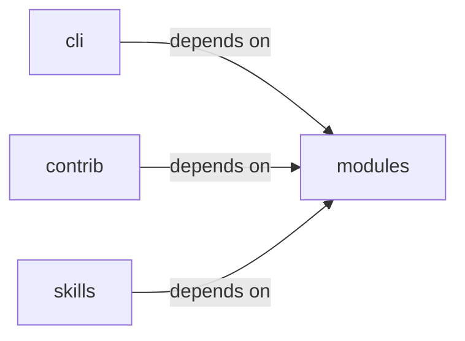

# skills/hermes-lazyown

skills/hermes-lazyown groups 12 files (c, py) around main, ConfigKeys, EnvKeys, Defaults, PhaseNames. Phishing Wizard command set.

## cli (12.1)

cli groups 1 files (py) around PhishingWizardCommandSet, do_phish_wizard, do_phish_serve, PhishingHandler, log_message. Phishing Wizard command set.

## contrib (12.2)

contrib groups 2 files (py) around SamsungKnoxExploitServer, do_GET, apk_bytes, launch_html, exploit_js.

## modules (12.3)

modules groups 1 files (c) around main.

## skills (12.4)

skills groups 8 files (py) around ConfigKeys, EnvKeys, Defaults, PhaseNames, Paths. Dynamic Claude.md rule generator for the Hermes-LazyOwn integration.

**Files**:

- cli/commands/phishing_wizard.py
- contrib/legacy/lazygalazy.py
- contrib/legacy/lazyhttpreverseshell.py
- modules/backdoor/server.c
- skills/hermes-lazyown/claudemd_rules.py
- skills/hermes-lazyown/config_bridge.py
- skills/hermes-lazyown/constants.py
- skills/hermes-lazyown/executor.py
- skills/hermes-lazyown/hermes_sync.py
- skills/hermes-lazyown/mcp_server.py
- skills/hermes-lazyown/output_compactor.py
- skills/lazyown_mcp_opencode.py
