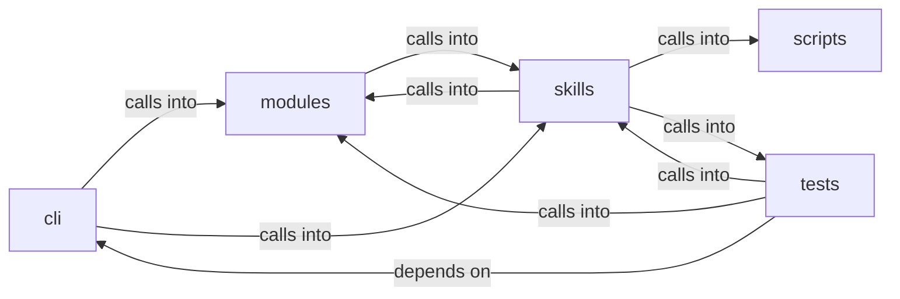

# skills/mcp_tools

skills/mcp_tools groups 235 files (py) around MCPContext, _try_import, _update_task_status, _credential_worth_task, _task_title_open. Caldera-style command set — operation lifecycle, TTP coverage, and planner.

## cli (1.1)

cli groups 3 files (py) around DaemonControlCommandSet, do_daemon_mode, do_daemon_pause, do_daemon_resume, do_daemon_veto. Caldera-style command set — operation lifecycle, TTP coverage, and planner.

## modules (1.2)

modules groups 31 files (py) around PipelineError, PipelineSchemaError, PipelineNotFoundError, PipelineCycleError, PipelineStep. Global asset truth store joined to per-task exploration chains.

## scripts (1.3)

scripts groups 1 files (py) around _backup, _opencode_path, _hermes_path, patch_opencode, patch_hermes. Patch operator agent configs to use the Lazy llama.cpp server.

## skills (1.4)

skills groups 171 files (py) around MCPContext, _try_import, _update_task_status, _credential_worth_task, _task_title_open. Autonomous Campaign Intelligence (ACI) Planner

## tests (1.5)

tests groups 29 files (py) around test_autonomous_flow_integration, _make_goal, _patched_paths, _start_patches, _stop_patches. test_autonomous_flow_integration: Simulates a simplified autonomous flow to verify...

**Files**:

- cli/commands/caldera.py
- cli/commands/daemon_ctl.py
- cli/commands/exploitgym.py
- modules/asset_graph.py
- modules/atomic_enricher.py
- modules/cve_matcher.py
- modules/engage_summary.py
- modules/enrich.py
- modules/evasion_engine.py
- modules/event_engine.py
- modules/evidence.py
- modules/exploitgym_gym.py
- modules/goals.py
- modules/intercept.py
- modules/lazyown_bridge.py
- modules/lesson_ingestor.py
- modules/llm_evaluator.py
- modules/llm_pool.py
- modules/mcp_agent_bridge.py
- modules/moe_router.py
- modules/obs_parser.py
- modules/operation.py
- modules/pipeline_engine.py
- modules/planner.py
- modules/playbook_engine.py
- modules/playbook_executor.py
- modules/reactive_engine.py
- modules/rl_trainer.py
- modules/selfupdate.py
- modules/session_rag.py
- modules/session_reader.py
- modules/timeline_narrator.py
- modules/toolset.py
- modules/ttp_coverage.py
- scripts/lazy_opencode_config.py
- skills/aci_planner.py
- skills/autonomous_daemon.py
- skills/autonomous_replay.py
- skills/daemon_control.py
- skills/heartbeat.py
- skills/hive_mind.py
- skills/lazyown_automapper.py
- skills/lazyown_context.py
- skills/lazyown_daemon.py
- skills/lazyown_facts.py
- skills/lazyown_groq_agents.py
- skills/lazyown_llm.py
- skills/lazyown_mcp.py
- skills/lazyown_mcp_helpers.py
- skills/lazyown_objective.py
- skills/lazyown_parquet_db.py
- skills/lazyown_policy.py
- skills/lazyown_session.py
- skills/mcp_lazy.py
- skills/mcp_tools/__init__.py
- skills/mcp_tools/_context.py
- skills/mcp_tools/aci_plan.py
- skills/mcp_tools/aci_replan.py
- skills/mcp_tools/aci_status.py
- skills/mcp_tools/ack_event.py
- skills/mcp_tools/add_rule.py
- skills/mcp_tools/add_target.py
- skills/mcp_tools/agent_result.py
- skills/mcp_tools/agent_status.py
- skills/mcp_tools/atomic_resolve.py
- skills/mcp_tools/atomic_search.py
- skills/mcp_tools/auto_populate.py
- skills/mcp_tools/autonomous_events.py
- skills/mcp_tools/autonomous_inject.py
- skills/mcp_tools/autonomous_replay.py
- skills/mcp_tools/autonomous_start.py
- skills/mcp_tools/autonomous_status.py
- skills/mcp_tools/autonomous_stop.py
- skills/mcp_tools/bridge_suggest.py
- skills/mcp_tools/c2_adversary.py
- skills/mcp_tools/c2_command.py
- skills/mcp_tools/c2_notes.py
- skills/mcp_tools/c2_profile.py
- skills/mcp_tools/c2_redop.py
- skills/mcp_tools/c2_script.py
- skills/mcp_tools/c2_search_agent.py
- skills/mcp_tools/c2_status.py
- skills/mcp_tools/c2_vuln_analysis.py
- skills/mcp_tools/campaign_lessons.py
- skills/mcp_tools/campaign_sitrep.py
- skills/mcp_tools/campaign_tasks.py
- skills/mcp_tools/claudemd.py
- skills/mcp_tools/command_help.py
- skills/mcp_tools/create_addon.py
- skills/mcp_tools/create_tool.py
- skills/mcp_tools/credentials.py
- skills/mcp_tools/cron_schedule.py
- skills/mcp_tools/cve_search.py
- skills/mcp_tools/daemon.py
- skills/mcp_tools/daemon_approve.py
- skills/mcp_tools/daemon_focus.py
- skills/mcp_tools/daemon_mode.py
- skills/mcp_tools/daemon_pause.py
- skills/mcp_tools/daemon_resume.py
- skills/mcp_tools/daemon_status.py
- skills/mcp_tools/daemon_veto.py
- skills/mcp_tools/deploy_beacon.py
- skills/mcp_tools/discover_commands.py
- skills/mcp_tools/engage_approve.py
- skills/mcp_tools/engage_list_pending.py
- skills/mcp_tools/engage_status.py
- skills/mcp_tools/engage_target.py
- skills/mcp_tools/eval_quality.py
- skills/mcp_tools/evasion_generate.py
- skills/mcp_tools/evasion_rotate.py
- skills/mcp_tools/evidence_grep.py
- skills/mcp_tools/exploitgym_list.py
- skills/mcp_tools/exploitgym_run.py
- skills/mcp_tools/exploitgym_score.py
- skills/mcp_tools/exploitgym_status.py
- skills/mcp_tools/facts_show.py
- skills/mcp_tools/fast_run.py
- skills/mcp_tools/generate_report.py
- skills/mcp_tools/get_beacons.py
- skills/mcp_tools/get_config.py
- skills/mcp_tools/groq_agent.py
- skills/mcp_tools/harness_status.py
- skills/mcp_tools/heartbeat_status.py
- skills/mcp_tools/hive_collect.py
- skills/mcp_tools/hive_forget.py
- skills/mcp_tools/hive_plan.py
- skills/mcp_tools/hive_recall.py
- skills/mcp_tools/hive_recover.py
- skills/mcp_tools/hive_result.py
- skills/mcp_tools/hive_spawn.py
- skills/mcp_tools/hive_status.py
- skills/mcp_tools/inject_objective.py
- skills/mcp_tools/job_status.py
- skills/mcp_tools/lazy_workspace.py
- skills/mcp_tools/list_addons.py
- skills/mcp_tools/list_agents.py
- skills/mcp_tools/list_event_rules.py
- skills/mcp_tools/list_plugins.py
- skills/mcp_tools/list_sessions.py
- skills/mcp_tools/list_targets.py
- skills/mcp_tools/llm_ask.py
- skills/mcp_tools/lolbas_list.py
- skills/mcp_tools/lolbas_use.py
- skills/mcp_tools/manage_permissions.py
- skills/mcp_tools/memory_recall.py
- skills/mcp_tools/memory_store.py
- skills/mcp_tools/misp_export.py
- skills/mcp_tools/next_objective.py
- skills/mcp_tools/opencode_config.py
- skills/mcp_tools/parquet_annotate.py
- skills/mcp_tools/parquet_query.py
- skills/mcp_tools/phase_guide.py
- skills/mcp_tools/pipeline_list.py
- skills/mcp_tools/pipeline_run.py
- skills/mcp_tools/pipeline_status.py
- skills/mcp_tools/pipeline_validate.py
- skills/mcp_tools/playbook_generate.py
- skills/mcp_tools/playbook_run.py
- skills/mcp_tools/policy_status.py
- skills/mcp_tools/poll_events.py
- skills/mcp_tools/rag_index.py
- skills/mcp_tools/rag_query.py
- skills/mcp_tools/rea.py
- skills/mcp_tools/reactive_suggest.py
- skills/mcp_tools/read_prompt.py
- skills/mcp_tools/read_session_file.py
- skills/mcp_tools/run_agent.py
- skills/mcp_tools/run_api.py
- skills/mcp_tools/run_command.py
- skills/mcp_tools/run_command_async.py
- skills/mcp_tools/search_tools.py
- skills/mcp_tools/searchsploit.py
- skills/mcp_tools/session_diff.py
- skills/mcp_tools/session_init.py
- skills/mcp_tools/session_resume.py
- skills/mcp_tools/session_state.py
- skills/mcp_tools/session_status.py
- skills/mcp_tools/set_active_target.py
- skills/mcp_tools/soul.py
- skills/mcp_tools/subagent_run.py
- skills/mcp_tools/swan_ensemble.py
- skills/mcp_tools/swan_route.py
- skills/mcp_tools/swan_run.py
- skills/mcp_tools/swan_status.py
- skills/mcp_tools/target_context.py
- skills/mcp_tools/tasks_cleanup.py
- skills/mcp_tools/threat_model.py
- skills/mcp_tools/timeline.py
- skills/mcp_tools/winbox_eventlogs.py
- skills/mcp_tools/winbox_exec.py
- skills/mcp_tools/winbox_gym_list.py
- skills/mcp_tools/winbox_gym_plan.py
- skills/mcp_tools/winbox_gym_run.py
- skills/mcp_tools/winbox_snapshot.py
- skills/mcp_tools/winbox_status.py
- skills/mcp_tools/winbox_tools.py
- skills/mcp_tools/winbox_vm.py
- skills/sessions_watcher.py
- skills/swan_agent.py
- skills/tests/test_autonomous_daemon.py
- skills/tests/test_facts.py
- skills/tests/test_hive_mind.py
- skills/tests/test_mcp_smoke.py
- skills/tests/test_objectives.py
- skills/tests/test_parquet_db.py
- skills/update_knowledge.py
- tests/integration_autonomous_flow.py
- tests/test_aci_planner.py
- tests/test_autonomous_ops.py
- tests/test_autonomous_replay.py
- tests/test_boyscout_contracts.py
- tests/test_bridge_catalog_filtered.py
- tests/test_chain_selector.py
- tests/test_core_modules.py
- tests/test_daemon_control.py
- tests/test_daemon_loop.py
- tests/test_engage_gates.py
- tests/test_engage_orchestrator.py
- tests/test_engage_summary.py
- tests/test_exploitgym_gym.py
- tests/test_lazy_parity.py
- tests/test_lesson_ingestor.py
- tests/test_mcp_auto_loop_wrapper.py
- tests/test_mcp_improvements.py
- tests/test_mcp_lazy.py
- tests/test_mcp_tools_registry.py
- tests/test_metrics_aware_selector.py
- tests/test_moe_rl_swan.py
- tests/test_moe_router_check_regression.py
- tests/test_pipeline_engine.py
- tests/test_rea_mcp.py
- tests/test_reactive_engine_semantic.py
- tests/test_reactive_lateral_data.py
- tests/test_safety_gates.py
- tests/test_scope_bound_auto_gate.py
