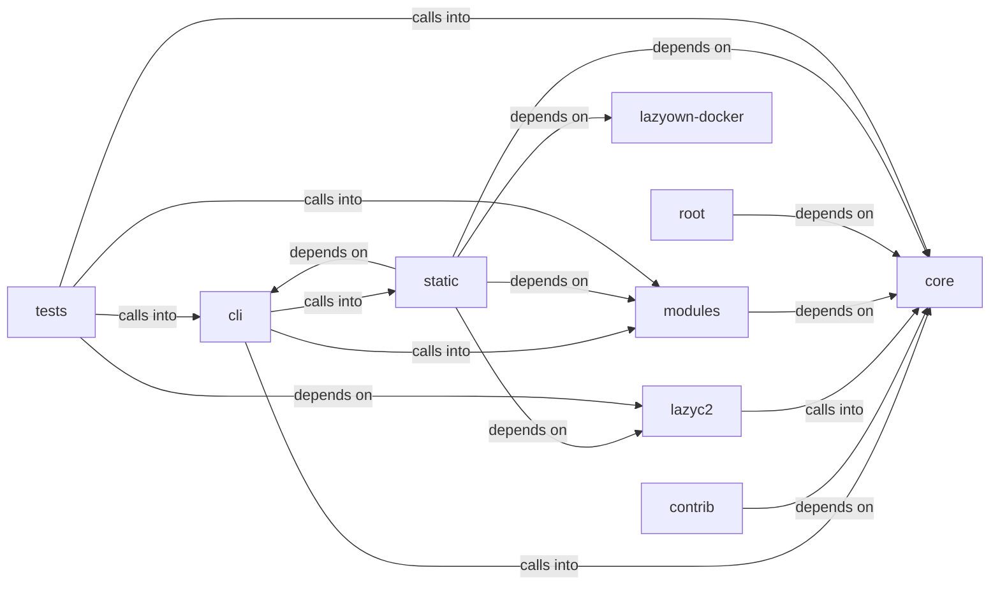

# static/js

static/js groups 55 files (c, js, py, sh) around _apply_env_overrides, _coerce_env_value, _mask_if_sensitive, _log_config_change, _collect_validation_warnings. ``assign`` business logic.

## cli (6.1)

cli groups 11 files (py) around apply_assign, format_payload, style, active_tokens, paint. ``assign`` business logic.

## contrib (6.2)

contrib groups 1 files (py) around generate_key_iv, main.

## core (6.3)

core groups 6 files (py) around _apply_env_overrides, _coerce_env_value, _mask_if_sensitive, _log_config_change, _collect_validation_warnings. Configuration loader and Config wrapper.

## lazyc2 (6.4)

lazyc2 groups 2 files (py) around HealthConfig, _health_status, _listener_alive, health, ping. API blueprint for the LazyOwn C2 server.

## lazyown-docker (6.5)

lazyown-docker groups 1 files (sh).

## modules (6.6)

modules groups 8 files (c, py) around TlsProfile, get_cipher_suites, get_ja3_hash, from_dict, to_dict. Purple Team Closed-Loop — honest measurement of offensive detection.

## root (6.7)

root groups 1 files (py) around main.

## static (6.8)

static groups 14 files (js) around As, Be, Cs, Do, Ds. Version 1.73.4 3d-force-graph - https://github.com/vasturiano/3d-force-graph...

## tests (6.9)

tests groups 11 files (py) around TestHexSource, test_valid_hex_decodes_to_32_bytes, test_wrong_length_raises, test_non_hex_raises, TestDiskSource. TDD tests for the AES key resolution contract.

**Files**:

- cli/assign.py
- cli/commands/bof_registry.py
- cli/commands/c2_profile.py
- cli/commands/defaults.py
- cli/commands/purple_team.py
- cli/commands/session_ops.py
- cli/commands/sleep_obfuscation.py
- cli/commands/socks_proxy.py
- cli/session_resumer.py
- cli/show.py
- cli/style.py
- contrib/legacy/lazybinenc.py
- core/config.py
- core/defaults.py
- core/payload_schema.py
- core/process.py
- core/prompt.py
- core/protocols.py
- key.py
- lazyc2/blueprints/api.py
- lazyc2/state.py
- lazyown-docker/init.sh
- modules/auto_purple.py
- modules/beacon_config_builder.py
- modules/bof_registry.py
- modules/c2_profile_engine.py
- modules/exp.c
- modules/search.py
- modules/sleep_obfuscation.py
- modules/socks_proxy.py
- static/js/3d-force-graph-1.73.4.min.js
- static/js/bootstrap-4.5.2.min.js
- static/js/bootstrap-5.3.0.bundle.min.js
- static/js/chart.min.js
- static/js/force-graph-1.43.5.min.js
- static/js/html2pdf.bundle.min.js
- static/js/jquery-3.5.1.slim.min.js
- static/js/particles.js
- static/js/popper-2.5.4.min.js
- static/js/quill-2.0.3.js
- static/js/showdown-2.1.0.min.js
- static/js/tippy-6.js
- static/js/vis-network-9.1.2.min.js
- static/js/vis-network.min.js
- tests/test_aes_key_propagation.py
- tests/test_beacon_config_builder.py
- tests/test_bof_registry.py
- tests/test_c2_profile_engine.py
- tests/test_cli_assign.py
- tests/test_core.py
- tests/test_core_config.py
- tests/test_core_defaults.py
- tests/test_payload_schema.py
- tests/test_sleep_obfuscation.py
- tests/test_socks_proxy.py
