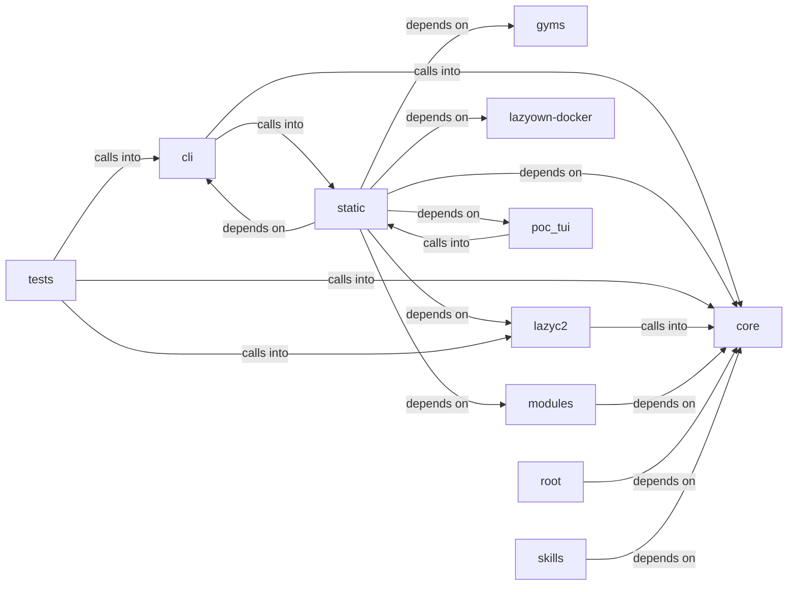

# static/js

static/js groups 49 files (c, js, php, py, sh) around FieldKind, Severity, FieldSpec, ValidationIssue, _validate_string. ``assign`` business logic.

## cli (10.1)

cli groups 6 files (py) around apply_assign, format_payload, style, active_tokens, paint. ``assign`` business logic.

## core (10.2)

core groups 4 files (py) around FieldKind, Severity, FieldSpec, ValidationIssue, _validate_string. Operator-managed parameter registry.

## gyms (10.3)

gyms groups 1 files (php).

## lazyc2 (10.4)

lazyc2 groups 2 files (py) around AddonCreatorConfig, live_placeholders, ParamSpec, to_dict, AddonDraft. LazyAddon creator contract for the LazyOwn C2 web interface.

## lazyown-docker (10.5)

lazyown-docker groups 1 files (sh).

## modules (10.6)

modules groups 3 files (c, py) around _GNU_SOURCE, MQUEUE_NUM, INBOUND, OUTBOUND, DESC_MAX. gcc exp.c -o exp -l mnl -l nftnl -w

## poc_tui (10.7)

poc_tui groups 4 files (py) around ShellBackend, __init__, import_shell_class, start, run. Entry point: python3 -m poc_tui

## root (10.8)

root groups 1 files (py) around main.

## skills (10.9)

skills groups 4 files (py) around handle, handle, handle, handle, coerce_value. MCP tool ``lazyown_create_param`` (migrated from the call_tool dispatch chain).

## static (10.10)

static groups 16 files (js) around rand, clamp, Terminal, constructor, push. Version 1.73.4 3d-force-graph - https://github.com/vasturiano/3d-force-graph...

## tests (10.11)

tests groups 7 files (py) around crypto_module, tmp_sessions, TestAutoCryptoConfig, test_default_config, test_custom_config. Tests for cli.auto_crypto — automatic session data encryption.

**Files**:

- cli/assign.py
- cli/commands/params_ops.py
- cli/commands/session_ops.py
- cli/session_resumer.py
- cli/show.py
- cli/style.py
- core/param_registry.py
- core/payload_schema.py
- core/process.py
- core/prompt.py
- gyms/docker/php2shell/src/info.php
- key.py
- lazyc2/addon_creator.py
- lazyc2/state.py
- lazyown-docker/init.sh
- modules/exp.c
- modules/lazy_verify.py
- modules/search.py
- poc_tui/__main__.py
- poc_tui/app.py
- poc_tui/run.py
- poc_tui/test_app.py
- skills/mcp_tools/create_param.py
- skills/mcp_tools/delete_param.py
- skills/mcp_tools/list_params.py
- skills/mcp_tools/set_config.py
- static/hexabot/hexabot-spinner.js
- static/js/3d-force-graph-1.73.4.min.js
- static/js/bootstrap-4.5.2.min.js
- static/js/bootstrap-5.3.0.bundle.min.js
- static/js/chart.min.js
- static/js/force-graph-1.43.5.min.js
- static/js/html2pdf.bundle.min.js
- static/js/jquery-3.5.1.slim.min.js
- static/js/particles.js
- static/js/popper-2.5.4.min.js
- static/js/quill-2.0.3.js
- static/js/showdown-2.1.0.min.js
- static/js/tippy-6.js
- static/js/vis-network-9.1.2.min.js
- static/js/vis-network.min.js
- static/js/xterm.js
- tests/test_auto_crypto.py
- tests/test_cli_assign.py
- tests/test_core_config.py
- tests/test_param_registry.py
- tests/test_payload_schema.py
- tests/test_php2shell_addon.py
- tests/test_placeholder_coverage.py
