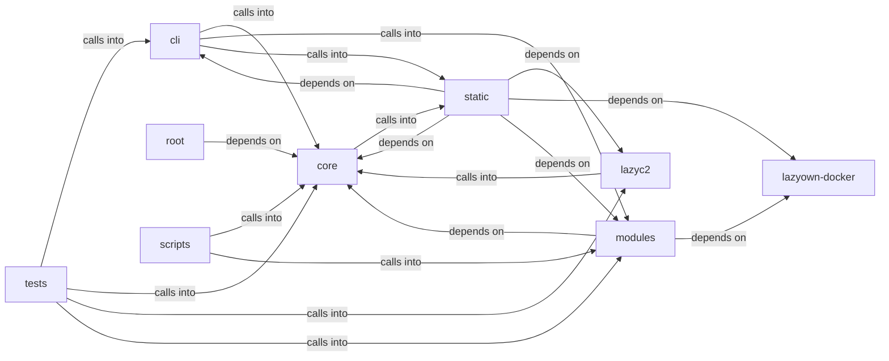

# static/js

static/js groups 49 files (c, js, py, sh) around _apply_env_overrides, _coerce_env_value, _mask_if_sensitive, _log_config_change, _calling_frame. ``assign`` business logic.

## cli (8.1)

cli groups 8 files (py) around apply_assign, format_payload, PersistMigratedCommandSet, generate_backdoor_username, generate_backdoor_password. ``assign`` business logic.

## core (8.2)

core groups 5 files (py) around _apply_env_overrides, _coerce_env_value, _mask_if_sensitive, _log_config_change, _calling_frame. Configuration loader and Config wrapper.

## lazyc2 (8.3)

lazyc2 groups 2 files (py) around AddonCreatorConfig, live_placeholders, ParamSpec, to_dict, AddonDraft. LazyAddon creator contract for the LazyOwn C2 web interface.

## lazyown-docker (8.4)

lazyown-docker groups 1 files (sh).

## modules (8.5)

modules groups 7 files (c, py) around _build_linux_x64_reverse_tcp, _patch_shellcode_x64, PayloadTemplate, __init__, generate. Purple Team Closed-Loop — honest measurement of offensive detection.

## root (8.6)

root groups 1 files (py) around main.

## scripts (8.7)

scripts groups 1 files (py) around SmokeConfig, check_surfaces, check_calls, main. Smoke check for the public surfaces documented in CORE.md.

## static (8.8)

static groups 13 files (js) around As, Be, Cs, Do, Ds. Version 1.73.4 3d-force-graph - https://github.com/vasturiano/3d-force-graph...

## tests (8.9)

tests groups 11 files (py) around TestHexSource, test_valid_hex_decodes_to_32_bytes, test_wrong_length_raises, test_non_hex_raises, TestDiskSource. TDD tests for the AES key resolution contract.

**Files**:

- cli/assign.py
- cli/commands/params_ops.py
- cli/commands/persist_migrated.py
- cli/commands/purple_team.py
- cli/commands/session_ops.py
- cli/purple_tui.py
- cli/session_resumer.py
- cli/show.py
- core/config.py
- core/param_registry.py
- core/payload_schema.py
- core/process.py
- core/prompt.py
- key.py
- lazyc2/addon_creator.py
- lazyc2/state.py
- lazyown-docker/init.sh
- modules/auto_purple.py
- modules/exp.c
- modules/gym_cleanup.py
- modules/lazy_verify.py
- modules/payload_factory.py
- modules/rootkit/rootkit.c
- modules/traffic_morpher.py
- scripts/devtools/core_smoke.py
- static/js/3d-force-graph-1.73.4.min.js
- static/js/bootstrap-4.5.2.min.js
- static/js/bootstrap-5.3.0.bundle.min.js
- static/js/chart.min.js
- static/js/force-graph-1.43.5.min.js
- static/js/html2pdf.bundle.min.js
- static/js/jquery-3.5.1.slim.min.js
- static/js/particles.js
- static/js/popper-2.5.4.min.js
- static/js/quill-2.0.3.js
- static/js/tippy-6.js
- static/js/vis-network-9.1.2.min.js
- static/js/vis-network.min.js
- tests/test_aes_key_propagation.py
- tests/test_audit_remediation.py
- tests/test_backdoor_random.py
- tests/test_cli_assign.py
- tests/test_core_config.py
- tests/test_gym_lifecycle.py
- tests/test_param_registry.py
- tests/test_payload_factory.py
- tests/test_payload_schema.py
- tests/test_php2shell_addon.py
- tests/test_placeholder_coverage.py
