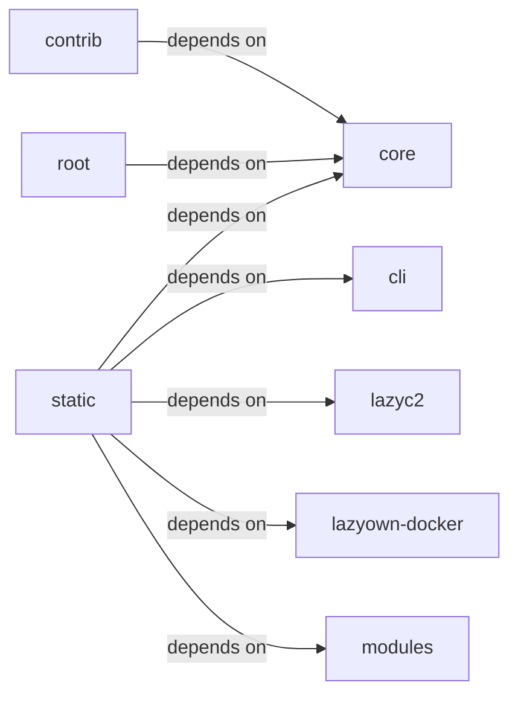

# static/js

static/js groups 25 files (c, js, py, sh) around check_go_tool_installed, is_binary_present, handle_multiple_rhosts, wrapper, check_sudo. ``assign`` business logic.

## cli (8.1)

cli groups 3 files (py) around apply_assign, format_payload, style, active_tokens, paint. ``assign`` business logic.

## contrib (8.2)

contrib groups 1 files (py) around generate_key_iv, main.

## core (8.3)

core groups 2 files (py) around check_go_tool_installed, is_binary_present, handle_multiple_rhosts, wrapper, check_sudo. Process and subprocess utilities for the LazyOwn framework.

## lazyc2 (8.4)

lazyc2 groups 1 files (py). Global C2 server state — namespace for shared mutable objects.

## lazyown-docker (8.5)

lazyown-docker groups 1 files (sh).

## modules (8.6)

modules groups 2 files (c, py) around _GNU_SOURCE, MQUEUE_NUM, INBOUND, OUTBOUND, DESC_MAX. gcc exp.c -o exp -l mnl -l nftnl -w

## root (8.7)

root groups 1 files (py) around main.

## static (8.8)

static groups 14 files (js) around As, Be, Cs, Do, Ds. Version 1.73.4 3d-force-graph - https://github.com/vasturiano/3d-force-graph...

**Files**:

- cli/assign.py
- cli/show.py
- cli/style.py
- contrib/legacy/lazybinenc.py
- core/process.py
- core/prompt.py
- key.py
- lazyc2/state.py
- lazyown-docker/init.sh
- modules/exp.c
- modules/search.py
- static/js/3d-force-graph-1.73.4.min.js
- static/js/bootstrap-4.5.2.min.js
- static/js/bootstrap-5.3.0.bundle.min.js
- static/js/chart.min.js
- static/js/force-graph-1.43.5.min.js
- static/js/html2pdf.bundle.min.js
- static/js/jquery-3.5.1.slim.min.js
- static/js/particles.js
- static/js/popper-2.5.4.min.js
- static/js/quill-2.0.3.js
- static/js/showdown-2.1.0.min.js
- static/js/tippy-6.js
- static/js/vis-network-9.1.2.min.js
- static/js/vis-network.min.js
