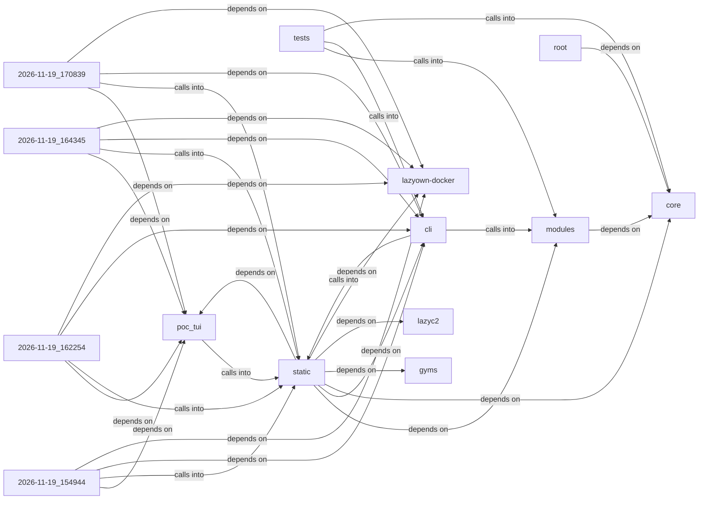

# static/js

static/js groups 62 files (c, js, php, py, sh) around CommandInjectionError, UrlValidationError, needs_shell, safe_system, _kill_process_tree. ! jQuery v1.11.3 | (c) 2005, 2015 jQuery Foundation, Inc. | jquery.org/license

## 2026-11-19_154944 (10.1)

2026-11-19_154944 groups 1 files (js) around s, c, d. ! jQuery v1.11.3 | (c) 2005, 2015 jQuery Foundation, Inc. | jquery.org/license

## 2026-11-19_162254 (10.2)

2026-11-19_162254 groups 1 files (js) around s, c, d. ! jQuery v1.11.3 | (c) 2005, 2015 jQuery Foundation, Inc. | jquery.org/license

## 2026-11-19_164345 (10.3)

2026-11-19_164345 groups 1 files (js) around s, c, d. ! jQuery v1.11.3 | (c) 2005, 2015 jQuery Foundation, Inc. | jquery.org/license

## 2026-11-19_170839 (10.4)

2026-11-19_170839 groups 1 files (js) around s, c, d. ! jQuery v1.11.3 | (c) 2005, 2015 jQuery Foundation, Inc. | jquery.org/license

## cli (10.5)

cli groups 6 files (py) around apply_assign, format_payload, style, active_tokens, paint. ``assign`` business logic.

## core (10.6)

core groups 4 files (py) around CommandInjectionError, UrlValidationError, needs_shell, safe_system, _kill_process_tree. Process and subprocess utilities for the LazyOwn framework.

## gyms (10.7)

gyms groups 1 files (php).

## lazyc2 (10.8)

lazyc2 groups 1 files (py). Global C2 server state — namespace for shared mutable objects.

## lazyown-docker (10.9)

lazyown-docker groups 1 files (sh).

## modules (10.10)

modules groups 11 files (c, py) around Migration, _docker_exec, _core_services_apply, build_migrations, apply_migrations. UnifiedCommandExecutor — shared shell command execution service.

## poc_tui (10.11)

poc_tui groups 4 files (py) around ShellBackend, __init__, import_shell_class, start, run. Entry point: python3 -m poc_tui

## root (10.12)

root groups 1 files (py) around main.

## static (10.13)

static groups 16 files (js) around rand, clamp, Terminal, constructor, push. Version 1.73.4 3d-force-graph - https://github.com/vasturiano/3d-force-graph...

## tests (10.14)

tests groups 13 files (py) around crypto_module, tmp_sessions, TestAutoCryptoConfig, test_default_config, test_custom_config. Tests for cli.auto_crypto — automatic session data encryption.

**Files**:

- 2026-11-19_154944/jquery-1.11.3.min.js
- 2026-11-19_162254/jquery-1.11.3.min.js
- 2026-11-19_164345/jquery-1.11.3.min.js
- 2026-11-19_170839/jquery-1.11.3.min.js
- cli/assign.py
- cli/commands/mcp_bridge.py
- cli/commands/session_ops.py
- cli/session_resumer.py
- cli/show.py
- cli/style.py
- core/process.py
- core/prompt.py
- core/safe_exec.py
- core/safe_subprocess.py
- gyms/docker/php2shell/src/info.php
- key.py
- lazyc2/state.py
- lazyown-docker/init.sh
- modules/command_executor.py
- modules/dns_beacon.py
- modules/exp.c
- modules/lazy_verify.py
- modules/lazypoophish.py
- modules/lazyshortener.py
- modules/metasploitable_migrations.py
- modules/resource_script.py
- modules/search.py
- modules/threat_model.py
- modules/winbox_gym.py
- poc_tui/__main__.py
- poc_tui/app.py
- poc_tui/run.py
- poc_tui/test_app.py
- static/hexabot/hexabot-spinner.js
- static/js/3d-force-graph-1.73.4.min.js
- static/js/bootstrap-4.5.2.min.js
- static/js/bootstrap-5.3.0.bundle.min.js
- static/js/chart.min.js
- static/js/force-graph-1.43.5.min.js
- static/js/html2pdf.bundle.min.js
- static/js/jquery-3.5.1.slim.min.js
- static/js/particles.js
- static/js/popper-2.5.4.min.js
- static/js/quill-2.0.3.js
- static/js/showdown-2.1.0.min.js
- static/js/tippy-6.js
- static/js/vis-network-9.1.2.min.js
- static/js/vis-network.min.js
- static/js/xterm.js
- tests/test_auto_crypto.py
- tests/test_cli_assign.py
- tests/test_executor_kernel.py
- tests/test_group_kill.py
- tests/test_loop_auto_orchestrator.py
- tests/test_metasploitable_migrations.py
- tests/test_payload_schema.py
- tests/test_resource_script.py
- tests/test_safe_subprocess.py
- tests/test_safe_subprocess_behavior.py
- tests/test_security_hardening.py
- tests/test_security_hardening_v4.py
- tests/test_shell_semantics.py
