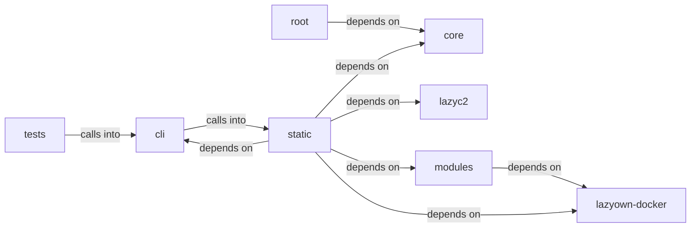

# static/js

static/js groups 28 files (c, js, py, sh) around apply_assign, format_payload, style, active_tokens, paint. ``assign`` business logic.

## cli (9.1)

cli groups 5 files (py) around apply_assign, format_payload, style, active_tokens, paint. ``assign`` business logic.

## core (9.2)

core groups 1 files (py) around _load_prompt_payload, get_git_info, get_venv_info, get_kernel, get_terminal_size. Prompt builder for LazyOwn CLI and C2 dashboard banner.

## lazyc2 (9.3)

lazyc2 groups 1 files (py). Global C2 server state — namespace for shared mutable objects.

## lazyown-docker (9.4)

lazyown-docker groups 1 files (sh).

## modules (9.5)

modules groups 3 files (c, py) around _GNU_SOURCE, MQUEUE_NUM, INBOUND, OUTBOUND, DESC_MAX. gcc exp.c -o exp -l mnl -l nftnl -w

## root (9.6)

root groups 1 files (py) around main.

## static (9.7)

static groups 14 files (js) around As, Be, Cs, Do, Ds. Version 1.73.4 3d-force-graph - https://github.com/vasturiano/3d-force-graph...

## tests (9.8)

tests groups 2 files (py) around _add_repo_root_to_syspath, TestApplyAssign, test_returns_true_when_key_exists, test_returns_false_when_key_missing, test_does_not_invoke_save_on_failure. ``do_assign`` / ``do_show`` behaviour and shell wiring tests.

**Files**:

- cli/assign.py
- cli/commands/session_ops.py
- cli/session_resumer.py
- cli/show.py
- cli/style.py
- core/prompt.py
- key.py
- lazyc2/state.py
- lazyown-docker/init.sh
- modules/exp.c
- modules/rootkit/rootkit.c
- modules/search.py
- static/js/3d-force-graph-1.73.4.min.js
- static/js/bootstrap-4.5.2.min.js
- static/js/bootstrap-5.3.0.bundle.min.js
- static/js/chart.min.js
- static/js/force-graph-1.43.5.min.js
- static/js/html2pdf.bundle.min.js
- static/js/jquery-3.5.1.slim.min.js
- static/js/particles.js
- static/js/popper-2.5.4.min.js
- static/js/quill-2.0.3.js
- static/js/showdown-2.1.0.min.js
- static/js/tippy-6.js
- static/js/vis-network-9.1.2.min.js
- static/js/vis-network.min.js
- tests/test_cli_assign.py
- tests/test_payload_schema.py
