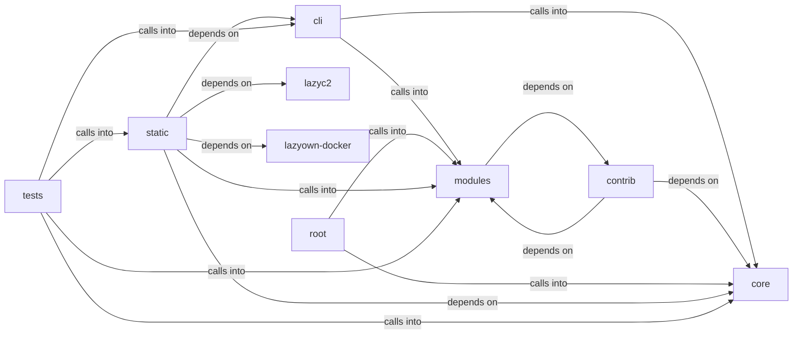

# static/js

static/js groups 56 files (c, js, py, sh) around FieldKind, Severity, FieldSpec, ValidationIssue, _validate_string. ``assign`` business logic.

## cli (6.1)

cli groups 4 files (py) around apply_assign, format_payload, style, active_tokens, paint. ``assign`` business logic.

## contrib (6.2)

contrib groups 6 files (py) around _ret_model, truncate_message, _configure_logging, _load_knowledge_base, _save_knowledge_base. Autor: Gris Iscomeback Correo electrónico: grisiscomeback[at]gmail[dot]com Fecha de...

## core (6.3)

core groups 10 files (py) around FieldKind, Severity, FieldSpec, ValidationIssue, _validate_string. Core primitives for the LazyOwn framework.

## lazyc2 (6.4)

lazyc2 groups 1 files (py). Global C2 server state — namespace for shared mutable objects.

## lazyown-docker (6.5)

lazyown-docker groups 1 files (sh).

## modules (6.6)

modules groups 6 files (c, py) around retModel, delete_lines, no_html, default_project_root, resolve_model. retModel: gemma2-9b-it        Google  8,192   -       - llama-3.3-70b-versatile...

## root (6.7)

root groups 5 files (py) around SecureSessionManager, __init__, register_failed_attempt, check_lockout, check_rate_limit.

## static (6.8)

static groups 15 files (js) around As, Be, Cs, Do, Ds. Version 1.73.4 3d-force-graph - https://github.com/vasturiano/3d-force-graph...

## tests (6.9)

tests groups 8 files (py) around _command_set, TestDoAsk, test_empty_question_prints_usage, test_question_forwarded_with_session_context, test_backend_error_surfaces_as_message. Behavioural tests for the resurrected ``ask``/``groq`` commands.

**Files**:

- cli/assign.py
- cli/commands/ai.py
- cli/show.py
- cli/style.py
- contrib/legacy/lazybinenc.py
- contrib/legacy/lazygptcli.py
- contrib/legacy/lazygptcli_unified.py
- contrib/legacy/lazyphishingai.py
- contrib/legacy/lazyproxy.py
- contrib/legacy/lazyseo.py
- core/__init__.py
- core/dependencies.py
- core/errors.py
- core/http.py
- core/llm_budget.py
- core/network.py
- core/parsers.py
- core/payload_schema.py
- core/process.py
- core/prompt.py
- discord_c2.py
- key.py
- lazyc2/state.py
- lazyown-docker/init.sh
- modules/colors.py
- modules/exp.c
- modules/llm_adapter.py
- modules/llm_prompts.py
- modules/search.py
- modules/sidequestion.py
- slack_c2_bot.py
- static/js/3d-force-graph-1.73.4.min.js
- static/js/bootstrap-4.5.2.min.js
- static/js/bootstrap-5.3.0.bundle.min.js
- static/js/chart.min.js
- static/js/force-graph-1.43.5.min.js
- static/js/html2pdf.bundle.min.js
- static/js/jquery-3.5.1.slim.min.js
- static/js/particles.js
- static/js/popper-2.5.4.min.js
- static/js/quill-2.0.3.js
- static/js/showdown-2.1.0.min.js
- static/js/tippy-6.js
- static/js/vis-network-9.1.2.min.js
- static/js/vis-network.min.js
- static/js/xterm.js
- telegram_c2.py
- telegram_hermes.py
- tests/test_ai_commands_llm.py
- tests/test_core_config.py
- tests/test_dependencies.py
- tests/test_llm_adapter_parity.py
- tests/test_llm_budget.py
- tests/test_llm_prompts.py
- tests/test_payload_schema.py
- tests/test_single_implementation.py
